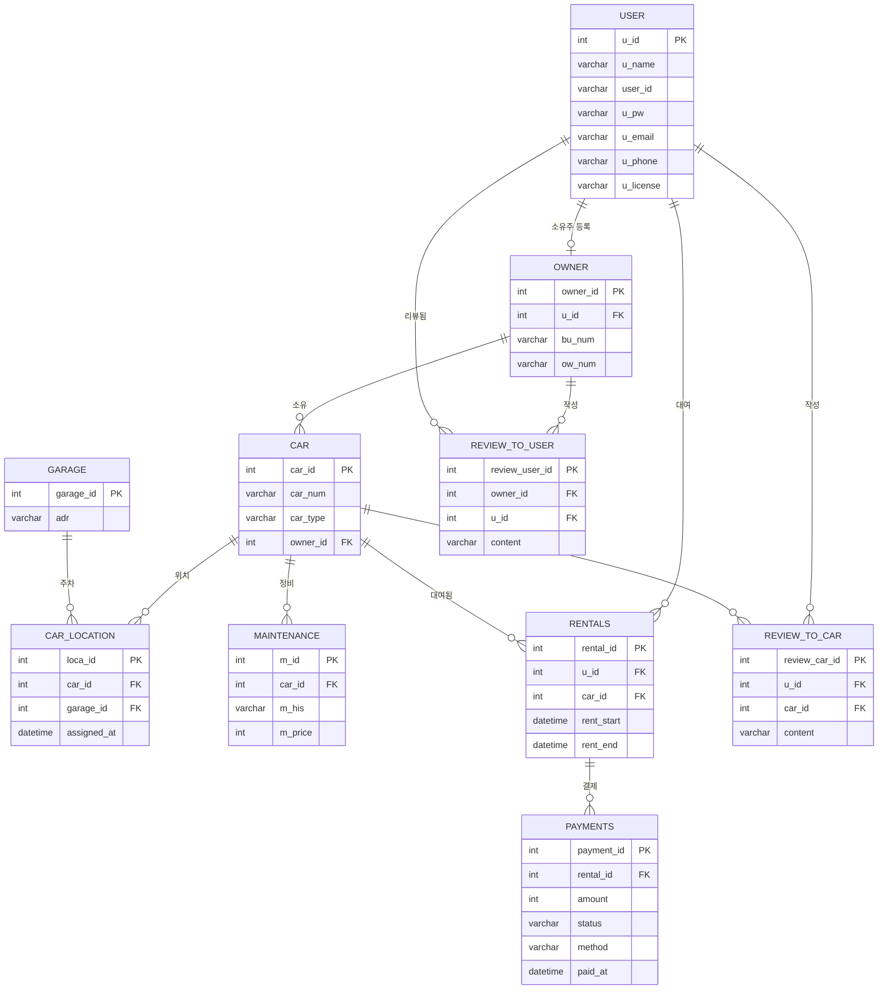

# DB 팀과제 — 자동차 렌탈 시스템

> 주제: **자동차 렌탈(Car Rental) 관리 시스템**
> DBMS: **MySQL 8** · 스키마: **rentcar** · 테이블 **10개** (요구 최소 8개 충족)
> 기준: **노션의 `rentcar` 스키마 + 목데이터(2번째 INSERT 세트)** 와 동일한 컬럼명/데이터를 사용합니다.
> 기존 실습(`student/enrol`, SCOTT `dept/emp/salgrade`)과 겹치지 않는 주제입니다.

---

## 목차

1. [주제 선정](#1-주제-선정)
2. [요구사항 분석 — 개체·속성·관계](#2-요구사항-분석)
3. [논리 설계 — 실제 값 넣어보기](#3-논리-설계)
4. [물리 설계 — 테이블 정의서](#4-물리-설계--테이블-정의서)
5. [테이블 생성 쿼리 (CREATE TABLE)](#5-테이블-생성-쿼리)
6. [데이터 삽입 (INSERT)](#6-데이터-삽입)
7. [쿼리문 20개](#7-쿼리문-20개)

---

## 1. 주제 선정

**자동차 렌탈 시스템** — 회원(사용자)·차량 소유주·차고지·차량·대여·결제·정비·리뷰를 관리하는 시스템.

- M:N 브릿지 테이블(`car_location`, `rentals`)이 있어 설계 연습에 적합
- 사용자 ↔ 소유주가 1:1 관계라 스키마 분리 연습에 적합

---

## 2. 요구사항 분석

### 2-1. 요구사항 문장

- 사용자는 회원가입 시 **이름, 아이디, 비밀번호, 이메일, 휴대폰번호, 면허증번호**를 입력해야 한다.
- 소유주는 **렌탈업 승인번호와 차량 보험번호**를 입력해야 한다.
- 자동차를 등록할 때는 **차량 번호, 차량 종류, 소유주 id(FK)**를 입력해야 한다.
- 차고지는 **차고지 주소**를 기록해야 하며, 위치별로 차량들을 조회할 수 있다.
- 정비 이력에는 **차량 id(FK), 정비 내역, 정비 금액**을 작성해야 한다.
- 대여 시 **차량 id(FK), 사용자 id(FK), 대여시간, 반납시간**을 제공해야 한다.
- 결제 정보는 **결제id, 대여id(FK), 결제금액, 결제수단, 결제상태, 결제일**을 제공해야 한다.
- 차량 사용자는 사용한 차량에 대해 **리뷰**를 남길 수 있다.
- 차량 소유주는 사용한 사용자에 대해 **리뷰**를 남길 수 있다.

### 2-2. 개체(Entity)와 속성(Attribute)

| 개체 (테이블) | 속성 (컬럼) | 비고 |
| --- | --- | --- |
| **user** (사용자) | u_id, u_name, user_id, u_pw, u_email, u_phone, u_license | u_id=PK |
| **owner** (소유주) | owner_id, u_id(FK), bu_num, ow_num | owner_id=PK |
| **garage** (차고지) | garage_id, adr | |
| **car** (자동차) | car_id, car_num, car_type, owner_id(FK) | car_id=PK |
| **car_location** (차량-차고지 위치) | loca_id, car_id(FK), garage_id(FK), assigned_at | 브릿지 |
| **maintenance** (정비 이력) | m_id, car_id(FK), m_his, m_price | |
| **rentals** (대여) | rental_id, u_id(FK), car_id(FK), rent_start, rent_end | |
| **payments** (결제) | payment_id, rental_id(FK), amount, status, method, paid_at | |
| **review_to_car** (차량 리뷰) | review_car_id, u_id(FK), car_id(FK), content | |
| **review_to_user** (사용자 리뷰) | review_user_id, owner_id(FK), u_id(FK), content | |

> **소유자여부 처리**: 노션 `rentcar` 버전은 `user`에 `owner_id`를 두지 않고, 소유주 여부를 `owner.u_id`(1:1)로 표현합니다.
> 이렇게 하면 `user ↔ owner` **순환 참조가 사라져** 생성/삽입이 단순해집니다.

### 2-3. 관계(Relationship)

| 관계 | 카디널리티 | 설명 |
| --- | --- | --- |
| user — owner | 1 : 1 | 한 사용자가 소유주가 된다 |
| owner — car | 1 : N | 한 소유주가 여러 차량을 등록한다 |
| car — garage | **M : N** | `car_location` 브릿지 |
| car — maintenance | 1 : N | 한 차량에 여러 정비 이력 |
| user — car | **M : N** | `rentals` 브릿지(대여 이력) |
| rentals — payments | 1 : N | 한 대여에 결제(본결제/추가결제) |
| user — car (리뷰) | M : N | `review_to_car` |
| owner — user (리뷰) | M : N | `review_to_user` |

---

## 3. 논리 설계

각 테이블의 컬럼과 **실제로 넣어본 값(노션 목데이터)** 입니다.

### 3-1. user (사용자)

| 컬럼 | u_id (PK) | u_name | user_id | u_pw | u_email | u_phone | u_license |
| --- | --- | --- | --- | --- | --- | --- | --- |
| 값 | 1 | 김민수 | minsu01 | pw1234 | minsu@test.com | 010-1111-1111 | 11-23-456789-01 |
| 값 | 2 | 이서연 | seoyeon | pw1234 | seoyeon@test.com | 010-2222-2222 | 11-24-567890-02 |
| 값 | 3 | 박지훈 | jihoon | pw1234 | jihoon@test.com | 010-3333-3333 | 12-22-678901-03 |
| 값 | 4 | 최유진 | yujin | pw1234 | yujin@test.com | 010-4444-4444 | 12-23-789012-04 |
| 값 | 5 | 정하늘 | haneul | pw1234 | haneul@test.com | 010-5555-5555 | 13-21-890123-05 |
| 값 | 6 | 한도윤 | doyun | pw1234 | doyun@test.com | 010-6666-6666 | 13-24-901234-06 |

### 3-2. owner (소유주)

| 컬럼 | owner_id (PK) | u_id (FK) | bu_num | ow_num |
| --- | --- | --- | --- | --- |
| 값 | 1 | 1 | RB-2024-0001 | INS-100001 |
| 값 | 2 | 2 | RB-2024-0002 | INS-100002 |

### 3-3. garage (차고지)

| 컬럼 | garage_id (PK) | adr |
| --- | --- | --- |
| 값 | 1 | 서울특별시 강남구 테헤란로 100 |
| 값 | 2 | 부산광역시 해운대구 해운대로 200 |
| 값 | 3 | 제주특별자치도 제주시 공항로 300 |

### 3-4. car (자동차)

| 컬럼 | car_id (PK) | car_num | car_type | owner_id (FK) |
| --- | --- | --- | --- | --- |
| 값 | 1 | 12가3456 | SUV | 1 |
| 값 | 2 | 34나5678 | 세단 | 1 |
| 값 | 3 | 56다7890 | 경차 | 2 |
| 값 | 4 | 78라1234 | 전기차 | 2 |
| 값 | 5 | 90마5678 | 승합 | 1 |

### 3-5. car_location (차량-차고지 브릿지)

| 컬럼 | loca_id (PK) | car_id (FK) | garage_id (FK) | assigned_at |
| --- | --- | --- | --- | --- |
| 값 | 1 | 1 | 1 | 2026-09-01 09:00:00 |
| 값 | 2 | 2 | 1 | 2026-09-01 09:00:00 |
| 값 | 3 | 3 | 2 | 2026-09-01 09:00:00 |
| 값 | 4 | 4 | 3 | 2026-09-01 09:00:00 |
| 값 | 5 | 5 | 1 | 2026-09-01 09:00:00 |
| 값 | 6 | 5 | 2 | 2026-10-01 09:00:00 |

### 3-6. maintenance (정비 이력)

| 컬럼 | m_id (PK) | car_id (FK) | m_his | m_price |
| --- | --- | --- | --- | --- |
| 값 | 1 | 1 | 엔진오일 교환 | 80000 |
| 값 | 2 | 1 | 타이어 4개 교체 | 400000 |
| 값 | 3 | 3 | 브레이크 패드 교체 | 150000 |

### 3-7. rentals (대여)

| 컬럼 | rental_id (PK) | u_id (FK) | car_id (FK) | rent_start | rent_end |
| --- | --- | --- | --- | --- | --- |
| 값 | 1 | 3 | 1 | 2026-10-01 09:00:00 | 2026-10-03 09:00:00 |
| 값 | 2 | 4 | 2 | 2026-10-02 10:00:00 | 2026-10-04 10:00:00 |
| 값 | 3 | 5 | 3 | 2026-10-05 12:00:00 | 2026-10-06 12:00:00 |
| 값 | 4 | 3 | 4 | 2026-10-08 09:00:00 | 2026-10-10 18:00:00 |
| 값 | 5 | 6 | 1 | 2026-10-12 09:00:00 | 2026-10-15 09:00:00 |

### 3-8. payments (결제)

| 컬럼 | payment_id (PK) | rental_id (FK) | amount | status | method | paid_at |
| --- | --- | --- | --- | --- | --- | --- |
| 값 | 1 | 1 | 100000 | 완료 | 카드 | 2026-10-01 08:50:00 |
| 값 | 2 | 2 | 90000 | 완료 | 카드 | 2026-10-02 09:40:00 |
| 값 | 3 | 3 | 50000 | 완료 | 현금 | 2026-10-05 11:50:00 |
| 값 | 4 | 4 | 200000 | 완료 | 계좌이체 | 2026-10-08 08:30:00 |
| 값 | 5 | 5 | 150000 | 대기 | 카드 | NULL |
| 값 | 6 | 1 | 20000 | 완료 | 카드 | 2026-10-03 09:30:00 |

### 3-9. review_to_car (차량 리뷰)

| 컬럼 | review_car_id (PK) | u_id (FK) | car_id (FK) | content |
| --- | --- | --- | --- | --- |
| 값 | 1 | 3 | 1 | 차가 깨끗하고 승차감이 좋았어요. |
| 값 | 2 | 4 | 2 | 연비가 좋고 운전하기 편했어요. |
| 값 | 3 | 5 | 3 | 작아서 주차하기 편했어요. |

### 3-10. review_to_user (사용자 리뷰)

| 컬럼 | review_user_id (PK) | owner_id (FK) | u_id (FK) | content |
| --- | --- | --- | --- | --- |
| 값 | 1 | 1 | 3 | 반납 시간을 잘 지키고 차를 깨끗하게 사용했어요. |
| 값 | 2 | 1 | 4 | 차량 상태 그대로 잘 반납해 주셨어요. |
| 값 | 3 | 2 | 5 | 친절하고 연락이 잘 되는 고객이에요. |

---

## 4. 물리 설계 — 테이블 정의서

### 4-1. 테이블 목록

| No | 테이블명 | 한글명 | PK | 행 수(샘플) |
| --- | --- | --- | --- | --- |
| 1 | user | 사용자 | u_id | 6 |
| 2 | owner | 소유주 | owner_id | 2 |
| 3 | garage | 차고지 | garage_id | 3 |
| 4 | car | 자동차 | car_id | 5 |
| 5 | car_location | 차량-차고지 위치 | loca_id | 6 |
| 6 | maintenance | 정비 이력 | m_id | 3 |
| 7 | rentals | 대여 | rental_id | 5 |
| 8 | payments | 결제 | payment_id | 6 |
| 9 | review_to_car | 차량 리뷰 | review_car_id | 3 |
| 10 | review_to_user | 사용자 리뷰 | review_user_id | 3 |

### 4-2. 컬럼 정의서 (통합)

| 테이블 | 컬럼명 | 데이터 타입 | NULL | KEY | 제약조건 | 설명 |
| --- | --- | --- | --- | --- | --- | --- |
| user | u_id | INT | N | PK | AUTO_INCREMENT | 회원번호 |
| user | u_name | VARCHAR(10) | N | | | 이름 |
| user | user_id | VARCHAR(20) | N | UQ | | 로그인 아이디 |
| user | u_pw | VARCHAR(255) | N | | | 비밀번호 |
| user | u_email | VARCHAR(100) | N | UQ | | 이메일 |
| user | u_phone | VARCHAR(20) | N | UQ | | 휴대폰번호 |
| user | u_license | VARCHAR(20) | N | UQ | | 면허증번호 |
| owner | owner_id | INT | N | PK | AUTO_INCREMENT | 소유주 ID |
| owner | u_id | INT | N | FK, UQ | → user(u_id) | 소유주 회원 |
| owner | bu_num | VARCHAR(20) | N | UQ | | 렌탈업 승인번호 |
| owner | ow_num | VARCHAR(20) | N | UQ | | 차량 보험번호 |
| garage | garage_id | INT | N | PK | AUTO_INCREMENT | 차고지 ID |
| garage | adr | VARCHAR(200) | N | | | 차고지 주소 |
| car | car_id | INT | N | PK | AUTO_INCREMENT | 차량 ID |
| car | car_num | VARCHAR(20) | N | UQ | | 차량 번호 |
| car | car_type | VARCHAR(10) | N | | | 차량 종류 |
| car | owner_id | INT | N | FK | → owner(owner_id) | 소유주 ID |
| car_location | loca_id | INT | N | PK | AUTO_INCREMENT | 위치 이력 ID |
| car_location | car_id | INT | N | FK | → car(car_id) | 차량 ID |
| car_location | garage_id | INT | N | FK | → garage(garage_id) | 차고지 ID |
| car_location | assigned_at | DATETIME | N | | DEFAULT CURRENT_TIMESTAMP | 배치 시각 |
| maintenance | m_id | INT | N | PK | AUTO_INCREMENT | 정비 이력 ID |
| maintenance | car_id | INT | N | FK | → car(car_id) | 차량 ID |
| maintenance | m_his | VARCHAR(100) | N | | | 정비 내역 |
| maintenance | m_price | INT | N | | | 정비 금액 |
| rentals | rental_id | INT | N | PK | AUTO_INCREMENT | 대여 ID |
| rentals | u_id | INT | N | FK | → user(u_id) | 대여 사용자 |
| rentals | car_id | INT | N | FK | → car(car_id) | 대여 차량 |
| rentals | rent_start | DATETIME | N | | | 대여 시작시간 |
| rentals | rent_end | DATETIME | N | | | 반납 시간 |
| payments | payment_id | INT | N | PK | AUTO_INCREMENT | 결제 ID |
| payments | rental_id | INT | N | FK | → rentals(rental_id) | 대여 ID |
| payments | amount | INT | N | | | 결제 금액 |
| payments | status | VARCHAR(20) | N | | | 결제 상태(완료/대기/취소) |
| payments | method | VARCHAR(20) | N | | | 결제 수단(카드/현금/계좌이체) |
| payments | paid_at | DATETIME | Y | | | 결제일 |
| review_to_car | review_car_id | INT | N | PK | AUTO_INCREMENT | 차량 리뷰 ID |
| review_to_car | u_id | INT | N | FK | → user(u_id) | 작성자 |
| review_to_car | car_id | INT | N | FK | → car(car_id) | 대상 차량 |
| review_to_car | content | VARCHAR(1000) | N | | | 리뷰 내용 |
| review_to_user | review_user_id | INT | N | PK | AUTO_INCREMENT | 사용자 리뷰 ID |
| review_to_user | owner_id | INT | N | FK | → owner(owner_id) | 작성 소유주 |
| review_to_user | u_id | INT | N | FK | → user(u_id) | 대상 사용자 |
| review_to_user | content | VARCHAR(1000) | N | | | 리뷰 내용 |

---

## 5. 테이블 생성 쿼리

> 노션 `rentcar` 스키마와 동일합니다. (FK·UNIQUE·CHECK 포함)

```sql
-- 렌트카 DB (FK, 타입 정리 버전)
CREATE SCHEMA IF NOT EXISTS rentcar;
USE rentcar;

-- 0) 기존 테이블 제거 (자식 → 부모)
DROP TABLE IF EXISTS review_to_user;
DROP TABLE IF EXISTS review_to_car;
DROP TABLE IF EXISTS payments;
DROP TABLE IF EXISTS rentals;
DROP TABLE IF EXISTS maintenance;
DROP TABLE IF EXISTS car_location;
DROP TABLE IF EXISTS car;
DROP TABLE IF EXISTS owner;
DROP TABLE IF EXISTS garage;
DROP TABLE IF EXISTS user;

-- 1. 사용자
CREATE TABLE user (
  u_id      INT AUTO_INCREMENT NOT NULL PRIMARY KEY,
  u_name    VARCHAR(10)  NOT NULL,
  user_id   VARCHAR(20)  NOT NULL UNIQUE,   -- 로그인 아이디
  u_pw      VARCHAR(255) NOT NULL,          -- 암호화한 비밀번호
  u_email   VARCHAR(100) NOT NULL UNIQUE,
  u_phone   VARCHAR(20)  NOT NULL UNIQUE,
  u_license VARCHAR(20)  NOT NULL UNIQUE    -- 면허증번호
);

-- 2. 소유주 (user의 한 종류, 1:1)
CREATE TABLE owner (
  owner_id INT AUTO_INCREMENT NOT NULL PRIMARY KEY,
  u_id     INT         NOT NULL UNIQUE,
  bu_num   VARCHAR(20) NOT NULL UNIQUE,     -- 렌탈업 승인번호
  ow_num   VARCHAR(20) NOT NULL UNIQUE,     -- 차량보험번호
  FOREIGN KEY (u_id) REFERENCES user(u_id)
);

-- 3. 차고지
CREATE TABLE garage (
  garage_id INT AUTO_INCREMENT NOT NULL PRIMARY KEY,
  adr       VARCHAR(200) NOT NULL
);

-- 4. 자동차
CREATE TABLE car (
  car_id   INT AUTO_INCREMENT NOT NULL PRIMARY KEY,
  car_num  VARCHAR(20) NOT NULL UNIQUE,     -- 차량번호
  car_type VARCHAR(10) NOT NULL,
  owner_id INT         NOT NULL,
  FOREIGN KEY (owner_id) REFERENCES owner(owner_id)
);

-- 5. 차량위치 (차량 <-> 차고지 브릿지)
CREATE TABLE car_location (
  loca_id     INT AUTO_INCREMENT PRIMARY KEY,
  car_id      INT      NOT NULL,
  garage_id   INT      NOT NULL,
  assigned_at DATETIME NOT NULL DEFAULT CURRENT_TIMESTAMP,
  UNIQUE (car_id, garage_id),
  FOREIGN KEY (car_id)    REFERENCES car(car_id),
  FOREIGN KEY (garage_id) REFERENCES garage(garage_id)
);

-- 6. 정비이력
CREATE TABLE maintenance (
  m_id    INT AUTO_INCREMENT PRIMARY KEY,
  car_id  INT          NOT NULL,
  m_his   VARCHAR(100) NOT NULL,
  m_price INT          NOT NULL,
  FOREIGN KEY (car_id) REFERENCES car(car_id)
);

-- 7. 대여 (사용자 <-> 차량 브릿지)
CREATE TABLE rentals (
  rental_id  INT AUTO_INCREMENT NOT NULL PRIMARY KEY,
  u_id       INT      NOT NULL,
  car_id     INT      NOT NULL,
  rent_start DATETIME NOT NULL,
  rent_end   DATETIME NOT NULL,
  FOREIGN KEY (u_id)   REFERENCES user(u_id),
  FOREIGN KEY (car_id) REFERENCES car(car_id),
  CHECK (rent_end > rent_start)
);

-- 8. 결제
CREATE TABLE payments (
  payment_id INT AUTO_INCREMENT PRIMARY KEY,
  rental_id  INT         NOT NULL,
  amount     INT         NOT NULL,
  status     VARCHAR(20) NOT NULL,          -- 완료, 대기, 취소
  method     VARCHAR(20) NOT NULL,          -- 카드, 현금, 계좌이체
  paid_at    DATETIME,
  FOREIGN KEY (rental_id) REFERENCES rentals(rental_id)
);

-- 9. 차량 리뷰 (사용자 -> 차량)
CREATE TABLE review_to_car (
  review_car_id INT AUTO_INCREMENT PRIMARY KEY,
  u_id          INT           NOT NULL,
  car_id        INT           NOT NULL,
  content       VARCHAR(1000) NOT NULL,
  FOREIGN KEY (u_id)   REFERENCES user(u_id),
  FOREIGN KEY (car_id) REFERENCES car(car_id)
);

-- 10. 사용자 리뷰 (소유주 -> 사용자)
CREATE TABLE review_to_user (
  review_user_id INT AUTO_INCREMENT PRIMARY KEY,
  owner_id       INT           NOT NULL,
  u_id           INT           NOT NULL,
  content        VARCHAR(1000) NOT NULL,
  FOREIGN KEY (owner_id) REFERENCES owner(owner_id),
  FOREIGN KEY (u_id)     REFERENCES user(u_id)
);
```

---

## 6. 데이터 삽입

> 노션 목데이터(2번째 세트)와 동일합니다. (부모 → 자식 순서)

```sql
USE rentcar;

-- 1. 사용자 (1~2번은 소유주, 3~6번은 일반 사용자)
INSERT INTO user (u_name, user_id, u_pw, u_email, u_phone, u_license) VALUES
('김민수', 'minsu01',  'pw1234', 'minsu@test.com',  '010-1111-1111', '11-23-456789-01'),
('이서연', 'seoyeon',  'pw1234', 'seoyeon@test.com','010-2222-2222', '11-24-567890-02'),
('박지훈', 'jihoon',   'pw1234', 'jihoon@test.com', '010-3333-3333', '12-22-678901-03'),
('최유진', 'yujin',    'pw1234', 'yujin@test.com',  '010-4444-4444', '12-23-789012-04'),
('정하늘', 'haneul',   'pw1234', 'haneul@test.com', '010-5555-5555', '13-21-890123-05'),
('한도윤', 'doyun',    'pw1234', 'doyun@test.com',  '010-6666-6666', '13-24-901234-06');

-- 2. 소유주 (u_id 1, 2번 사용자)
INSERT INTO owner (u_id, bu_num, ow_num) VALUES
(1, 'RB-2024-0001', 'INS-100001'),
(2, 'RB-2024-0002', 'INS-100002');

-- 3. 차고지
INSERT INTO garage (adr) VALUES
('서울특별시 강남구 테헤란로 100'),
('부산광역시 해운대구 해운대로 200'),
('제주특별자치도 제주시 공항로 300');

-- 4. 자동차 (1,2,5번은 소유주1 / 3,4번은 소유주2)
INSERT INTO car (car_num, car_type, owner_id) VALUES
('12가3456', 'SUV',    1),
('34나5678', '세단',   1),
('56다7890', '경차',   2),
('78라1234', '전기차', 2),
('90마5678', '승합',   1);

-- 5. 차량위치 (5번 차량은 강남 -> 부산으로 옮긴 이력)
INSERT INTO car_location (car_id, garage_id, assigned_at) VALUES
(1, 1, '2026-09-01 09:00:00'),
(2, 1, '2026-09-01 09:00:00'),
(3, 2, '2026-09-01 09:00:00'),
(4, 3, '2026-09-01 09:00:00'),
(5, 1, '2026-09-01 09:00:00'),
(5, 2, '2026-10-01 09:00:00');

-- 6. 정비이력
INSERT INTO maintenance (car_id, m_his, m_price) VALUES
(1, '엔진오일 교환',   80000),
(1, '타이어 4개 교체', 400000),
(3, '브레이크 패드 교체', 150000);

-- 7. 대여
INSERT INTO rentals (u_id, car_id, rent_start, rent_end) VALUES
(3, 1, '2026-10-01 09:00:00', '2026-10-03 09:00:00'),
(4, 2, '2026-10-02 10:00:00', '2026-10-04 10:00:00'),
(5, 3, '2026-10-05 12:00:00', '2026-10-06 12:00:00'),
(3, 4, '2026-10-08 09:00:00', '2026-10-10 18:00:00'),
(6, 1, '2026-10-12 09:00:00', '2026-10-15 09:00:00');

-- 8. 결제 (5번 대여는 결제 대기, 1번 대여는 추가 결제 포함)
INSERT INTO payments (rental_id, amount, status, method, paid_at) VALUES
(1, 100000, '완료', '카드',     '2026-10-01 08:50:00'),
(2,  90000, '완료', '카드',     '2026-10-02 09:40:00'),
(3,  50000, '완료', '현금',     '2026-10-05 11:50:00'),
(4, 200000, '완료', '계좌이체', '2026-10-08 08:30:00'),
(5, 150000, '대기', '카드',     NULL),
(1,  20000, '완료', '카드',     '2026-10-03 09:30:00');

-- 9. 차량 리뷰 (사용자 -> 차량)
INSERT INTO review_to_car (u_id, car_id, content) VALUES
(3, 1, '차가 깨끗하고 승차감이 좋았어요.'),
(4, 2, '연비가 좋고 운전하기 편했어요.'),
(5, 3, '작아서 주차하기 편했어요.');

-- 10. 사용자 리뷰 (소유주 -> 사용자)
INSERT INTO review_to_user (owner_id, u_id, content) VALUES
(1, 3, '반납 시간을 잘 지키고 차를 깨끗하게 사용했어요.'),
(1, 4, '차량 상태 그대로 잘 반납해 주셨어요.'),
(2, 5, '친절하고 연락이 잘 되는 고객이에요.');
```

---

## 7. 쿼리문 20개

> 요구 조건(조인 · 그룹핑 · 부질의 · 탑앤)을 모두 포함한 **20개**입니다.
> 위 **노션 `rentcar` 스키마 + 목데이터(3~6장)** 기준으로 실행 가능한 MySQL 8 쿼리입니다.

### 유형 요약

| No | 유형 | 설명 |
| --- | --- | --- |
| 1 | 조인 | 차량 + 소유주 회원명 |
| 2 | 조인 | 대여 내역 상세 |
| 3 | 조인 + 그룹핑 | 차량별 대여 건수 |
| 4 | 그룹핑 + HAVING | 2건 이상 대여한 사용자 |
| 5 | 조인 + 그룹핑 | 사용자별 결제 완료 금액 합계 |
| 6 | 조인 + 그룹핑 | 차고지별 주차 차량 수 |
| 7 | 부질의(단일행) | 전체 평균 결제금액보다 큰 결제 |
| 8 | 부질의(다중행 IN) | 리뷰가 등록된 차량 |
| 9 | 부질의(NOT EXISTS) | 정비 이력이 없는 차량 |
| 10 | 부질의(스칼라 상관) | 차량별 리뷰 수 |
| 11 | 탑앤 | 결제 금액 상위 3건 |
| 12 | 탑앤 + 조인 | 대여 기간이 가장 긴 1건 |
| 13 | 탑앤 + 그룹핑 | 대여 건수 상위 2대 |
| 14 | 조인 + 그룹핑 | 차량별 총 정비 비용 |
| 15 | 부질의(인라인 뷰) + 그룹핑 | 사용자별 대여 건수 |
| 16 | 그룹핑 | 결제 상태별 건수·합계·평균 |
| 17 | 조인(3개) + 그룹핑 | 소유주별 등록 차량 수 |
| 18 | 부질의(NOT EXISTS) | 한 번도 대여되지 않은 차량 |
| 19 | 탑앤 + 조인 + 그룹핑 | 대여 건수가 가장 많은 사용자 1명 |
| 20 | 날짜 함수 + 그룹핑 | 월별 대여 건수 |

```sql
-- 1. [조인] 차량 + 소유주 회원명
--    → 차량 5대, 소유주는 김민수(1,2,5번 차량) / 이서연(3,4번 차량)
SELECT c.car_id, c.car_num, c.car_type, o.owner_id, u.u_name AS owner_name
FROM car c
JOIN owner o ON c.owner_id = o.owner_id
JOIN user  u ON o.u_id     = u.u_id
ORDER BY c.car_id;

-- 2. [조인] 대여 내역 상세 (대여자, 차량, 기간)
SELECT r.rental_id, u.u_name AS renter, c.car_num, c.car_type, r.rent_start, r.rent_end
FROM rentals r
JOIN user u ON r.u_id   = u.u_id
JOIN car  c ON r.car_id = c.car_id
ORDER BY r.rental_id;

-- 3. [조인 + 그룹핑] 차량별 대여 건수 (대여 없는 차량도 0으로 포함)
--    → car1: 2건, car2/3/4: 각 1건, car5: 0건
SELECT c.car_id, c.car_num, COUNT(r.rental_id) AS rent_count
FROM car c
LEFT JOIN rentals r ON c.car_id = r.car_id
GROUP BY c.car_id, c.car_num
ORDER BY rent_count DESC, c.car_id;

-- 4. [그룹핑 + HAVING] 2건 이상 대여한 사용자
--    → u_id 3 (박지훈, 2건)
SELECT u_id, COUNT(*) AS rent_count
FROM rentals
GROUP BY u_id
HAVING COUNT(*) >= 2;

-- 5. [조인 + 그룹핑] 사용자별 결제 완료 금액 합계
--    → 박지훈 320000, 최유진 90000, 정하늘 50000
SELECT u.u_id, u.u_name, SUM(p.amount) AS total_paid
FROM payments p
JOIN rentals r ON p.rental_id = r.rental_id
JOIN user    u ON r.u_id      = u.u_id
WHERE p.status = '완료'
GROUP BY u.u_id, u.u_name
ORDER BY total_paid DESC;

-- 6. [조인 + 그룹핑] 차고지별 주차 차량 수
--    → 강남 3대, 부산 2대, 제주 1대
SELECT g.garage_id, g.adr, COUNT(cl.car_id) AS car_count
FROM garage g
LEFT JOIN car_location cl ON g.garage_id = cl.garage_id
GROUP BY g.garage_id, g.adr
ORDER BY car_count DESC;

-- 7. [부질의 - 단일행] 전체 평균 결제금액보다 큰 결제
--    → payments 4(200000), 5(150000)
SELECT payment_id, amount
FROM payments
WHERE amount > (SELECT AVG(amount) FROM payments);

-- 8. [부질의 - 다중행 IN] 리뷰가 등록된 차량
--    → car 1, 2, 3
SELECT car_id, car_num, car_type
FROM car
WHERE car_id IN (SELECT car_id FROM review_to_car);

-- 9. [부질의 - NOT EXISTS] 정비 이력이 없는 차량
--    → car 2, 4, 5
SELECT c.car_id, c.car_num
FROM car c
WHERE NOT EXISTS (
  SELECT 1 FROM maintenance m WHERE m.car_id = c.car_id
);

-- 10. [부질의 - 스칼라 상관] 차량별 리뷰 수
SELECT c.car_id, c.car_num,
       (SELECT COUNT(*) FROM review_to_car rc WHERE rc.car_id = c.car_id) AS review_count
FROM car c
ORDER BY c.car_id;

-- 11. [탑앤] 결제 금액 상위 3건
--     → 200000, 150000, 100000
SELECT payment_id, amount, status
FROM payments
ORDER BY amount DESC
LIMIT 3;

-- 12. [탑앤 + 조인] 대여 기간이 가장 긴 1건
--     → rentals 5 (72시간)
SELECT r.rental_id, u.u_name AS renter, c.car_num,
       TIMESTAMPDIFF(HOUR, r.rent_start, r.rent_end) AS rent_hours
FROM rentals r
JOIN user u ON r.u_id   = u.u_id
JOIN car  c ON r.car_id = c.car_id
ORDER BY rent_hours DESC
LIMIT 1;

-- 13. [탑앤 + 그룹핑] 대여 건수 상위 2대
SELECT car_id, COUNT(*) AS rent_count
FROM rentals
GROUP BY car_id
ORDER BY rent_count DESC
LIMIT 2;

-- 14. [조인 + 그룹핑] 차량별 총 정비 비용
--     → car1 480000(2회), car3 150000(1회)
SELECT c.car_id, c.car_num,
       COUNT(m.m_id)   AS maint_count,
       SUM(m.m_price)  AS total_maint_cost
FROM car c
JOIN maintenance m ON c.car_id = m.car_id
GROUP BY c.car_id, c.car_num
ORDER BY total_maint_cost DESC;

-- 15. [부질의 - 인라인 뷰 + 그룹핑] 사용자별 대여 건수
SELECT u_id, rent_count
FROM (
  SELECT u_id, COUNT(*) AS rent_count
  FROM rentals
  GROUP BY u_id
) t
WHERE rent_count >= 1
ORDER BY rent_count DESC, u_id;

-- 16. [그룹핑] 결제 상태별 건수·합계·평균
--     → 완료 5건/460000/92000, 대기 1건/150000/150000
SELECT status,
       COUNT(*)    AS pay_count,
       SUM(amount) AS total_amount,
       AVG(amount) AS avg_amount
FROM payments
GROUP BY status
ORDER BY total_amount DESC;

-- 17. [조인(3개) + 그룹핑] 소유주별 등록 차량 수
--     → owner1(김민수) 3대, owner2(이서연) 2대
SELECT o.owner_id, u.u_name AS owner_name, COUNT(c.car_id) AS car_count
FROM owner o
JOIN user u     ON o.u_id     = u.u_id
LEFT JOIN car c ON o.owner_id = c.owner_id
GROUP BY o.owner_id, u.u_name
ORDER BY car_count DESC;

-- 18. [부질의 - NOT EXISTS] 한 번도 대여되지 않은 차량
--     → car 5 (90마5678)
SELECT c.car_id, c.car_num, c.car_type
FROM car c
WHERE NOT EXISTS (
  SELECT 1 FROM rentals r WHERE r.car_id = c.car_id
);

-- 19. [탑앤 + 조인 + 그룹핑] 대여 건수가 가장 많은 사용자 1명
--     → 박지훈 (2건)
SELECT u.u_id, u.u_name, COUNT(*) AS rent_count
FROM rentals r
JOIN user u ON r.u_id = u.u_id
GROUP BY u.u_id, u.u_name
ORDER BY rent_count DESC
LIMIT 1;

-- 20. [날짜 함수 + 그룹핑] 월별 대여 건수
--     → 2026-10 : 5건
SELECT DATE_FORMAT(r.rent_start, '%Y-%m') AS rent_month,
       COUNT(*)                           AS rent_count
FROM rentals r
GROUP BY DATE_FORMAT(r.rent_start, '%Y-%m')
ORDER BY rent_month;
```

> **탑앤(TOP-N) 참고**: MySQL은 `LIMIT n`, Oracle은 `ROWNUM <= n` 또는 `FETCH FIRST n ROWS ONLY`를 사용합니다.
> 이 과제는 MySQL 8 기준이므로 `LIMIT`을 사용했습니다.

---

## 부록 — ERD



---

## 한 줄 요약

1. **주제** = 자동차 렌탈 (기존 student/enrol, SCOTT 제외)
2. **스키마** = `rentcar` (노션과 동일한 컬럼명)
3. **테이블 10개** = user, owner, garage, car, car_location, maintenance, rentals, payments, review_to_car, review_to_user
4. **관계** = car↔garage(M:N, `car_location`), user↔car(M:N, `rentals`), user↔owner(1:1)
5. **쿼리 20개** = 조인 · 그룹핑 · 부질의 · 탑앤 모두 포함
