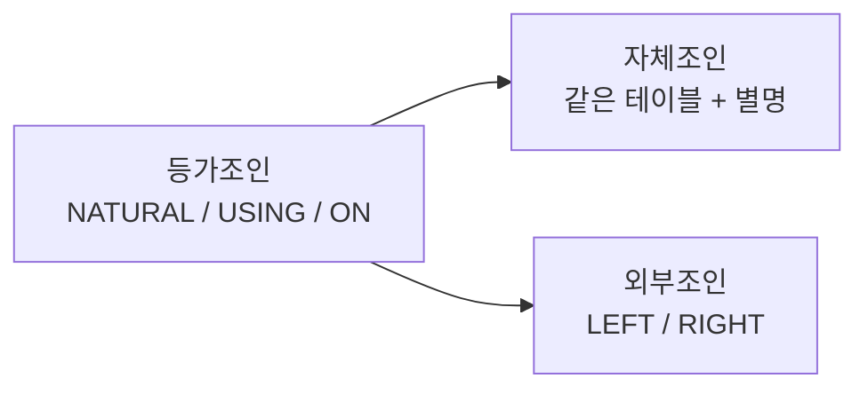

# Review — SQL 질의어 종합 복습

> 참고: [Notion — SQL 질의어](https://app.notion.com/p/SQL-256974c0f4ae80d88315e52f30d33497)  
> 이전: [Session 5 — Redis](unit3_advanced/session5.md)

SELECT·서브쿼리·조인을 한곳에서 복습한다. 작성 순서와 실행 개념을 정리하고, 앞서 배운 문법을 실무 패턴으로 연결한다.

---

## 이번 세션 목표

| 목표             | 내용                                                 |
| ---------------- | ---------------------------------------------------- |
| SELECT 작성 순서 | FROM → WHERE → GROUP BY → HAVING → SELECT → ORDER BY |
| 서브쿼리         | 단일 행 / 다중 행, `IN`·`ANY`·`ALL`·`EXISTS`         |
| 조인             | 등가조인, 자체조인, 외부조인                         |

---

## 1. 순서 익히기

SQL 문을 **쓰는 순서**와 **DB가 처리하는 순서**를 구분해서 익힌다.

### 작성 순서 (문법 순서)

```sql
SELECT   조회할 열
FROM     조회할 테이블 명
WHERE    조회할 행을 선별하는 조건식
GROUP BY 그룹화할 열 지정
HAVING   출력 그룹을 제한하는 조건식
ORDER BY 정렬하려는 열
```

### 처리 순서 (실행 개념)

| 단계 | 절         | 역할                  |
| ---- | ---------- | --------------------- |
| 1    | `FROM`     | 대상 테이블 결정      |
| 2    | `WHERE`    | 행 필터링             |
| 3    | `GROUP BY` | 그룹 생성             |
| 4    | `HAVING`   | 그룹 필터링           |
| 5    | `SELECT`   | 조회할 열·표현식 선택 |
| 6    | `ORDER BY` | 결과 정렬             |

- `WHERE`는 **집계 전** 행을 걸러낸다.
- `HAVING`은 **집계 후** 그룹을 걸러낸다.
- `SELECT`의 별명(`AS`)은 보통 `ORDER BY`에서만 바로 쓸 수 있다. (`WHERE`에서는 불가)

### 예시

```sql
SELECT deptno, AVG(sal) AS 평균급여
FROM emp
WHERE sal >= 1000
GROUP BY deptno
HAVING AVG(sal) >= 2000
ORDER BY 평균급여 DESC;
```

---

## 2. 서브 쿼리(부 질의)

**서브 쿼리**란, SQL 문 안에 포함된 또 다른 SQL 문이다.
즉, **다른 쿼리의 결과를 사용하기 위해 내부에 작성된 쿼리**이다.

```sql
SELECT name
FROM employees
WHERE department_id = (
    SELECT id
    FROM departments
    WHERE name = 'Sales'
);
```

### 2-1. 단일 행 서브 쿼리

실행 결과가 **단 하나의 행**으로 나오는 서브 쿼리.
비교 연산자(`=`, `>`, `<`, `>=`, `<=`, `<>`)와 함께 사용한다.

```sql
-- KING보다 급여가 높은 사원
SELECT ename, sal
FROM emp
WHERE sal > (
    SELECT sal FROM emp WHERE ename = 'KING'
);
```

### 2-2. 다중 행 서브 쿼리

실행 결과가 **여러 개의 행**으로 나오는 서브 쿼리.
다중 행 연산자와 함께 사용한다.

| 다중행 연산자 | 설명                                                                |
| ------------- | ------------------------------------------------------------------- |
| `IN`          | 메인쿼리의 데이터가 서브쿼리 결과 중 **하나라도 일치**하면 true     |
| `ANY`, `SOME` | 메인쿼리의 조건식을 만족하는 서브쿼리 결과가 **하나 이상**이면 true |
| `ALL`         | 메인쿼리의 조건식을 서브쿼리 결과 **모두가** 만족하면 true          |
| `EXISTS`      | 서브쿼리의 결과가 **존재하면** true                                 |

### 예시

```sql
-- IN: 부서 10 또는 20에 속한 사원
SELECT ename, deptno
FROM emp
WHERE deptno IN (SELECT deptno FROM dept WHERE deptno IN (10, 20));

-- ANY: 부서 30의 어떤 사원보다 급여가 높은 사원
SELECT ename, sal
FROM emp
WHERE sal > ANY (SELECT sal FROM emp WHERE deptno = 30);

-- ALL: 부서 30의 모든 사원보다 급여가 높은 사원
SELECT ename, sal
FROM emp
WHERE sal > ALL (SELECT sal FROM emp WHERE deptno = 30);

-- EXISTS: 부하 직원이 있는 관리자만 조회
SELECT e.ename
FROM emp e
WHERE EXISTS (
    SELECT 1 FROM emp s WHERE s.mgr = e.empno
);
```

### 정리

| 구분    | 결과 행 수 | 사용 연산자                         |
| ------- | ---------- | ----------------------------------- |
| 단일 행 | 0 또는 1행 | `=`, `>`, `<` 등                    |
| 다중 행 | 여러 행    | `IN`, `ANY`/`SOME`, `ALL`, `EXISTS` |

---

## 3. 조인

서로 다른 여러 테이블에 나누어져 있는 정보들 중에서 **사용자가 필요한 정보만 가져와 한 화면에서 조회**하는 기법이다.

### 3-1. 등가조인 (Equi Join)

두 테이블에서 **공통적으로 존재하는 컬럼의 값이 일치하는 행**을 연결하여 데이터를 조회하는 방법이다.
(특정 속성의 tuple 값이 일치하는 경우 해당 행을 연결)

| 문법                    | 설명                                         |
| ----------------------- | -------------------------------------------- |
| `NATURAL JOIN`          | 같은 이름 컬럼을 자동으로 등가 조건에 사용   |
| `JOIN ... USING (컬럼)` | 지정한 공통 컬럼으로 등가 조인               |
| `JOIN ... ON 조건`      | 임의의 조인 조건을 명시 (실무에서 가장 흔함) |
| 구식 Equi Join          | `FROM A, B WHERE A.col = B.col`              |

```sql
-- JOIN ... ON (권장)
SELECT e.ename, d.dname
FROM emp e
JOIN dept d ON e.deptno = d.deptno;

-- JOIN ... USING
SELECT ename, dname
FROM emp
JOIN dept USING (deptno);

-- NATURAL JOIN
SELECT ename, dname
FROM emp
NATURAL JOIN dept;
```

### 3-2. 자체조인 (Self Join)

**하나의 테이블을 마치 두 개의 테이블처럼** 사용하여 자기 자신과 조인하는 방식이다.
별명(alias)이 필수이다.

```sql
-- 사원과 그 상사의 이름
SELECT e.ename AS 사원, m.ename AS 상사
FROM emp e
JOIN emp m ON e.mgr = m.empno;
```

### 3-3. 외부조인 (Outer Join)

두 개 이상의 테이블을 결합할 때, **한쪽 테이블의 모든 행을 포함**시키면서 다른 테이블의 관련 행을 가져오는 조인 방식이다.
일치하는 행이 없으면 상대쪽 컬럼은 `NULL`이 된다.

| 종류                                   | 설명                                                                   |
| -------------------------------------- | ---------------------------------------------------------------------- |
| 왼쪽 외부조인 (`LEFT [OUTER] JOIN`)    | 왼쪽 테이블의 모든 행을 포함하고, 오른쪽에서 조건에 맞는 행을 가져온다 |
| 오른쪽 외부조인 (`RIGHT [OUTER] JOIN`) | 오른쪽 테이블의 모든 행을 포함하고, 왼쪽에서 조건에 맞는 행을 가져온다 |

```sql
-- LEFT JOIN: 부서가 없는 사원도 포함
SELECT e.ename, d.dname
FROM emp e
LEFT JOIN dept d ON e.deptno = d.deptno;

-- RIGHT JOIN: 사원이 없는 부서도 포함
SELECT e.ename, d.dname
FROM emp e
RIGHT JOIN dept d ON e.deptno = d.deptno;
```

### 조인 한눈에 보기



---

## 4. 실습 문제

```sql
-- 1. SELECT 작성 순서대로: 부서별 평균 급여가 2000 이상인 부서만, 평균급여 내림차순으로 조회
SELECT deptno, AVG(sal) AS 평균급여
FROM emp
GROUP BY deptno
HAVING AVG(sal) >= 2000
ORDER BY 평균급여 DESC;

-- 2. 단일 행 서브쿼리: SCOTT과 같은 부서의 사원
SELECT ename, deptno
FROM emp
WHERE deptno = (SELECT deptno FROM emp WHERE ename = 'SCOTT');

-- 3. IN: 급여 등급 1에 해당하는 사원 (salgrade 사용)
SELECT e.ename, e.sal
FROM emp e
WHERE e.sal BETWEEN
    (SELECT losal FROM salgrade WHERE grade = 1)
    AND (SELECT hisal FROM salgrade WHERE grade = 1);

-- 4. EXISTS: 부서에 소속된 사원이 있는 부서만 조회
SELECT d.dname
FROM dept d
WHERE EXISTS (SELECT 1 FROM emp e WHERE e.deptno = d.deptno);

-- 5. 등가조인: 사원명과 부서명
SELECT e.ename, d.dname
FROM emp e
JOIN dept d ON e.deptno = d.deptno;

-- 6. 자체조인: 사원과 상사 이름
SELECT e.ename AS 사원, m.ename AS 상사
FROM emp e
LEFT JOIN emp m ON e.mgr = m.empno;

-- 7. LEFT JOIN: 사원이 없는 부서도 포함하여 부서명·사원명 조회
SELECT d.dname, e.ename
FROM dept d
LEFT JOIN emp e ON d.deptno = e.deptno;
```

---

## 한 줄 요약

1. **작성 순서** = `SELECT → FROM → WHERE → GROUP BY → HAVING → ORDER BY`
2. **처리 순서** = `FROM → WHERE → GROUP BY → HAVING → SELECT → ORDER BY`
3. **서브쿼리** = SQL 안의 또 다른 SQL (결과를 메인 쿼리가 사용)
4. **단일 행** = `=` 등 비교 연산자 / **다중 행** = `IN`, `ANY`, `ALL`, `EXISTS`
5. **등가조인** = 공통 컬럼 값이 일치하는 행을 연결 (`ON` / `USING` / `NATURAL`)
6. **자체조인** = 한 테이블을 별명으로 두 번 사용
7. **외부조인** = 한쪽 전체 행 유지 (`LEFT` / `RIGHT`), 미일치는 NULL

---

## [이전: Session 5 — Redis](unit3_advanced/session5.md) · [README로 이동](README.md)
