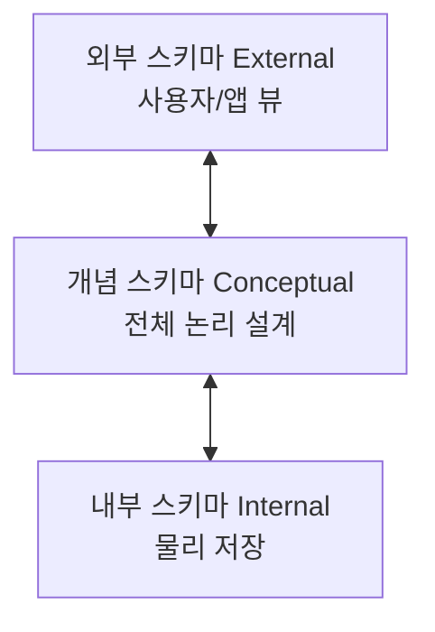

# Session 1 — 데이터베이스 기초 이론

> 단원: [unit1_basic — Basic Theory & DDL](#unit1-basic---basic-theory--ddl)  
> 참고: [Notion — 데이터베이스](https://app.notion.com/p/253974c0f4ae800e979bfbddbca13b88)  
> 다음: [Session 2 — DDL 실습](unit1_basic/session2.md)

---

## 이번 세션 목표

| 목표 | 내용 |
| ---- | ---- |
| DB를 쓰는 이유 | 파일 관리의 한계와 CRUD |
| 스키마 | 설계도 vs 실제 데이터 |
| 3계층 스키마 | 외부 / 개념 / 내부, 데이터 독립성 |
| RDBMS 구조 | 테이블·행·열, 릴레이션 성질 |
| 키 미리보기 | PK / FK / Unique / NOT NULL |

---

## 1. DB를 사용하는 이유

파일을 직접 관리하면 **데이터 조작이 어렵다.**

| 파일 관리의 한계               | DB를 쓰면                    |
| ------------------------------ | ---------------------------- |
| 검색·수정·삭제가 번거로움      | SQL로 일관되게 조작          |
| 동시 접근·무결성 관리가 어려움 | DBMS가 일관성·권한·백업 지원 |
| 구조·관계가 코드/문서에만 존재 | 스키마로 구조를 명확히 정의  |

### DB vs DBMS

| 용어 | 의미 |
| ---- | ---- |
| DB (Database) | 실제로 저장된 **데이터 집합** |
| DBMS (Database Management System) | DB를 만들고·관리하는 **소프트웨어** (예: MySQL, Oracle) |

사용자는 **SQL**로 데이터를 **CRUD** 한다.

| 동작   | 의미 | SQL 예   |
| ------ | ---- | -------- |
| Create | 생성 | `INSERT` |
| Read   | 조회 | `SELECT` |
| Update | 수정 | `UPDATE` |
| Delete | 삭제 | `DELETE` |

---

## 2. 스키마(Schema)란?

데이터베이스의 **구조를 정의한 것** → DB의 **청사진(설계도)**.

- 테이블이 어떤 **속성(컬럼)**을 가지는지
- 어떤 **값**이 들어올 수 있는지 (도메인·제약조건)
- 필요 시 **인덱스, 해싱** 등 물리적 저장 방식도 포함

```text
스키마(설계)  ≠  인스턴스(실제 저장된 데이터)
```

---

## 3. 3계층 스키마 구조

ANSI/SPARC의 **3-schema architecture**. 계층을 나눠 **데이터 독립성**을 높인다.

### 외부 스키마 (External Schema)

- 사용자가 보는 데이터 구조
- 사용자/앱별 **맞춤 뷰(View)** 제공
- 하나의 개념 스키마에 **여러 외부 스키마** 가능

### 개념 스키마 (Conceptual Schema)

- DB의 **전체 논리 구조** 정의
- 개체(Entity), 관계(Relationship), **제약조건** 포함
- 외부 스키마 ↔ 내부 스키마를 **연결**

### 내부 스키마 (Internal Schema)

- 데이터가 **실제로 저장되는 방식** (물리적 구조)
- 저장 방식, 인덱스, 해싱 등



### 데이터 독립성

| 종류               | 의미                                                                  |
| ------------------ | --------------------------------------------------------------------- |
| 논리 데이터 독립성 | 개념 스키마 변경이 외부 스키마(앱)에 미치는 영향 최소화               |
| 물리 데이터 독립성 | 내부 스키마(저장/인덱스) 변경이 개념·외부 스키마에 미치는 영향 최소화 |

---

## 4. RDBMS의 기본 구조

관계형 DBMS는 여러 **테이블**로 구성된다. 테이블 = **표**.

| 용어           | 의미                  | 예                    |
| -------------- | --------------------- | --------------------- |
| 테이블 (Table) | 표 형태의 데이터 집합 | `학생`                |
| 컬럼 (Column)  | 열 = 속성             | 학번, 이름, 전공      |
| 로우 (Row)     | 행 = 한 건의 레코드   | (2024001, 홍길동, CS) |

```text
        학번   |  이름  |  전공
       --------|--------|------
행 →   2024001 | 홍길동 | CS
행 →   2024002 | 김영희 | EE
         ↑ 열(컬럼)
```

---

## 5. 릴레이션(Relation)이란?

관계형 DB에서 데이터를 **표(Table) 형태**로 저장하는 구조.  
실무에서는 보통 **테이블**과 같은 의미로 쓴다.

| 수학/이론 용어 | 실무 용어                     |
| -------------- | ----------------------------- |
| Relation       | Table                         |
| Tuple          | Row / Record                  |
| Attribute      | Column / Field                |
| Domain         | 컬럼이 가질 수 있는 값의 집합 |

### 행 (Row, Tuple)

- 하나의 **데이터 레코드**
- 예: 학생 한 명의 정보 `(학번, 이름, 전공)`

### 열 (Column, Attribute)

- 데이터의 **속성(필드)**
- 예: `"학번"`, `"이름"`, `"전공"`

### 릴레이션의 성질

| 성질            | 설명                                     |
| --------------- | ---------------------------------------- |
| 튜플의 유일성   | 동일한 행(튜플)이 중복되지 않음 (이론상) |
| 행의 순서 무관  | 행 순서가 달라도 같은 릴레이션           |
| 열의 순서 무관  | 열 순서가 달라도 속성 이름으로 구분      |
| 원자성 (Atomic) | 각 셀의 값은 더 쪼개지지 않는 단일 값    |
| 속성명은 유일   | 같은 릴레이션 안에서 컬럼 이름 중복 불가 |

### 차수·카디널리티

| 용어                     | 의미              |
| ------------------------ | ----------------- |
| 차수 (Degree)            | 속성(컬럼)의 개수 |
| 카디널리티 (Cardinality) | 튜플(행)의 개수   |

예: 컬럼 3개·행 100개 → 차수 3, 카디널리티 100

---

## 6. 키 개념 미리보기

다음 세션(DDL)에서 실제로 쓰기 전, 자주 나오는 용어만 정리.

| 키               | 역할                                      |
| ---------------- | ----------------------------------------- |
| Primary Key (PK) | 행을 유일하게 식별 (예: 학번)             |
| Foreign Key (FK) | 다른 테이블의 PK를 참조하여 **관계** 표현 |
| Unique           | 중복 불가 (PK는 아니어도 됨)              |
| NOT NULL         | 빈 값 불가                                |

---

## 한 줄 요약

1. **파일 대신 DB** → SQL로 CRUD, 구조·무결성 관리
2. **DB** = 데이터, **DBMS** = 관리 소프트웨어
3. **스키마** = DB 설계도 (인스턴스 ≠ 스키마)
4. **3계층 스키마** = 외부 / 개념 / 내부 → 데이터 독립성
5. **RDBMS** = 테이블(릴레이션) = 행(튜플) × 열(속성)
6. **키** = PK로 식별, FK로 관계

---

이전 · [다음: Session 2 — DDL 실습](session2.md)
