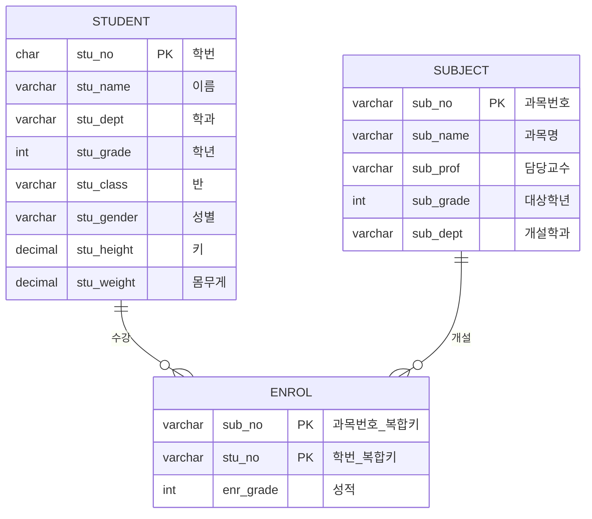

# Session 2 — DDL 실습 (student / subject / enrol)

> 이전: [Session 1 — 기초 이론](unit1_basic/session1.md) · 다음: [Session 3 — DML & DDL 변경 · DCL](session3.md)

MySQL에서 DB를 선택한 뒤, 테이블 생성 → 구조 확인 → 데이터 삽입 → 조회 순서로 진행한다.

---

## 이번 세션 목표

| 목표            | 내용                          |
| --------------- | ----------------------------- |
| 테이블 3개 생성 | `student`, `subject`, `enrol` |
| 제약조건        | PK, 복합키                    |
| 데이터 삽입     | INSERT → SELECT로 확인        |
| 구조 확인       | `DESC`로 컬럼·키 확인         |

```sql
USE hh;
```

---

## 1. 테이블 관계 개요



| 테이블    | 역할            | PK                        |
| --------- | --------------- | ------------------------- |
| `student` | 학생 정보       | `stu_no`                  |
| `subject` | 과목 정보       | `sub_no`                  |
| `enrol`   | 수강(학생↔과목) | `(sub_no, stu_no)` 복합키 |

> 원본 실습에는 **FK(외래키) 제약이 없음**.  
> 관계만 논리적으로 `enrol.sub_no` → `subject`, `enrol.stu_no` → `student`를 가리킨다.

---

## 2. 재생성 순서 (DROP)

테이블을 다시 만들 때는 **자식 → 부모** 순으로 지운다.  
(나중에 FK를 붙였다면 `enrol`을 먼저 DROP해야 한다.)

```sql
DROP TABLE IF EXISTS enrol;
DROP TABLE IF EXISTS student;
DROP TABLE IF EXISTS subject;
```

생성은 **부모 → 자식** (`student`, `subject` → `enrol`) 순이 안전하다.

---

## 3. student 테이블 생성

| 컬럼         | 타입           | 의미      |
| ------------ | -------------- | --------- |
| `stu_no`     | `CHAR(9)`      | 학번 (PK) |
| `stu_name`   | `VARCHAR(12)`  | 이름      |
| `stu_dept`   | `VARCHAR(20)`  | 학과      |
| `stu_grade`  | `INT`          | 학년      |
| `stu_class`  | `VARCHAR(1)`   | 반        |
| `stu_gender` | `VARCHAR(1)`   | 성별      |
| `stu_height` | `DECIMAL(5,2)` | 키        |
| `stu_weight` | `DECIMAL(5,2)` | 몸무게    |

```sql
CREATE TABLE student (
  stu_no     CHAR(9),
  stu_name   VARCHAR(12),
  stu_dept   VARCHAR(20),
  stu_grade  INT,
  stu_class  VARCHAR(1),
  stu_gender VARCHAR(1),
  stu_height DECIMAL(5,2),
  stu_weight DECIMAL(5,2),
  CONSTRAINT p_stu_no PRIMARY KEY (stu_no)
);
-- 제약조건 이름: p_stu_no
-- 기본키: stu_no

DESC student;
-- 또는 DESCRIBE student;
```

---

## 4. subject 테이블 생성

| 컬럼        | 타입          | 의미          |
| ----------- | ------------- | ------------- |
| `sub_no`    | `VARCHAR(3)`  | 과목번호 (PK) |
| `sub_name`  | `VARCHAR(30)` | 과목명        |
| `sub_prof`  | `VARCHAR(12)` | 담당교수      |
| `sub_grade` | `INT`         | 대상 학년     |
| `sub_dept`  | `VARCHAR(20)` | 개설 학과     |

```sql
CREATE TABLE subject (
  sub_no    VARCHAR(3),
  sub_name  VARCHAR(30),
  sub_prof  VARCHAR(12),
  sub_grade INT,
  sub_dept  VARCHAR(20),
  CONSTRAINT p_sub_no PRIMARY KEY (sub_no)
);

DESC subject;
```

---

## 5. enrol 테이블 생성

| 컬럼        | 타입         | 의미               |
| ----------- | ------------ | ------------------ |
| `sub_no`    | `VARCHAR(3)` | 과목번호 (복합 PK) |
| `stu_no`    | `VARCHAR(9)` | 학번 (복합 PK)     |
| `enr_grade` | `INT`        | 성적               |

```sql
CREATE TABLE enrol (
  sub_no    VARCHAR(3),
  stu_no    VARCHAR(9),
  enr_grade INT,
  CONSTRAINT p_course PRIMARY KEY (sub_no, stu_no)
);
-- 복합키: 같은 학생이 같은 과목을 두 번 등록할 수 없음

DESC enrol;
```

---

## 6. INSERT — 데이터 삽입

기본 형식:

```sql
INSERT INTO 테이블명 VALUES (...);
```

### 6.1 student

```sql
INSERT INTO student VALUES (20153075, '옥한빛', '기계', 1, 'C', 'M', 177, 80);
INSERT INTO student VALUES (20153088, '이태연', '기계', 1, 'C', 'F', 162, 50);
INSERT INTO student VALUES (20143054, '유가인', '기계', 2, 'C', 'F', 154, 47);
INSERT INTO student VALUES (20152088, '조민우', '전기전자', 1, 'C', 'M', 188, 90);
INSERT INTO student VALUES (20142021, '심수정', '전기전자', 2, 'A', 'F', 167, 45);
INSERT INTO student VALUES (20132003, '박희철', '전기전자', 3, 'B', 'M', NULL, 63);
INSERT INTO student VALUES (20151062, '김인중', '컴퓨터정보', 1, 'B', 'M', 166, 67);
INSERT INTO student VALUES (20141007, '진현무', '컴퓨터정보', 2, 'A', 'M', 174, 64);
INSERT INTO student VALUES (20131001, '김종헌', '컴퓨터정보', 3, 'C', 'M', NULL, 72);
INSERT INTO student VALUES (20131025, '옥성우', '컴퓨터정보', 3, 'A', 'F', 172, 63);

SELECT * FROM student;
```

> `stu_height`에 `NULL`이 있는 행 = 키 정보가 없음 (박희철, 김종헌).

### 6.2 subject

```sql
INSERT INTO subject VALUES ('111', '데이터베이스', '이재영', 2, '컴퓨터정보');
INSERT INTO subject VALUES ('110', '자동제어', '정순정', 2, '전기전자');
INSERT INTO subject VALUES ('109', '자동화설계', '박민영', 3, '기계');
INSERT INTO subject VALUES ('101', '컴퓨터개론', '강종영', 3, '컴퓨터정보');
INSERT INTO subject VALUES ('102', '기계공작법', '김태영', 1, '기계');
INSERT INTO subject VALUES ('103', '기초전자실험', '김유석', 1, '전기전자');
INSERT INTO subject VALUES ('104', '시스템분석설계', '강석현', 3, '컴퓨터정보');
INSERT INTO subject VALUES ('105', '기계요소설계', '김명성', 1, '기계');
INSERT INTO subject VALUES ('106', '전자회로시험', '최영민', 3, '전기전자');
INSERT INTO subject VALUES ('107', 'CAD응용실습', '구봉규', 2, '기계');
INSERT INTO subject VALUES ('108', '소프트웨어공학', '권민성', 1, '컴퓨터정보');

SELECT * FROM subject;
```

### 6.3 enrol

```sql
INSERT INTO enrol VALUES ('101', '20131001', 80);
INSERT INTO enrol VALUES ('104', '20131001', 56);
INSERT INTO enrol VALUES ('106', '20132003', 72);
INSERT INTO enrol VALUES ('103', '20152088', 45);
INSERT INTO enrol VALUES ('101', '20131025', 65);
INSERT INTO enrol VALUES ('104', '20131062', 65);
INSERT INTO enrol VALUES ('108', '20151062', 81);
INSERT INTO enrol VALUES ('107', '20143054', 41);
INSERT INTO enrol VALUES ('102', '20153075', 66);
INSERT INTO enrol VALUES ('105', '20153075', 56);
INSERT INTO enrol VALUES ('102', '20153088', 61);
INSERT INTO enrol VALUES ('105', '20153088', 78);

SELECT * FROM enrol;
```

---

## 7. 자주 쓰는 명령 정리

| 명령                                | 역할                              |
| ----------------------------------- | --------------------------------- |
| `USE DB명;`                         | 사용할 데이터베이스 선택          |
| `CREATE TABLE ...`                  | 테이블(스키마) 생성               |
| `DROP TABLE IF EXISTS ...`          | 테이블 삭제 (있으면)              |
| `CONSTRAINT 이름 PRIMARY KEY (...)` | PK 제약조건 지정                  |
| `DESC 테이블;` / `DESCRIBE 테이블;` | 테이블 구조 확인                  |
| `INSERT INTO ... VALUES (...);`     | 행 추가                           |
| `SELECT * FROM 테이블;`             | 전체 조회                         |
| `NULL`                              | 값이 없음 (빈 문자열 `''`과 다름) |

### 타입·제약 팁

| 항목           | 설명                                                           |
| -------------- | -------------------------------------------------------------- |
| `CHAR(n)`      | 고정 길이 — 남는 자리는 공백으로 채움                          |
| `VARCHAR(n)`   | 가변 길이 — 실제 길이만큼만 저장                               |
| `DECIMAL(5,2)` | 전체 5자리 중 소수 2자리 (예: `177.00`)                        |
| `INT`          | MySQL 8에서 `INT(1)` 표시 너비는 거의 의미 없음 → `INT`로 충분 |
| 복합키         | `enrol`의 PK가 두 컬럼 → Composite Key                         |

### (참고) FK를 나중에 붙이는 예

```sql
-- 예시 (원본 실습에는 없음)
ALTER TABLE enrol
  ADD CONSTRAINT fk_enrol_sub
    FOREIGN KEY (sub_no) REFERENCES subject(sub_no),
  ADD CONSTRAINT fk_enrol_stu
    FOREIGN KEY (stu_no) REFERENCES student(stu_no);
```

---

## 한 줄 요약

1. **실습** = `CREATE` → `DESC` → `INSERT` → `SELECT`
2. **student / subject** = 부모, **enrol** = 수강 관계 (복합 PK)
3. 원본에는 **FK 없음** — 관계는 논리적으로만 연결
4. 재생성 시 **DROP은 자식 먼저**, **CREATE는 부모 먼저**

---

[이전: Session 1 — 기초 이론](session1.md) · [다음: Session 3 — DML & DDL 변경 · DCL](session3.md)
