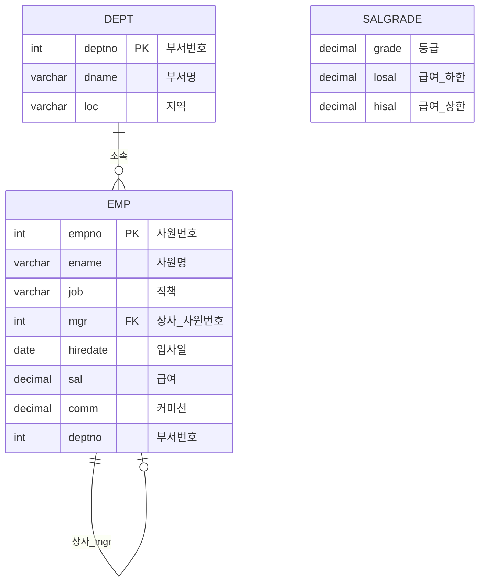

# Session 4 — SCOTT 스키마 (dept / emp / salgrade)

> 단원: [unit2_queries — SQL Querying](#unit2-queries---sql-querying)  
> 이전: [Session 3 — 문자열 함수·ORDER BY](unit2_queries/session3.md) · 다음: [Session 5 — JOIN 실습](unit2_queries/session5.md)  
> Session 2의 `student` / `subject` / `enrol`(학사)에 이어,  
> Oracle 교재에서 자주 쓰는 **부서·사원·급여등급** 샘플 스키마를 MySQL에서 만든다.

### 학사 스키마 vs SCOTT

|             | 학사 (Session 2)          | SCOTT (이번 세션)                  |
| ----------- | ------------------------- | ---------------------------------- |
| 테이블      | student / subject / enrol | dept / emp / salgrade              |
| 연습 포인트 | 복합키, 수강 관계         | **자기참조 FK**, 날짜, 급여 구간   |
| FK          | 원본에 없음               | `emp.mgr` → `emp.empno` (자기참조) |

---

## 1. 이번 세션 목표

| 목표            | 내용                                          |
| --------------- | --------------------------------------------- |
| 테이블 3개 생성 | `dept`, `emp`, `salgrade`                     |
| 제약조건        | PK, **자기참조 FK** (`emp.mgr` → `emp.empno`) |
| 데이터 삽입     | 사원 → 부서 → 급여등급 순서 (원본 실습 기준)  |
| 구조 확인       | `DESC`로 컬럼·키 확인                         |
| SELECT 연습     | 문제 1~40                                     |

```sql
USE hh;
```

---

## 2. 테이블 관계 개요



| 테이블     | 역할           | PK       | 비고                                          |
| ---------- | -------------- | -------- | --------------------------------------------- |
| `dept`     | 부서 정보      | `deptno` |                                               |
| `emp`      | 사원 정보      | `empno`  | `mgr`이 같은 테이블 `empno`를 참조 (자기참조) |
| `salgrade` | 급여 등급 구간 | (없음)   | `losal`~`hisal` 범위로 등급 판별              |

> 원본 실습에서 `emp.deptno` → `dept.deptno` **FK는 없음**.  
> 관계는 논리적으로만 연결된다. (`deptno` 값 10, 20, 30, 40)

---

## 3. dept 테이블 생성

| 컬럼     | 타입          | 의미          |
| -------- | ------------- | ------------- |
| `deptno` | `INT(2)`      | 부서번호 (PK) |
| `dname`  | `VARCHAR(14)` | 부서명        |
| `loc`    | `VARCHAR(13)` | 지역          |

```sql
CREATE TABLE dept(
  deptno INT(2),
  dname  VARCHAR(14),
  loc    VARCHAR(13),
  CONSTRAINT pk_dept PRIMARY KEY (deptno)
);

DESC dept;
```

---

## 4. emp 테이블 생성

| 컬럼       | 타입           | 의미                            |
| ---------- | -------------- | ------------------------------- |
| `empno`    | `INT(4)`       | 사원번호 (PK)                   |
| `ename`    | `VARCHAR(30)`  | 사원명                          |
| `job`      | `VARCHAR(20)`  | 직책                            |
| `mgr`      | `INT(4)`       | 상사 사원번호 (자기참조 FK)     |
| `hiredate` | `DATE`         | 입사일                          |
| `sal`      | `DECIMAL(7,2)` | 급여                            |
| `comm`     | `DECIMAL(7,2)` | 커미션 (없으면 `NULL`)          |
| `deptno`   | `INT(2)`       | 부서번호 (논리적으로 dept 참조) |

```sql
CREATE TABLE emp(
  empno    INT(4),
  ename    VARCHAR(30),
  job      VARCHAR(20),
  mgr      INT(4),  -- 외래키: emp.empno를 참조 (자기참조)
  FOREIGN KEY (mgr) REFERENCES emp(empno),
  hiredate DATE,
  sal      DECIMAL(7,2),
  comm     DECIMAL(7,2),
  deptno   INT(2),
  CONSTRAINT pk_emp PRIMARY KEY (empno)
);

DESC emp;
```

### 자기참조 FK란?

같은 테이블 안에서 **행끼리 관계**를 맺는 것.

```text
KING (empno=7839, mgr=NULL)     ← 최상위 (사장, 상사 없음)
  └─ JONES (mgr=7839)
  └─ BLAKE (mgr=7839)
  └─ CLARK (mgr=7839)
```

- `mgr` 값 = 상사의 `empno`
- 최상위 사원(PRESIDENT)은 상사가 없으므로 `mgr = NULL`
- **INSERT 순서**: 상사를 먼저 넣어야 FK가 통과한다  
  → `KING`을 먼저, 그다음 매니저·사원 순

---

## 5. salgrade 테이블 생성

| 컬럼    | 타입           | 의미      |
| ------- | -------------- | --------- |
| `grade` | `DECIMAL(7,2)` | 등급      |
| `losal` | `DECIMAL(7,2)` | 급여 하한 |
| `hisal` | `DECIMAL(7,2)` | 급여 상한 |

```sql
CREATE TABLE salgrade(
  grade DECIMAL(7,2),
  losal DECIMAL(7,2),
  hisal DECIMAL(7,2)
);

DESC salgrade;
```

> PK가 없다. 급여가 `losal`~`hisal` 구간에 들어가면 해당 `grade`를 매기는 용도.  
> 나중에 JOIN 예: `emp.sal BETWEEN salgrade.losal AND salgrade.hisal`

---

## 6. INSERT — 데이터 삽입

### 6.1 emp (사원)

상사가 먼저 들어가도록 순서가 잡혀 있다.  
`KING` → 매니저들 → 분석가/영업사원/사무원.

```sql
INSERT INTO emp VALUES (7839, 'KING',   'PRESIDENT', NULL, '1981-11-17', 5000, NULL, 10);
INSERT INTO emp VALUES (7566, 'JONES',  'MANAGER',   7839, '1981-4-2',   2975, NULL, 20);
INSERT INTO emp VALUES (7698, 'BLAKE',  'MANAGER',   7839, '1981-5-1',   2850, NULL, 30);
INSERT INTO emp VALUES (7782, 'CLARK',  'MANAGER',   7839, '1981-6-9',   2450, NULL, 10);
INSERT INTO emp VALUES (7788, 'SCOTT',  'ANALYST',   7566, '1987-7-13',  3000, NULL, 20);
INSERT INTO emp VALUES (7902, 'FORD',   'ANALYST',   7566, '1981-12-3',  3000, NULL, 20);
INSERT INTO emp VALUES (7499, 'ALLEN',  'SALESMAN',  7698, '1981-2-20',  1600,  300, 30);
INSERT INTO emp VALUES (7521, 'WARD',   'SALESMAN',  7698, '1981-2-22',  1250,  500, 30);
INSERT INTO emp VALUES (7654, 'MARTIN', 'SALESMAN',  7698, '1981-9-28',  1250, 1400, 30);
INSERT INTO emp VALUES (7844, 'TURNER', 'SALESMAN',  7698, '1981-9-8',   1500,    0, 30);
INSERT INTO emp VALUES (7900, 'JAMES',  'CLERK',     7698, '1981-12-3',   950, NULL, 30);
INSERT INTO emp VALUES (7934, 'MILLER', 'CLERK',     7782, '1982-1-23',  1300, NULL, 10);
INSERT INTO emp VALUES (7369, 'SMITH',  'CLERK',     7902, '1980-12-17',  800, NULL, 20);
INSERT INTO emp VALUES (7876, 'ADAMS',  'CLERK',     7788, '1987-07-13', 1100, NULL, 20);

SELECT * FROM emp;
```

| 포인트        | 설명                              |
| ------------- | --------------------------------- |
| `mgr = NULL`  | KING만 해당 (사장)                |
| `comm = NULL` | 커미션 없는 직책 (영업 외 대부분) |
| `comm = 0`    | TURNER — 커미션은 있지만 금액 0   |

### 6.2 dept (부서)

```sql
INSERT INTO dept VALUES (10, 'ACCOUNTING', 'NEW YORK');
INSERT INTO dept VALUES (20, 'RESEARCH',   'DALLAS');
INSERT INTO dept VALUES (30, 'SALES',      'CHICAGO');
INSERT INTO dept VALUES (40, 'OPERATIONS', 'BOSTON');

SELECT * FROM dept;
```

| deptno | dname      | loc      | 소속 사원 예        |
| ------ | ---------- | -------- | ------------------- |
| 10     | ACCOUNTING | NEW YORK | KING, CLARK, MILLER |
| 20     | RESEARCH   | DALLAS   | JONES, SCOTT, FORD… |
| 30     | SALES      | CHICAGO  | BLAKE, ALLEN, WARD… |
| 40     | OPERATIONS | BOSTON   | (사원 없음)         |

> `emp`에 `deptno` FK가 없어서, **부서보다 사원을 먼저** INSERT해도 오류가 나지 않는다.  
> FK를 붙인다면 `dept` → `emp` 순으로 넣어야 한다.

### 6.3 salgrade (급여 등급)

```sql
INSERT INTO salgrade VALUES (1,  700, 1200);
INSERT INTO salgrade VALUES (2, 1201, 1400);
INSERT INTO salgrade VALUES (3, 1401, 2000);
INSERT INTO salgrade VALUES (4, 2001, 3000);
INSERT INTO salgrade VALUES (5, 3001, 9999);

SELECT * FROM salgrade;
```

예: SMITH `sal=800` → grade 1 / KING `sal=5000` → grade 5

---

## 7. 자주 쓰는 명령·개념 정리

| 명령 / 개념                                  | 역할                                    |
| -------------------------------------------- | --------------------------------------- |
| `CREATE TABLE ...`                           | 테이블 생성                             |
| `CONSTRAINT 이름 PRIMARY KEY (...)`          | PK 지정                                 |
| `FOREIGN KEY (컬럼) REFERENCES 테이블(컬럼)` | FK 지정                                 |
| `DESC 테이블;`                               | 구조 확인                               |
| `INSERT INTO ... VALUES (...);`              | 행 추가                                 |
| 자기참조 FK                                  | 같은 테이블 PK를 참조 (`mgr` → `empno`) |
| `NULL`                                       | 값 없음 (KING의 상사, 대부분 커미션)    |

### 타입·제약 팁

- MySQL 8에서 `INT(2)`, `INT(4)`의 표시 너비는 거의 의미 없음 → `INT`로 충분
- `DECIMAL(7,2)`: 전체 7자리 중 소수 2자리 (예: `2975.00`)
- 자기참조 FK가 있으면 **참조되는 행을 먼저** INSERT
- 나중에 `emp.deptno` FK를 붙이려면 예:

```sql
-- 예시 (원본 실습에는 없음)
ALTER TABLE emp
  ADD CONSTRAINT fk_emp_dept
    FOREIGN KEY (deptno) REFERENCES dept(deptno);
```

---

## 8. 실습 문제 — SELECT (1~40)

> 테이블: `emp`(사원), `dept`(부서), `salgrade`(급여등급)

```sql
-- 1. 사원 테이블의 구조를 검색하라.
DESC emp;

-- 2. 부서 테이블의 구조를 검색하라.
DESC dept;

-- 3. 급여 테이블의 구조를 검색하라.
DESC salgrade;

-- 4. 사원들의 사원번호, 사원이름, 사원직무를 검색하라.
SELECT empno, ename, job FROM emp;

-- 5. 부서의 부서번호와 부서이름을 검색하라.
SELECT deptno, dname FROM dept;

-- 6. 부서의 부서이름과 지역을 검색하라.
SELECT dname, loc FROM dept;

-- 7. 사원들의 급여와 커미션을 검색하라.
SELECT sal, comm FROM emp;

-- 8. 사원들의 입사일 중복을 제거하고 검색하라.
SELECT DISTINCT hiredate FROM emp;

-- 9. 사원들의 상급자사원번호(mgr) 중복을 제거하고 검색하라.
SELECT DISTINCT mgr FROM emp;

-- 10. 사원들의 부서번호 중복을 제거하고 검색하라.
SELECT DISTINCT deptno FROM emp;

-- 11. 사원들의 이름과 6개월 급여의 합을 검색하라.
SELECT ename, sal * 6 FROM emp;

-- 12. 사원들의 6개월 커미션(comm)의 합을 검색하라.
SELECT SUM(comm) * 6 FROM emp;

-- 13. 사원이름을 'name'으로, 급여를 'salary'로 열 이름을 부여하여 검색하라.
SELECT ename AS name, sal AS salary FROM emp;

-- 14. 사원의 사원번호, 사원이름, 입사일, 부서번호를 한글로 바꾸어 검색하라.
SELECT empno AS 사원번호, ename AS 사원이름, hiredate AS 입사일, deptno AS 부서번호 FROM emp;

-- 15. 부서번호, 부서이름, 지역을 한글 제목으로 검색하라.
SELECT deptno AS 부서번호, dname AS 부서이름, loc AS 지역 FROM dept;

-- 16. 사원의 사원직무와 사원이름을 합쳐서 검색하라.
SELECT CONCAT(job, ename) FROM emp;

-- 17. 입사일·사원이름을 '80-12-17에 입사한 SMITH입니다' 식으로 검색하라.
SELECT CONCAT(DATE_FORMAT(hiredate, '%y-%c-%e'), '에 입사한 ', ename, '입니다') FROM emp;

-- 18. 10번 부서에 근무하는 사원이름을 검색하라.
SELECT ename FROM emp WHERE deptno = 10;

-- 19. 급여가 2000 이상인 사원들의 사원번호, 사원이름을 검색하라.
SELECT empno, ename FROM emp WHERE sal >= 2000;

-- 20. 사원직무가 'CLERK'인 사원들의 사원번호, 사원이름을 검색하라.
SELECT empno, ename FROM emp WHERE job = 'CLERK';

-- 21. 1980년 12월 17일에 입사한 사원이름을 검색하라.
SELECT ename FROM emp WHERE hiredate = '1980-12-17';

-- 22. 부서번호 30 이외의 부서이름과 지역을 검색하라.
SELECT dname, loc FROM dept WHERE deptno <> 30;

-- 23. 급여등급이 5인 급여의 상위급여와 하위급여를 검색하라.
SELECT hisal, losal FROM salgrade WHERE grade = 5;

-- 24. 'WARD' 사원의 모든 정보를 검색하라.
SELECT * FROM emp WHERE ename = 'WARD';

-- 25. 10번 부서에 근무하는 MANAGER의 사원이름을 검색하라.
SELECT ename FROM emp WHERE deptno = 10 AND job = 'MANAGER';

-- 26. 급여가 2000 이상이며, 30번 부서에 근무하는 사원들의 사원번호와 사원이름을 검색하라.
SELECT empno, ename FROM emp WHERE sal >= 2000 AND deptno = 30;

-- 27. 사원직무가 'CLERK'이며, 81년 이후에 입사한 사원들의 사원번호와 사원이름을 검색하라.
SELECT empno, ename FROM emp WHERE job = 'CLERK' AND hiredate >= '1981-01-01';

-- 28. 20번 부서 외에 근무하는 MANAGER의 사원이름을 검색하라.
-- (원문 '20부터 외에' → 20번 부서 이외로 해석)
SELECT ename FROM emp WHERE deptno <> 20 AND job = 'MANAGER';

-- 29. BOSTON 이외 지역에 있는 부서이름을 검색하라.
SELECT dname FROM dept WHERE loc <> 'BOSTON';

-- 30. SALESMAN이며 급여가 1500 이상인 사원이름을 검색하라.
-- (원문 'SALEMAN' → SALESMAN 오타)
SELECT ename FROM emp WHERE job = 'SALESMAN' AND sal >= 1500;

-- 31. 급여가 1000 이상이며 2500 이하인 사원의 사원번호, 사원이름, 급여를 검색하라.
SELECT empno, ename, sal FROM emp WHERE sal BETWEEN 1000 AND 2500;

-- 32. 사원번호가 75XX인 사원의 사원번호, 사원이름, 부서번호를 검색하라.
SELECT empno, ename, deptno FROM emp WHERE empno LIKE '75%';

-- 33. 부서번호가 10 또는 30에 근무하는 사원들의 사원이름과 급여를 검색하라.
SELECT ename, sal FROM emp WHERE deptno IN (10, 30);

-- 34. 상급자사원번호가 76으로 시작하는 사원들의 사원이름을 검색하라.
SELECT ename FROM emp WHERE mgr LIKE '76%';

-- 35. 사원번호가 79로 시작하는 사원들의 사원이름, 급여, 커미션을 검색하라.
SELECT ename, sal, comm FROM emp WHERE empno LIKE '79%';

-- 36. 1981년 2월에 입사한 사원의 사원번호, 사원이름, 부서번호를 검색하라.
SELECT empno, ename, deptno FROM emp WHERE hiredate LIKE '1981-02%';

-- 37. 사원이름 중간에 'A'가 들어있는 사원의 사원번호와 사원이름을 검색하라.
SELECT empno, ename FROM emp WHERE ename LIKE '%A%';

-- 38. 상급자사원번호가 NULL인 사원의 사원번호와 사원이름을 검색하라.
SELECT empno, ename FROM emp WHERE mgr IS NULL;

-- 39. 상급자사원번호가 NULL이 아닌 사원의 사원번호, 이름, 상급자사원번호를 검색하라.
SELECT empno, ename, mgr FROM emp WHERE mgr IS NOT NULL;

-- 40. 사원번호가 7902 또는 7781인 사원이름을 검색하라.
SELECT ename FROM emp WHERE empno IN (7902, 7781);

-- [문제추가] 자연조인과 등가조인 실습

-- 1. 점수가 70점 이하인 학생 이름 검색 (natural join)
SELECT DISTINCT stu_name FROM student natural join enrol WHERE enr_grade <= 70;

-- 2. 점수가 70점 이상인 학생 이름 검색 (equi-join)
SELECT DISTINCT stu.stu_name FROM student stu JOIN enrol en ON stu.stu_no = en.stu_no WHERE en.enr_grade >= 70;

-- 3. 강종영 교수 강의 수강생 이름 검색 (equi-join)
SELECT DISTINCT s.stu_name FROM student s, enrol e, subject su
WHERE s.stu_no = e.stu_no AND e.sub_no = su.sub_no AND su.sub_prof = '강종영';
```

### (참고) 문제 해석 메모

| 번호     | 메모                                                            |
| -------- | --------------------------------------------------------------- |
| 12       | `SUM(comm)` 후 ×6. `comm`이 `NULL`인 행은 `SUM`에서 제외됨      |
| 17       | MySQL: `DATE_FORMAT(hiredate, '%y-%c-%e')`로 `80-12-17` 형태    |
| 28       | 원문「20부터 외에」→ **20번 부서 이외**로 처리                  |
| 30       | 원문 `SALEMAN` → **`SALESMAN`** 오타                            |
| 32·34·35 | 숫자 컬럼도 MySQL에서 `LIKE '75%'` 가능 (암시적 문자열 변환)    |
| 38·39    | `NULL` 비교는 `=` / `<>`가 아니라 **`IS NULL` / `IS NOT NULL`** |
| 40       | 데이터에 `7781`은 없음 (`7782` CLARK). 문제 그대로 `7781` 사용  |

---

## 한 줄 요약

1. **dept** = 부서, **emp** = 사원, **salgrade** = 급여 등급 구간
2. **emp.mgr** = 같은 테이블 `empno`를 가리키는 **자기참조 FK**
3. **KING**은 `mgr = NULL`, INSERT는 상사부터
4. **emp.deptno ↔ dept** 관계는 논리만 (원본에 FK 없음)
5. **salgrade**는 PK 없이 급여 구간(`losal`~`hisal`)으로 등급 매칭

-- [추가 연습문제] 서브쿼리 및 JOIN 변환 실습

-- 1. 김인중 학생의 평균 점수보다 낮은 점수를 가진 학생의 학번과 이름을 검색해라.
SELECT stu_no, stu_name FROM student WHERE stu_no IN (
    SELECT stu_no FROM enrol WHERE enr_grade < (SELECT AVG(enr_grade) FROM enrol WHERE stu_no = '20151062')
);

-- 2. 전체 학생의 평균 점수보다 높은 점수를 가진 학생의 학번과 이름, 과목이름, 점수를 검색해라.
SELECT s.stu_no, s.stu_name, sub_name as 과목명, enr_grade as 점수
FROM student s JOIN enrol e ON s.stu_no = e.stu_no JOIN subject sub ON e.sub_no = sub.sub_no
WHERE e.enr_grade > (SELECT AVG(enr_grade) FROM enrol);

-- 3. 점수가 학과별 학생들의 평균 점수보다 높은 학생의 학번을 검색해라. (all, (any,some))
SELECT DISTINCT stu_no FROM enrol e1 WHERE enr_grade > ALL (
    SELECT AVG(enr_grade) FROM enrol e2 WHERE e1.stu_no != e2.stu_no GROUP BY e2.stu_no
);

-- 2) -- ADAMS 사원이 근무중인 부서이름 검색해라.(equi join)
SELECT d.dname FROM emp e JOIN dept d ON e.deptno = d.deptno WHERE e.ename = 'ADAMS';

-- 3) -- 급여가 2000이상인 사원들의 사원명과 지역을 검색(natural join)
SELECT DISTINCT s.stu_name, s.stu_dept FROM student s JOIN enrol e ON s.stu_no = e.stu_no WHERE e.enr_grade >= 2000;

-- 3) -- 급여가 2000이상인 사원들의 사원명과 지역을 검색(natural join) -> equi join으로 바꾸기
SELECT s.stu_name, d.deptno FROM student s JOIN enrol e ON s.stu_no = e.stu_no JOIN dept d ON s.stu_dept = d.deptno WHERE e.enr_grade >= 2000;

-- 4) -- 급여가 1000이상 2000이하인 사원들의 사원번호, 사원이름, 부서이름을
--    사원번호 순으로 검색(join using)
SELECT s

-- 4) -- 급여가 1000이상 2000이하인 사원들의 사원번호, 사원이름, 부서이름을
--    사원번호 순으로 검색(join using)
SELECT s.stu_no, s.stu_name, s.stu_dept FROM student s JOIN enrol e ON s.stu_no = e.stu_no GROUP BY s.stu_no HAVING MAX(enr_grade) BETWEEN 1000 AND 2000 ORDER BY s.stu_no;

-- 2) -- equi join으로 바꾸기
SELECT s.stu_no, s.stu_name, d.deptno FROM student s, enrol e, dept d WHERE s.stu_no = e.stu_no AND e.stu_no = d.deptno AND e.enr_grade BETWEEN 1000 AND 2000 ORDER BY s.stu_no;.stu_no, s.stu_name, s.stu_dept FROM student s JOIN enrol e ON s.stu_no = e.stu_no GROUP BY s.stu_no H

-- 2) -- equi join으로 바꾸기
SELECT s.stu_no, s.stu_name, d.deptno FROM student s, enrol e, dept d WHERE s.stu_no = e.stu_no AND e.stu_no = d.deptno AND e.enr_grade BETWEEN 1000 AND 2000 ORDER BY s.stu_no;AVING MAX(enr_grade) BETWEEN 1000 AND 2000 ORDER BY s.stu_no;

-- 2) -- equi join으로 바꾸기
SELECT s.stu_no, s.stu_name, d.deptno FROM student s, enrol e, dept d WHERE s.stu_no = e.stu_no AND e.stu_no = d.deptno AND e.enr_grade BETWEEN 1000 AND 2000 ORDER BY s.stu_no;

-- 5) -- 사원직무가 salesman이면서 chicago 지역에 근무 중인 사원명을 검색
SELECT s

-- 5) -- 사원직무가 salesman이면서 chicago 지역에 근무 중인 사원명을 검색
SELECT s.stu_name FROM student s WHERE EXISTS (
    SELECT 1 FROM enrol e WHERE e.stu_no = s.stu_no AND EXISTS (
        SELECT 1 FROM subject sub WHERE sub.sub_no = e.sub_no AND sub.sub_prof = 'salesman'
    )
);

-- 6) -- chicago 지역에 근무하는 사원명을 검색
SELECT s.stu_name FROM student s WHERE EXISTS (
    SELECT 1 FROM enrol e WHERE e.stu_no = s.stu_no AND EXISTS (
        SELECT 1 FROM subject sub WHERE sub.sub_no = e.sub_no AND sub.sub_dept = 'chicago'
    )
);

-- 7) -- new york이나 dallas지역에 근무하는 사원들의 사원번호, 사원이름을
--    사원번호 순으로 검색(equi join)
SELECT s.stu_no, s.stu_name FROM student s, dept d WHERE s.stu_dept = d.deptno AND d.loc IN ('new york', 'dallas') ORDER BY s.stu_no;

-- 8) -- 부서이름이 accounting이거나 지역이 chicago 인 사원의
--    사원번호와 사원을 검색(equi join)
SELECT s.stu_no, s.stu_name FROM student s, dept d WHERE s.stu_dept = d.deptno AND (d.dname = 'accounting' OR d.loc = 'chicago');

-- 6) -- new york이나 dallas지역에 근무하는 사원들의 사원번호, 사원이름을
--    사원번호 순으로 검색(natural join)
SELECT DISTINCT s.stu_no, s.stu_name FROM student s NATURAL JOIN enrol e WHERE EXISTS (
    SELECT 1 FROM dept d WHERE d.deptno = s.stu_dept AND d.loc IN ('new york', 'dallas')
) ORDER BY s.stu_no;

-- 3) -- chicago 지역에 근무하는 사원명을 검색
SELECT s.stu_name FROM student s WHERE EXISTS (
    SELECT 1 FROM enrol e WHERE e.stu_no = s.stu_no AND EXISTS (
        SELECT 1 FROM subject sub WHERE sub.sub_no = e.sub_no AND sub.sub_dept = 'chicago'
    )
);

-- 4) -- new york이나 dallas지역에 근무하는 사원들의 사원번호, 사원이름을
--    사원번호 순으로 검색(equi join)
SELECT s.stu_no, s.stu_name FROM student s, dept d WHERE s.stu_dept = d.deptno AND d.loc IN ('new york', 'dallas') ORDER BY s.stu_no;

-- 5) -- 부서이름이 accounting이거나 지역이 chicago 인 사원의
--    사원번호와 사원을 검색(equi join)
SELECT s.stu_no, s.stu_name FROM student s, dept d WHERE s.stu_dept = d.deptno AND (d.dname = 'accounting' OR d.loc = 'chicago');

-- 6) -- new york이나 dallas지역에 근무하는 사원들의 사원번호, 사원이름을
--    사원번호 순으로 검색(natural join)
SELECT DISTINCT s.stu_no, s.stu_name FROM student s NATURAL JOIN enrol e WHERE EXISTS (
    SELECT 1 FROM dept d WHERE d.deptno = s.stu_dept AND d.loc IN ('new york', 'dallas')
) ORDER BY s.stu_no;.stu_name FROM student s WHERE EXISTS (
    SELECT 1 FROM enrol e WHERE e.stu_no = s.stu_no AND EXISTS (
        SELECT 1 FROM subject sub WHERE sub.sub_no = e.sub_no AND sub.sub_prof = 'salesman'
    )
);

-- 3) -- chicago 지역에 근무하는 사원명을 검색
SELECT s.stu_name FROM student s WHERE EXISTS (
    SELECT 1 FROM enrol e WHERE e.stu_no = s.stu_no AND EXISTS (
        SELECT 1 FROM subject sub WHERE sub.sub_no = e.sub_no AND sub.sub_dept = 'chicago'
    )
);

-- 4) -- new york이나 dallas지역에 근무하는 사원들의 사원번호, 사원이름을
--    사원번호 순으로 검색(equi join)
SELECT s.stu_no, s.stu_name FROM student s, dept d WHERE s.stu_dept = d.deptno AND d.loc IN ('new york', 'dallas') ORDER BY s.stu_no;

-- 5) -- 부서이름이 accounting이거나 지역이 chicago 인 사원의
--    사원번호와 사원이름을 검색(equi join)
SELECT s.stu_no, s.stu_name FROM student s, dept d WHERE s.stu_dept = d.deptno AND (d.dname = 'accounting' OR d.loc = 'chicago');

-- 6) -- new york이나 dallas지역에 근무하는 사원들의 사원번호, 사원이름을
--    사원번호 순으로 검색(natural join)
SELECT DISTINCT s.stu_no, s.stu_name FROM student s NATURAL JOIN enrol e WHERE EXISTS (
    SELECT 1 FROM dept d WHERE d.deptno = s.stu_dept AND d.loc IN ('new york', 'dallas')
) ORDER BY s.stu_no;

---
[이전: Session 3 — 문자열 함수·ORDER BY](unit2_queries/session3.md) · [다음: Session 5 — JOIN 실습](unit2_queries/session5.md)
