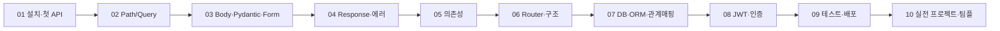

# FastAPI Study

## 폴더 구조

| 폴더                     | 용도                                                      |
| ------------------------ | --------------------------------------------------------- |
| [`session/`](./session/) | 단원별 체계적 커리큘럼 (01~10, 다이어그램·연습 문제 포함) |
| [`sources/`](./sources/) | 실습 코드 (`main1.py`~`main3.py`)                         |

## 학습 흐름

## 단원 구성

| 단원                 | 레슨                             | 원본에서 흡수된 주요 내용                                                                                            |
| -------------------- | -------------------------------- | -------------------------------------------------------------------------------------------------------------------- |
| 01-getting-started   | 설치·첫 API·자동 문서화          | conda/venv 설치, Uvicorn 실행                                                                                        |
| 02-path-query        | Path·Query·검증                  | 라우트 매칭 순서, Optional 쿼리, 총정리 문제                                                                         |
| 03-request-body      | Pydantic·Body·Form               | Body/폼 처리, 직렬화, Field·validator, 사용자 중복확인                                                               |
| 04-response-errors   | Response 모델·상태 코드·에러     | JSONResponse/HTMLResponse/RedirectResponse, PlainTextResponse, HTTPException                                         |
| 05-dependencies      | Depends·패턴·체이닝              | OAuth2PasswordRequestForm 맛보기                                                                                     |
| 06-routers-structure | APIRouter·구조·설정              | include_router, prefix, tags 분리                                                                                    |
| 07-database          | ORM·CRUD·비동기·관계매핑·Raw SQL | create_engine, Connection Pooling, 테이블 만들기, 1:N·M:N ER 다이어그램, CRUD, bindparams INSERT                     |
| 08-auth-security     | 해싱·OAuth2·JWT·CORS             | JWT 토큰 구조(Header.Payload.Signature), JWT+DB 통합, 조회 메서드 비교표                                             |
| 09-testing-deploy    | 테스트·Docker·체크리스트         | (커리큘럼 전용)                                                                                                      |
| 10-project           | 실전 프로젝트·팀플               | `.env`·Settings·requirements.txt·Alembic, Router→Service→Crud→Model 흐름, bcrypt·토큰 쿠키 전달, Student/Course 과제 |

## 파일 규칙

- 다이어그램(Mermaid)은 각 레슨의 **정리** 또는 해당 섹션에 위치한다
- 실습 코드는 `sources/mainN.py`에 날짜 순번으로 저장한다
- 과제는 `session/10-project/04-team-project-checklist.md`의 Student/Course 요구사항을 따른다
