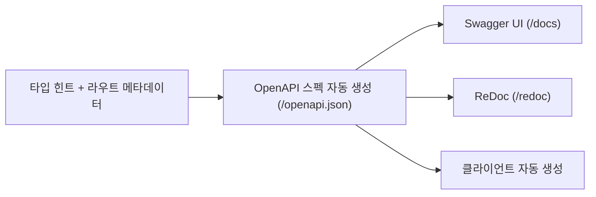

# 레슨 3. 자동 문서화 활용하기

## 이번 레슨에서 배울 내용

- OpenAPI와 Swagger UI / ReDoc
- 문서에 설명·태그·예제 추가하기
- 문서 UI를 켜고 끄는 방법

---

## 1. 자동 문서란?

FastAPI는 코드의 타입 힌트와 라우트 정보를 읽어 **OpenAPI 스펙**을 자동 생성합니다.  
그 스펙을 바탕으로 두 가지 UI를 제공합니다.

| URL | 이름 | 특징 |
|-----|------|------|
| `/docs` | Swagger UI | 브라우저에서 바로 API 호출 가능 |
| `/redoc` | ReDoc | 읽기 좋은 문서 형태 |
| `/openapi.json` | OpenAPI JSON | 스펙 원본 |

서버를 켠 뒤 http://127.0.0.1:8000/docs 를 열어 보세요.

---

## 2. 앱·엔드포인트에 메타데이터 추가

```python
from fastapi import FastAPI

app = FastAPI(
    title="학습용 Todo API",
    description="FastAPI 커리큘럼 실습용 API입니다.",
    version="0.1.0",
    contact={"name": "학습자", "email": "student@example.com"},
)


@app.get(
    "/items/{item_id}",
    summary="아이템 단건 조회",
    description="경로의 item_id로 아이템을 조회합니다.",
    tags=["items"],
)
def read_item(item_id: int):
    """아이템을 조회합니다.

    - **item_id**: 조회할 아이템 ID
    """
    return {"item_id": item_id}
```

문서에 반영되는 주요 옵션:

- `title`, `description`, `version` → 앱 전체
- `summary`, `description`, `tags` → 엔드포인트
- docstring → ReDoc/Swagger 설명에 표시

---

## 3. 응답 예제와 태그 그룹

```python
from fastapi import FastAPI
from pydantic import BaseModel, Field

app = FastAPI(
    openapi_tags=[
        {"name": "items", "description": "아이템 관련 API"},
        {"name": "users", "description": "사용자 관련 API"},
    ]
)


class Item(BaseModel):
    name: str = Field(examples=["노트북"])
    price: float = Field(examples=[1200000])


@app.post("/items", tags=["items"], response_model=Item)
def create_item(item: Item):
    return item
```

`/docs`에서 **Try it out** → 값을 넣고 → **Execute**로 바로 테스트할 수 있습니다.

---

## 4. 문서 UI 비활성화 (운영 환경)

운영에서는 문서를 숨기는 경우가 많습니다.

```python
app = FastAPI(
    docs_url=None,       # /docs 비활성
    redoc_url=None,      # /redoc 비활성
    openapi_url=None,    # /openapi.json 비활성
)
```

또는 환경별로 분기합니다.

```python
import os
from fastapi import FastAPI

is_prod = os.getenv("ENV") == "production"

app = FastAPI(
    docs_url=None if is_prod else "/docs",
    redoc_url=None if is_prod else "/redoc",
)
```

---

## 정리

- FastAPI는 OpenAPI 문서를 **코드로부터 자동 생성**합니다
- 개발 중에는 `/docs`로 API를 빠르게 검증하세요
- 운영에서는 필요에 따라 문서 URL을 비활성화하세요



---

## 연습 문제

1. 앱 `title`을 `"Bookstore API"`, `version`을 `"1.0.0"`으로 설정하세요.
2. `/books` GET에 `tags=["books"]`, `summary="도서 목록"`을 추가하세요.
3. 운영 환경에서만 `/docs`를 끄는 조건을 코드로 적어 보세요.

<details>
<summary>정답 예시</summary>

```python
import os
from fastapi import FastAPI

app = FastAPI(
    title="Bookstore API",
    version="1.0.0",
    docs_url=None if os.getenv("ENV") == "production" else "/docs",
)

@app.get("/books", tags=["books"], summary="도서 목록")
def list_books():
    return [{"title": "FastAPI 입문"}]
```

</details>
