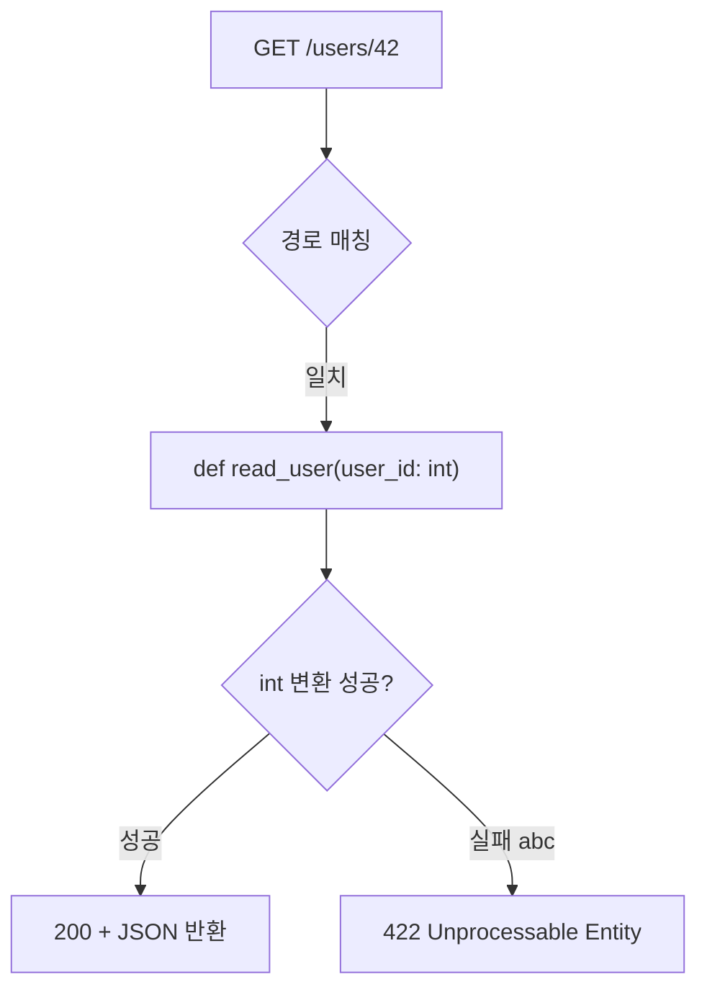
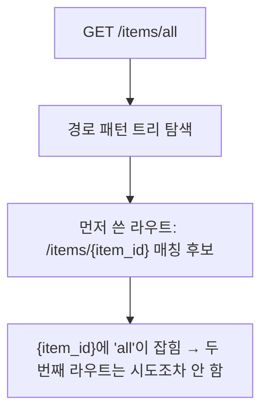

# 레슨 1. Path Parameters

## 이번 레슨에서 배울 내용

- URL 경로에 포함된 변수 받기
- 타입 변환과 자동 검증
- 여러 경로 매개변수 사용

---

## 1. Path Parameter란?

URL **경로의 일부**로 전달되는 값입니다.

```
GET /users/42
         └─ path parameter: 42
```

```python
from fastapi import FastAPI

app = FastAPI()


@app.get("/users/{user_id}")
def read_user(user_id: int):
    return {"user_id": user_id, "type": type(user_id).__name__}
```

- `user_id: int` → 문자열이 아니라 **정수로 변환**
- `"abc"`를 보내면 **422 Unprocessable Entity** (검증 실패)




---

## 2. 여러 경로 매개변수

```python
@app.get("/users/{user_id}/posts/{post_id}")
def read_post(user_id: int, post_id: int):
    return {"user_id": user_id, "post_id": post_id}
```

요청 예: `/users/1/posts/10`

---

## 3. 미리 정의된 값 (Enum)

특정 문자열만 허용하고 싶을 때 Enum을 사용합니다.

```python
from enum import Enum
from fastapi import FastAPI

app = FastAPI()


class ModelName(str, Enum):
    alexnet = "alexnet"
    resnet = "resnet"
    lenet = "lenet"


@app.get("/models/{model_name}")
def get_model(model_name: ModelName):
    return {"model_name": model_name, "message": f"{model_name.value} 선택됨"}
```

`/docs`에 선택 가능한 값이 드롭다운으로 표시됩니다.

---

## 4. 경로 순서 주의

고정 경로는 변수 경로보다 **먼저** 선언하세요.

```python
@app.get("/users/me")
def read_me():
    return {"user": "current"}


@app.get("/users/{user_id}")
def read_user(user_id: int):
    return {"user_id": user_id}
```

`/users/{user_id}`를 먼저 두면 `/users/me`의 `me`가 `user_id`로 해석될 수 있습니다.

### 라우트 매칭 순서

FastAPI는 경로 패턴 트리 depth를 사용해 라우트를 찾습니다.

```
/items/all       → depth 2
/items/{item_id} → depth 2 (같은 경로 깊이)
```

트리 탐색 시 먼저 쓴 라우트가 먼저 매칭 후보로 등록됩니다. 두 번째 라우트(`/items/all`)와 일치해도 첫 번째 라우트(`/items/{item_id}`)가 구조상 먼저 잡히면 두 번째는 시도조차 하지 않습니다. **고정된 경로는 맨 위에** 쓰세요.



---

## 정리

- Path Parameter는 URL 경로에 포함된 필수 값입니다
- 타입 힌트가 변환과 검증을 담당합니다
- 고정 경로를 변수 경로보다 위에 두세요

---

## 연습 문제

1. `/products/{product_id}`에서 `product_id`를 `int`로 받는 GET을 만드세요.
2. `/files/{file_path}`처럼 슬래시가 포함된 경로를 받으려면 어떻게 선언하나요?
3. `/categories/{name}`에서 `name`이 `"book" | "food" | "tech"`만 허용되게 만드세요.

<details>
<summary>정답 힌트</summary>

1. `@app.get("/products/{product_id}")` + `product_id: int`  
2. `@app.get("/files/{file_path:path}")`  
3. `str, Enum` 서브클래스로 허용 값 정의

</details>
