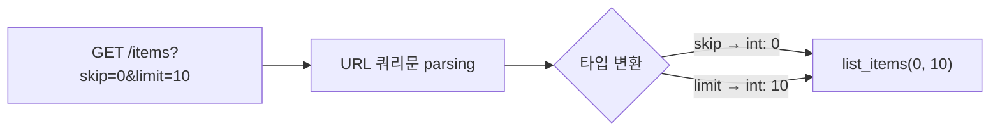

# 레슨 2. Query Parameters

## 이번 레슨에서 배울 내용

- 쿼리 문자열로 값 받기
- 필수 / 선택 / 기본값
- 리스트·불리언 쿼리

---

## 1. Query Parameter란?

`?` 뒤에 붙는 `key=value` 쌍입니다.

```
GET /items?skip=0&limit=10
         └─ query: skip=0, limit=10
```

```python
from fastapi import FastAPI

app = FastAPI()


@app.get("/items")
def list_items(skip: int = 0, limit: int = 10):
    return {"skip": skip, "limit": limit}
```

함수 인자 중 **경로에 없는 것**은 자동으로 쿼리 매개변수로 취급됩니다.

---

## 2. 필수 vs 선택

```python
from typing import Optional

# 기본값이 있으면 선택적
@app.get("/search")
def search(q: str | None = None):
    return {"q": q}


# 기본값이 없으면 필수
@app.get("/users")
def list_users(role: str):
    return {"role": role}
```

| 선언 | 의미 |
|------|------|
| `q: str` | 필수 쿼리 |
| `q: str = "all"` | 선택, 기본값 `"all"` |
| `q: str \| None = None` | 선택, 없으면 `None` |

---

## 3. 불리언 쿼리

```python
@app.get("/items")
def list_items(available: bool = True):
    return {"available": available}
```

다음이 모두 `True`로 인식됩니다: `1`, `true`, `True`, `on`, `yes`  
`False`: `0`, `false`, `False`, `off`, `no`

예: `/items?available=false`

---

## 4. 여러 값 (리스트)

```python
from fastapi import Query


@app.get("/items")
def list_items(tags: list[str] = Query(default=[])):
    return {"tags": tags}
```

요청 예:

```
/items?tags=python&tags=fastapi
→ {"tags": ["python", "fastapi"]}
```

---

## 5. Path + Query 함께 쓰기

```python
@app.get("/users/{user_id}/items")
def read_user_items(user_id: int, limit: int = 10, q: str | None = None):
    return {
        "user_id": user_id,
        "limit": limit,
        "q": q,
    }
```

요청 예: `/users/5/items?limit=3&q=book`

---

## 정리

- 경로에 없는 함수 인자 = Query Parameter
- 기본값 유무로 필수/선택이 결정됩니다
- 페이지네이션(`skip`, `limit`), 검색(`q`), 필터에 자주 사용합니다




---

## 연습 문제

1. `/posts?page=1&size=20` 형태의 목록 API를 만드세요. (`page`, `size` 기본값 포함)
2. 검색어 `keyword`는 선택, `sort`는 필수인 GET `/articles`를 만드세요.
3. `published: bool = True` 쿼리를 받아 그대로 반환하는 엔드포인트를 만드세요.

<details>
<summary>정답 예시</summary>

```python
@app.get("/posts")
def list_posts(page: int = 1, size: int = 20):
    return {"page": page, "size": size}


@app.get("/articles")
def list_articles(sort: str, keyword: str | None = None):
    return {"sort": sort, "keyword": keyword}


@app.get("/pubs")
def pubs(published: bool = True):
    return {"published": published}
```

</details>
