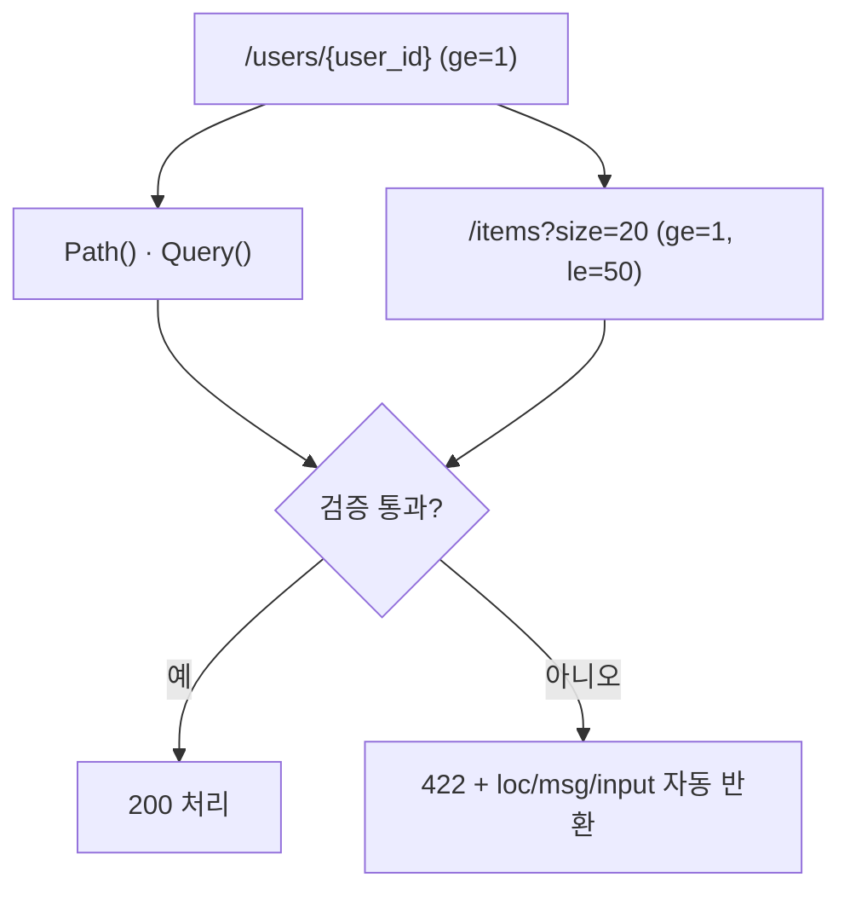

# 레슨 3. 검증과 메타데이터

## 이번 레슨에서 배울 내용

- `Path`, `Query`로 범위·길이 제한
- 설명·예제·별칭(alias) 추가
- 검증 실패 시 응답 이해하기

---

## 1. Path 검증

```python
from fastapi import FastAPI, Path

app = FastAPI()


@app.get("/items/{item_id}")
def read_item(
    item_id: int = Path(
        ge=1,
        le=1000,
        title="아이템 ID",
        description="1 이상 1000 이하의 정수",
    ),
):
    return {"item_id": item_id}
```

자주 쓰는 제약:

| 옵션 | 의미 |
|------|------|
| `ge` | greater or equal (≥) |
| `gt` | greater than (>) |
| `le` | less or equal (≤) |
| `lt` | less than (<) |

---

## 2. Query 검증

```python
from fastapi import Query


@app.get("/search")
def search(
    q: str = Query(
        min_length=2,
        max_length=50,
        pattern="^[a-zA-Z0-9가-힣 ]+$",
        description="검색어",
        examples=["fastapi"],
    ),
    limit: int = Query(default=10, ge=1, le=100),
):
    return {"q": q, "limit": limit}
```

| 옵션 | 의미 |
|------|------|
| `min_length` / `max_length` | 문자열 길이 |
| `pattern` | 정규식 |
| `default` | 기본값 |
| `examples` | 문서용 예제 |

---

## 3. 필수 Query를 명시적으로

```python
q: str = Query(..., min_length=1)  # ... = 필수
```

또는:

```python
q: str = Query(min_length=1)  # 기본값 없으면 필수
```

---

## 4. alias (별칭)

Python 변수명과 쿼리 키를 다르게 쓸 때 사용합니다.

```python
@app.get("/items")
def list_items(
    item_query: str | None = Query(default=None, alias="item-query"),
):
    return {"item_query": item_query}
```

요청: `/items?item-query=notebook`

---

## 5. 검증 실패 응답 (422)

잘못된 요청 시 FastAPI가 자동으로 상세 에러를 반환합니다.

```json
{
  "detail": [
    {
      "type": "greater_than_equal",
      "loc": ["path", "item_id"],
      "msg": "Input should be greater than or equal to 1",
      "input": "0"
    }
  ]
}
```

`loc`으로 어디서 실패했는지 확인할 수 있습니다.

---

## 정리

- `Path()`, `Query()`로 비즈니스 규칙을 선언적으로 검증합니다
- 문서를 위한 `description`, `examples`도 함께 넣을 수 있습니다
- 실패 시 422와 상세 `detail`가 자동 생성됩니다




---

## 연습 문제

1. `/users/{user_id}`에서 `user_id`는 1 이상만 허용하세요.
2. 쿼리 `page`는 기본 1, 최소 1 / `size`는 기본 20, 1~50으로 제한하세요.
3. 검색어 `q`는 최소 3글자, 필수 쿼리로 만드세요.

<details>
<summary>정답 예시</summary>

```python
from fastapi import FastAPI, Path, Query

app = FastAPI()


@app.get("/users/{user_id}")
def get_user(user_id: int = Path(ge=1)):
    return {"user_id": user_id}


@app.get("/list")
def list_all(
    page: int = Query(default=1, ge=1),
    size: int = Query(default=20, ge=1, le=50),
):
    return {"page": page, "size": size}


@app.get("/find")
def find(q: str = Query(min_length=3)):
    return {"q": q}
```

</details>
