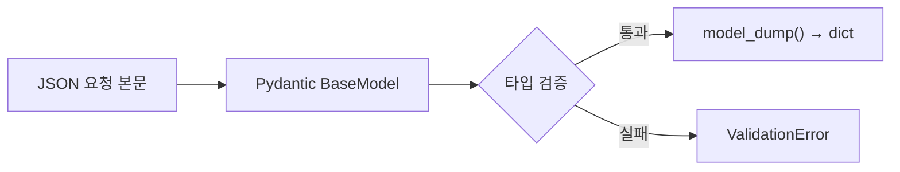

# 레슨 1. Pydantic 모델 기초

## 이번 레슨에서 배울 내용

- `BaseModel`이란 무엇인가
- 필드 타입과 기본값
- 모델 인스턴스 생성·직렬화

---

## 1. Pydantic이란?

Pydantic은 **데이터 검증과 설정 관리**를 위한 라이브러리입니다.  
FastAPI는 요청/응답 스키마에 Pydantic v2를 사용합니다.

```python
from pydantic import BaseModel


class User(BaseModel):
    id: int
    name: str
    email: str
    is_active: bool = True
```

---

## 2. 모델 사용하기

```python
user = User(id=1, name="김철수", email="kim@example.com")

print(user.name)           # 김철수
print(user.model_dump())   # dict로 변환
print(user.model_dump_json())  # JSON 문자열
```

잘못된 데이터가 들어오면 예외가 발생합니다.

```python
User(id="abc", name="Kim", email="x")  # ValidationError
```

---

## 3. 필드에 자주 쓰는 타입

| 타입 | 예 |
|------|-----|
| `str`, `int`, `float`, `bool` | 기본 스칼라 |
| `list[str]` | 문자열 리스트 |
| `dict[str, int]` | 딕셔너리 |
| `datetime` | 날짜/시간 |
| `EmailStr` | 이메일 (`email-validator` 필요) |
| `HttpUrl` | URL |

```python
from datetime import datetime
from pydantic import BaseModel, EmailStr, HttpUrl


class Profile(BaseModel):
    username: str
    email: EmailStr
    website: HttpUrl | None = None
    tags: list[str] = []
    created_at: datetime | None = None
```

`EmailStr` 사용 시:

```bash
pip install email-validator
```

---

## 4. Field로 메타데이터 추가

```python
from pydantic import BaseModel, Field


class Product(BaseModel):
    name: str = Field(min_length=1, max_length=100)
    price: float = Field(gt=0, description="판매 가격")
    stock: int = Field(default=0, ge=0)
```

---

## 정리

- `BaseModel` 상속으로 스키마를 선언합니다
- 타입 힌트 = 검증 규칙의 기본
- `model_dump()` / `model_dump_json()`으로 변환합니다




---

## 연습 문제

1. `Book` 모델: `title(str)`, `pages(int)`, `available(bool=True)`를 정의하세요.
2. `price`가 0보다 커야 하는 `Item` 모델을 `Field`로 만드세요.
3. 모델을 dict로 바꾸는 메서드 이름은 무엇인가요? (Pydantic v2)

<details>
<summary>정답</summary>

```python
from pydantic import BaseModel, Field

class Book(BaseModel):
    title: str
    pages: int
    available: bool = True

class Item(BaseModel):
    price: float = Field(gt=0)
```

3. `model_dump()`

</details>
