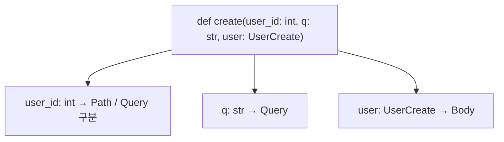

# 레슨 2. Request Body 다루기

## 이번 레슨에서 배울 내용

- POST/PUT에서 JSON Body 받기
- Path / Query / Body 조합
- 여러 Body 파라미터

---

## 1. 기본 Request Body

함수 인자에 `BaseModel` 타입을 넣으면 **요청 본문(JSON)** 으로 인식됩니다.

```python
from fastapi import FastAPI
from pydantic import BaseModel

app = FastAPI()


class Item(BaseModel):
    name: str
    description: str | None = None
    price: float
    tax: float | None = None


@app.post("/items")
def create_item(item: Item):
    total = item.price + (item.tax or 0)
    return {"item": item, "total": total}
```

요청 예:

```http
POST /items
Content-Type: application/json

{
  "name": "노트북",
  "price": 1500000,
  "tax": 150000
}
```

---

## 2. Path + Body

```python
@app.put("/items/{item_id}")
def update_item(item_id: int, item: Item):
    return {"item_id": item_id, "item": item}
```

- `item_id` → Path
- `item` → Body

---

## 3. Path + Query + Body

```python
@app.put("/items/{item_id}")
def update_item(
    item_id: int,
    item: Item,
    notify: bool = False,
):
    return {
        "item_id": item_id,
        "item": item,
        "notify": notify,
    }
```

규칙 요약:

| 인자 형태 | 위치 |
|-----------|------|
| 경로에 `{이름}` 존재 | Path |
| 단순 타입 (int, str…) | Query |
| Pydantic 모델 | Body |

---

## 4. 여러 모델 Body

두 모델을 받으면 JSON에 키가 생깁니다.

```python
class User(BaseModel):
    username: str
    email: str


@app.post("/offers")
def create_offer(item: Item, user: User):
    return {"item": item, "user": user}
```

요청 Body 예:

```json
{
  "item": {"name": "펜", "price": 1000},
  "user": {"username": "lee", "email": "lee@example.com"}
}
```

단일 객체로 합치려면 하나의 모델로 감싸는 편이 낫습니다.

```python
class Offer(BaseModel):
    item: Item
    user: User
```

---

## 5. 임베딩 Body (`embed`)

```python
from fastapi import Body


@app.post("/items")
def create_item(item: Item = Body(embed=True)):
    return item
```

요청이 `{"item": {...}}` 형태가 됩니다.

---

## 정리

- Pydantic 모델 인자 = JSON Request Body
- Path/Query/Body는 타입과 위치로 자동 구분됩니다
- 여러 모델보다 **하나의 요청 스키마**로 묶는 설계를 권장합니다




---

## 연습 문제

1. `POST /users` — `username`, `password`, `age`를 Body로 받아 그대로 반환하세요.
2. `PUT /users/{user_id}` — Path의 id와 Body의 사용자 정보를 함께 반환하세요.
3. 단순 `str` 인자와 Pydantic 모델 인자의 차이는 무엇인가요?

<details>
<summary>정답 힌트</summary>

```python
class UserCreate(BaseModel):
    username: str
    password: str
    age: int

@app.post("/users")
def create_user(user: UserCreate):
    return user

@app.put("/users/{user_id}")
def update_user(user_id: int, user: UserCreate):
    return {"user_id": user_id, "user": user}
```

3. 단순 타입은 Query(또는 Path), 모델은 Body로 해석됩니다.

</details>
