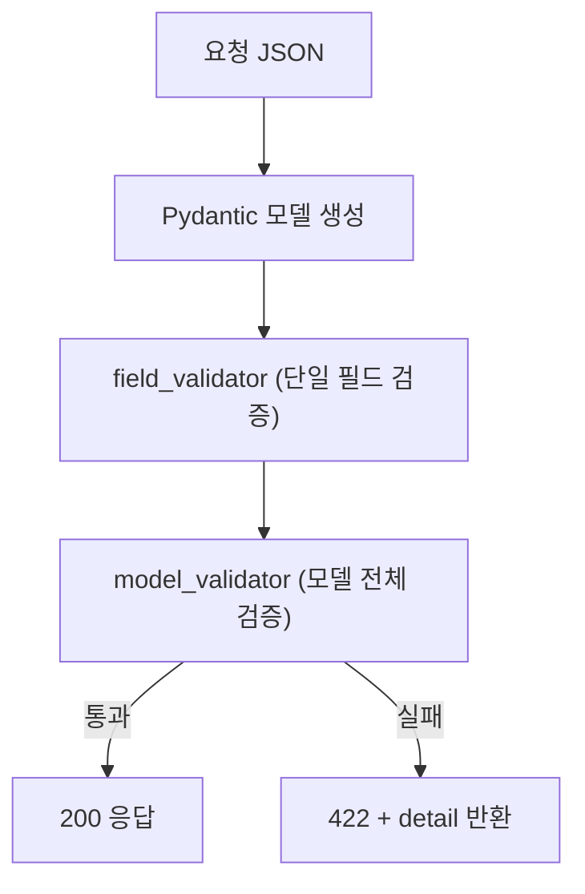

# 레슨 3. 중첩 모델과 고급 검증

## 이번 레슨에서 배울 내용

- 중첩(nested) 모델
- `field_validator` / `model_validator`
- 예제 데이터와 Config

---

## 1. 중첩 모델

```python
from pydantic import BaseModel, Field


class Image(BaseModel):
    url: str
    name: str


class Item(BaseModel):
    name: str
    description: str | None = None
    price: float = Field(gt=0)
    tags: list[str] = []
    images: list[Image] | None = None
```

요청 예:

```json
{
  "name": "카메라",
  "price": 500000,
  "tags": ["전자", "사진"],
  "images": [
    {"url": "https://example.com/1.jpg", "name": "전면"}
  ]
}
```

---

## 2. 필드 단위 검증

```python
from pydantic import BaseModel, field_validator


class User(BaseModel):
    username: str
    password: str

    @field_validator("username")
    @classmethod
    def username_alphanumeric(cls, v: str) -> str:
        if not v.isalnum():
            raise ValueError("username은 영문/숫자만 가능합니다")
        return v

    @field_validator("password")
    @classmethod
    def password_strength(cls, v: str) -> str:
        if len(v) < 8:
            raise ValueError("비밀번호는 8자 이상이어야 합니다")
        return v
```

---

## 3. 모델 단위 검증

여러 필드를 함께 볼 때 사용합니다.

```python
from pydantic import BaseModel, model_validator


class DateRange(BaseModel):
    start: int
    end: int

    @model_validator(mode="after")
    def check_range(self):
        if self.end < self.start:
            raise ValueError("end는 start 이상이어야 합니다")
        return self
```

---

## 4. 예제와 JSON Schema 커스터마이즈

```python
from pydantic import BaseModel, ConfigDict, Field


class Item(BaseModel):
    model_config = ConfigDict(
        json_schema_extra={
            "examples": [
                {
                    "name": "노트북",
                    "price": 1200000,
                    "tags": ["전자"],
                }
            ]
        }
    )

    name: str
    price: float = Field(gt=0)
    tags: list[str] = []
```

`/docs`의 Example Value에 반영됩니다.

---

## 5. 실무 팁

1. **Create / Update / Read** 모델을 분리하세요  
   - `UserCreate`(비밀번호 포함)  
   - `UserUpdate`(부분 수정)  
   - `UserRead`(비밀번호 제외)
2. 민감 정보는 응답 모델에서 제외합니다 (다음 단원)
3. 검증 메시지는 사용자가 이해하기 쉽게 작성합니다

---

## 정리

- 모델 안에 모델(또는 모델 리스트)을 넣어 중첩 구조를 표현합니다
- `field_validator`는 단일 필드, `model_validator`는 교차 검증에 사용합니다
- 입력/출력 스키마를 분리하는 습관이 중요합니다




---

## 연습 문제

1. `Address(street, city)`와 `Customer(name, address: Address)` 중첩 모델을 만드세요.
2. `price`와 `discount_price`가 있을 때, 할인가가 정가보다 작도록 `model_validator`를 작성하세요.
3. `tags`의 각 항목이 빈 문자열이 아니도록 검증하세요.

<details>
<summary>정답 예시</summary>

```python
from pydantic import BaseModel, field_validator, model_validator

class Address(BaseModel):
    street: str
    city: str

class Customer(BaseModel):
    name: str
    address: Address

class Deal(BaseModel):
    price: float
    discount_price: float

    @model_validator(mode="after")
    def check_discount(self):
        if self.discount_price >= self.price:
            raise ValueError("할인가는 정가보다 작아야 합니다")
        return self

class Tagged(BaseModel):
    tags: list[str]

    @field_validator("tags")
    @classmethod
    def no_empty_tags(cls, v: list[str]) -> list[str]:
        if any(not t.strip() for t in v):
            raise ValueError("빈 태그는 허용되지 않습니다")
        return v
```

</details>
