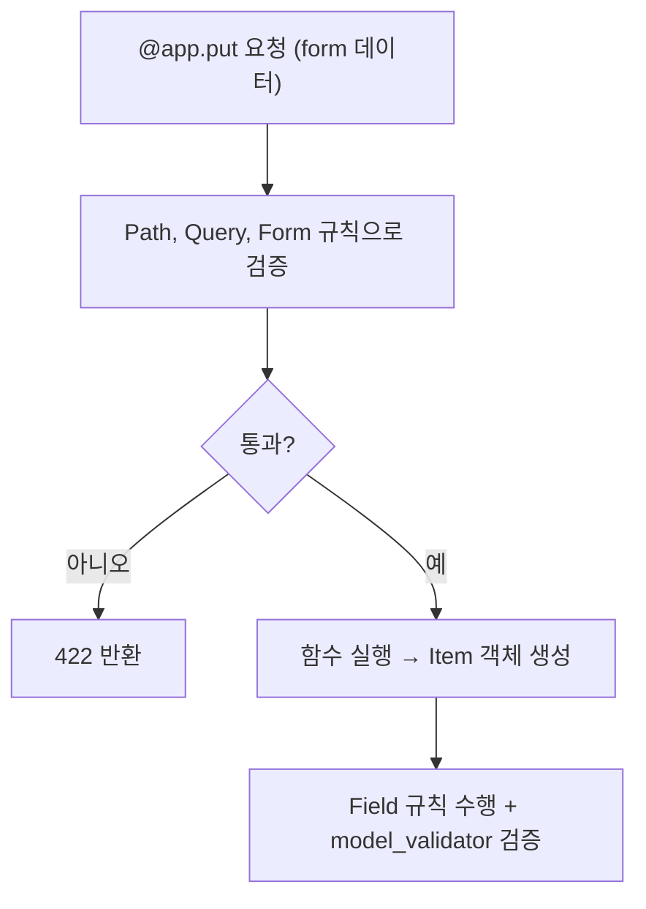

# 레슨 4. Form 데이터 처리

## 이번 레슨에서 배울 내용

- `Form()`으로 폼 데이터를 받는 방법
- 필수 Form(`Form(...)`)과 선택 Form, `Annotated` 조합
- Path/Query/Form을 한 요청에서 함께 검증하기

---

## 1. Form 데이터 받기

HTML 폼(`application/x-www-form-urlencoded`)으로 넘어오는 값은 `Form()`으로 받습니다.

```python
from fastapi import FastAPI, Form
from typing import Annotated

app = FastAPI()


@app.post("/login")
def login(
    username: str = Form(),
    email: str = Form(None),
    addr: Annotated[str, Form()] = None,
):
    return {"username": username, "email": email, "addr": addr}
```

- `Form()` → 필수 (값이 반드시 있어야 함)
- `Form(None)` / `Annotated[str, Form()] = None` → 선택

```python
@app.post("/login2")
def login2(
    username: str = Form(...),   # ellipsis(...) — 명시적으로 필수
    email: str = Form(...),
    addr: Annotated[str | None, Form()] = None,
):
    return {"username": username, "email": email, "addr": addr}
```

`...`(ellipsis)은 "이 값은 필수다"를 명시적으로 드러냅니다.

---

## 2. Path / Query / Form 한 번에 검증

```python
from fastapi import FastAPI, Path, Query, Form
from pydantic import BaseModel, Field, model_validator, ValidationError
from typing import Annotated

app = FastAPI()


class Item(BaseModel):
    name: str = Field(..., min_length=3, max_length=30)
    desc: str = Field(None, max_length=500)
    price: float = Field(..., ge=0)
    tax: float | None = None

    @model_validator(mode="after")
    def check(self):
        if self.tax > self.price:
            raise ValueError("tax가 price보다 크면 안 돼")
        return self


@app.put("/items/{item_id}")
def items1(
    item_id: int = Path(..., gt=0),
    q1: str = Query(..., max_length=50),
    name: str = Form(..., min_length=2, max_length=30),
    desc: Annotated[str, Form(max_length=100)] = None,
    price: float = Form(..., ge=0),
    tax: Annotated[float, Form()] = None,
):
    try:
        item = Item(name=name, desc=desc, price=price, tax=tax)
        return item
    except ValidationError as e:
        raise e
```

검증 순서:



검증 도구는 네 가지입니다.

| 도구 | 범위 |
|------|------|
| `Path()` | URL 경로 |
| `Query()` | 쿼리 문자열 |
| `Form()` | 폼 (데이터를 입력받아서 검증) |
| `Field()` | Pydantic 모델 클래스 안 검증 |

---

## 정리

- `Form()`는 HTML 폼 데이터를 받는 표준 방법입니다
- 필수/선택은 `Form()`, `Form(...)`, `Form(None)`로 구분합니다
- Path/Query/Form은 요청 단계에서, Field/Validator는 모델 단계에서 검증됩니다

---

## 연습 문제

1. `POST /register` — `username`, `email`, `phone`을 Form으로 받아 그대로 반환하세요.
2. username은 최소 3자, email은 EmailStr, password는 최소 8자 + `pattern='^[a-zA-Z0-9_]+$'`인 UserCreate 모델을 `/register`에서 사용하세요.
3. `POST /login` — username, password를 Form으로 받아 성공 시 `{"username": ..., "message": "로그인 성공"}`을 반환하세요.
</content>
