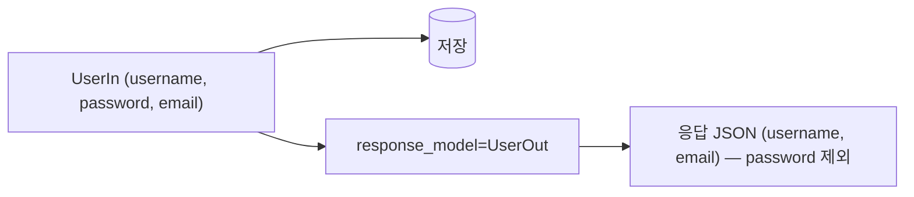

# 레슨 1. Response Model

## 이번 레슨에서 배울 내용

- `response_model`의 역할
- 입력/출력 모델 분리
- 응답 필터링과 `response_model_exclude`

---

## 1. 왜 response_model이 필요한가?

함수가 dict나 ORM 객체를 반환해도, **클라이언트로 나갈 형태**를 스키마로 고정할 수 있습니다.  
비밀번호처럼 나가면 안 되는 필드를 막을 때 특히 중요합니다.

```python
from fastapi import FastAPI
from pydantic import BaseModel, EmailStr

app = FastAPI()


class UserIn(BaseModel):
    username: str
    password: str
    email: EmailStr


class UserOut(BaseModel):
    username: str
    email: EmailStr


@app.post("/users", response_model=UserOut)
def create_user(user: UserIn):
    # password는 저장만 하고 응답에는 포함되지 않음
    return user
```

`UserIn`을 그대로 반환해도 `response_model=UserOut` 때문에 `password`가 제거됩니다.

---

## 2. 목록 응답

```python
@app.get("/users", response_model=list[UserOut])
def list_users():
    return [
        {"username": "a", "email": "a@example.com", "password": "secret"},
        {"username": "b", "email": "b@example.com", "password": "secret"},
    ]
```

---

## 3. 포함/제외 옵션

```python
@app.get(
    "/users/me",
    response_model=UserOut,
    response_model_exclude_unset=True,  # 설정 안 된 필드 제외
)
def read_me():
    return {"username": "me", "email": "me@example.com"}
```

| 옵션 | 효과 |
|------|------|
| `response_model_exclude_unset` | 미설정 필드 제외 |
| `response_model_exclude_none` | `None` 필드 제외 |
| `response_model_include` | 포함할 필드만 |
| `response_model_exclude` | 제외할 필드 |

---

## 4. 공통 베이스 모델 패턴

```python
class UserBase(BaseModel):
    username: str
    email: EmailStr


class UserCreate(UserBase):
    password: str


class UserRead(UserBase):
    id: int
```

중복을 줄이고 Create/Read를 명확히 나눕니다.

---

## 정리

- `response_model`은 **보안·문서·일관성**을 위한 핵심 도구입니다
- 입력 모델과 출력 모델로 분리하세요
- ORM/dict를 반환해도 스키마에 맞게 필터링됩니다




---

## 연습 문제

1. `ProductCreate(name, price, secret_code)`와 `ProductRead(name, price)`를 만들고 POST에 `response_model`을 적용하세요.
2. 비밀번호가 응답에 나가지 않는 이유를 한 문장으로 설명하세요.
3. `list[UserOut]` 응답 모델의 의미는 무엇인가요?

<details>
<summary>정답 힌트</summary>

2. `response_model`이 출력 스키마에 없는 필드를 제거하기 때문입니다.  
3. 사용자 객체 배열을 반환한다는 의미입니다.

</details>
