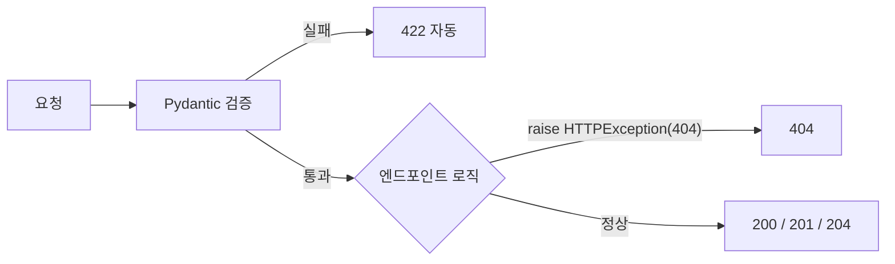

# 레슨 2. Status Codes

## 이번 레슨에서 배울 내용

- 자주 쓰는 HTTP 상태 코드
- FastAPI에서 상태 코드 지정
- `Response`, `JSONResponse` 사용

---

## 1. 자주 쓰는 상태 코드

| 코드 | 의미 | 언제 |
|------|------|------|
| 200 | OK | 일반 성공 |
| 201 | Created | 리소스 생성 |
| 204 | No Content | 성공했지만 본문 없음 (삭제 등) |
| 400 | Bad Request | 잘못된 요청 |
| 401 | Unauthorized | 인증 필요 |
| 403 | Forbidden | 권한 없음 |
| 404 | Not Found | 없음 |
| 422 | Unprocessable Entity | 검증 실패 (FastAPI 기본) |
| 500 | Internal Server Error | 서버 오류 |

---

## 2. 데코레이터에서 지정

```python
from fastapi import FastAPI, status
from pydantic import BaseModel

app = FastAPI()


class Item(BaseModel):
    name: str


@app.post(
    "/items",
    status_code=status.HTTP_201_CREATED,
    response_model=Item,
)
def create_item(item: Item):
    return item
```

숫자 `201` 대신 `status.HTTP_201_CREATED`를 쓰면 가독성이 좋습니다.

---

## 3. 204 No Content

```python
from fastapi import Response


@app.delete("/items/{item_id}", status_code=status.HTTP_204_NO_CONTENT)
def delete_item(item_id: int):
    # DB에서 삭제했다고 가정
    return Response(status_code=status.HTTP_204_NO_CONTENT)
```

본문 없이 상태 코드만 반환합니다.

---

## 4. 응답 헤더 추가

```python
from fastapi import Response


@app.get("/headers")
def get_headers(response: Response):
    response.headers["X-Custom-Header"] = "learning"
    return {"ok": True}
```

---

## 5. JSONResponse 직접 반환

```python
from fastapi.responses import JSONResponse


@app.post("/legacy")
def legacy():
    return JSONResponse(
        content={"message": "created"},
        status_code=201,
    )
```

특별한 경우가 아니면 `status_code=` + `response_model` 조합을 권장합니다.

---

## 정리

- 생성은 201, 삭제는 204처럼 **의미에 맞는 코드**를 사용하세요
- `fastapi.status` 상수를 사용하면 문서와 코드가 명확해집니다
- 검증 실패는 FastAPI가 422를 자동 처리합니다




---

## 연습 문제

1. `POST /books`가 201을 반환하도록 작성하세요.
2. `DELETE /books/{id}`가 204를 반환하도록 작성하세요.
3. 401과 403의 차이를 설명해 보세요.

<details>
<summary>정답 힌트</summary>

3. 401 = 로그인(인증)이 필요함 / 403 = 로그인했지만 권한이 없음

</details>
