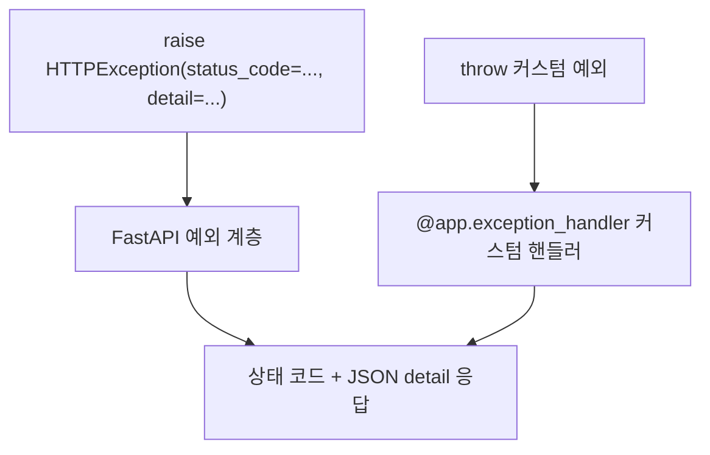

# 레슨 3. 에러 처리

## 이번 레슨에서 배울 내용

- `HTTPException`으로 에러 응답
- 커스텀 exception handler
- 일관된 에러 포맷 만들기

---

## 1. HTTPException

```python
from fastapi import FastAPI, HTTPException, status

app = FastAPI()

ITEMS = {1: {"name": "펜"}}


@app.get("/items/{item_id}")
def read_item(item_id: int):
    if item_id not in ITEMS:
        raise HTTPException(
            status_code=status.HTTP_404_NOT_FOUND,
            detail=f"item_id={item_id}를 찾을 수 없습니다",
        )
    return ITEMS[item_id]
```

응답 예:

```json
{"detail": "item_id=99를 찾을 수 없습니다"}
```

헤더도 추가할 수 있습니다.

```python
raise HTTPException(
    status_code=401,
    detail="인증이 필요합니다",
    headers={"WWW-Authenticate": "Bearer"},
)
```

---

## 2. 커스텀 예외

```python
from fastapi import Request
from fastapi.responses import JSONResponse


class ItemNotFoundError(Exception):
    def __init__(self, item_id: int):
        self.item_id = item_id


@app.exception_handler(ItemNotFoundError)
async def item_not_found_handler(request: Request, exc: ItemNotFoundError):
    return JSONResponse(
        status_code=404,
        content={
            "error": "ITEM_NOT_FOUND",
            "item_id": exc.item_id,
            "path": str(request.url),
        },
    )


@app.get("/v2/items/{item_id}")
def read_item_v2(item_id: int):
    if item_id not in ITEMS:
        raise ItemNotFoundError(item_id)
    return ITEMS[item_id]
```

---

## 3. 요청 검증 에러 커스터마이즈

```python
from fastapi.exceptions import RequestValidationError


@app.exception_handler(RequestValidationError)
async def validation_handler(request: Request, exc: RequestValidationError):
    return JSONResponse(
        status_code=422,
        content={
            "error": "VALIDATION_ERROR",
            "details": exc.errors(),
        },
    )
```

팀에서 정한 에러 포맷이 있을 때 유용합니다.

---

## 4. 실무 가이드

1. 비즈니스 오류는 `HTTPException` 또는 도메인 예외로 표현
2. `detail`에는 내부 스택트레이스가 아닌 **안전한 메시지**만
3. 예상치 못한 500은 로그로 남기고, 클라이언트에는 일반 메시지
4. 에러 코드(`ITEM_NOT_FOUND` 등)를 문자열로 주면 클라이언트가 분기하기 쉽습니다

---

## 정리

- `raise HTTPException(...)`이 가장 기본적인 에러 응답 방법입니다
- 반복되는 패턴은 커스텀 예외 + handler로 통일하세요
- 클라이언트용 메시지와 서버 로그를 분리하세요




---

## 연습 문제

1. 없는 사용자를 조회하면 404 + `"User not found"`를 반환하세요.
2. 나이(`age`)가 0 미만이면 400을 반환하는 로직을 작성하세요.
3. 커스텀 예외 `PermissionDenied`와 handler를 만들어 보세요.

<details>
<summary>정답 예시</summary>

```python
@app.get("/users/{user_id}")
def get_user(user_id: int):
    if user_id != 1:
        raise HTTPException(status_code=404, detail="User not found")
    return {"id": 1, "name": "Kim"}


@app.post("/check-age")
def check_age(age: int):
    if age < 0:
        raise HTTPException(status_code=400, detail="age must be >= 0")
    return {"age": age}
```

</details>
