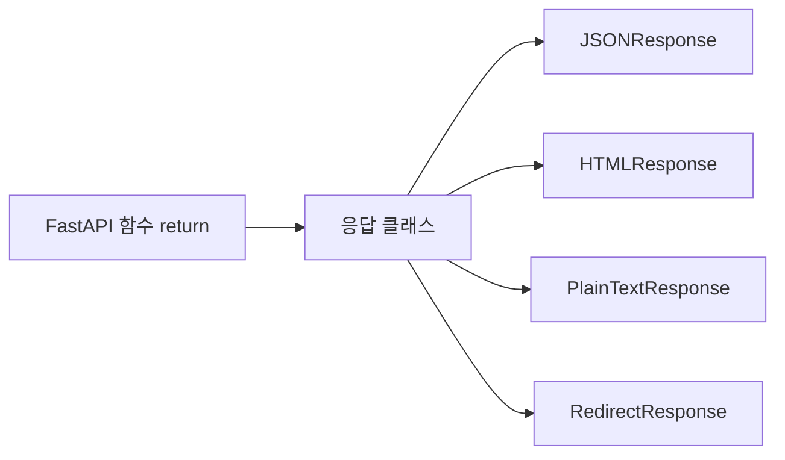

# 레슨 4. Response 클래스

## 이번 레슨에서 배울 내용

- HTTP 응답 구조
- JSONResponse / HTMLResponse / RedirectResponse / PlainTextResponse

---

## 1. HTTP 응답 구조

요청에 따라 보내는 메시지로, 처리 상태와 content를 담습니다.

1. **상태 라인**: HTTP version, 상태 코드
2. **Response Headers**: Content-Type, 서버 정보 등
3. **Response Body**: HTML, JSON 등 실제 데이터

FastAPI는 응답 클래스를 지정해 body의 형태를 바꿀 수 있습니다.



---

## 2. JSONResponse

dict / Pydantic 모델을 JSON 문자열로 변환해 바디에 담아 전송합니다.

```python
from fastapi import FastAPI, status
from fastapi.responses import JSONResponse

app = FastAPI()

# 1. 클라이언트가 /resp/3?msg=hello 요청
# 2. resp 함수 실행
# 3. 함수가 json 응답을 만들어 반환
# 4. 클라이언트는 상태 코드 200과 json 데이터 받음
@app.get("/resp/{stu_id}", response_class=JSONResponse)
def resp(stu_id: int, msg: str | None = None):
    return JSONResponse(
        content={"con": "fastapi", "stu_id": stu_id, "msg": msg},
        status_code=status.HTTP_200_OK,
    )
```

`response_class=JSONResponse`는 기본값입니다. dict를 반환하면 자동으로 JSON으로 변환됩니다.

---

## 3. HTMLResponse

문자열 HTML을 그대로 바디에 담습니다.

```python
from fastapi import FastAPI, status
from fastapi.responses import HTMLResponse

app = FastAPI()

@app.get("/html/{stu_id}", response_class=HTMLResponse)
def html1(stu_id: int, q: str | None = None):
    content1 = f"""
        <html>
            <body>
                <h1>FastAPI</h1>
                <p>stu_id:{stu_id}</p>
                <p>q:{q}</p>
            </body>
        </html>
    """
    return HTMLResponse(content=content1, status_code=status.HTTP_200_OK)
```

---

## 4. RedirectResponse

주소 강제 이동입니다.

```python
from fastapi import FastAPI, status, Form
from fastapi.responses import RedirectResponse

# GET -> GET: 302 상태 코드 생략 가능
@app.get("/redirect")
def redirect1(msg: str | None = None):
    return RedirectResponse(url=f"/html/4?q={msg}", status_code=status.HTTP_302_FOUND)

# POST -> GET: 상태 코드를 적어야 함
@app.post("/redirect2")
def redirect2(stu_id: int = Form(), q: str = Form()):
    return RedirectResponse(url=f"/html/{stu_id}?q={q}", status_code=status.HTTP_302_FOUND)
```

| 요청 | 특징 |
|------|------|
| GET → GET | 302 상태 코드 생략 가능 |
| POST → GET | 상태 코드를 명시해야 함 |

---

## 5. PlainTextResponse

```python
from fastapi.responses import PlainTextResponse

@app.get("/plaintext", response_class=PlainTextResponse)
def plaintext():
    return "Hello, World!"
```

---

## 연습 문제

1. `/go-to-home` GET 요청 시 `/home`으로 리다이렉트하세요 (GET 리다이렉트는 기본 상태 코드 302 사용).
2. `/submit-form` POST로 form 데이터(username, age)를 받아 `/user-info/{username}?age={age}`로 리다이렉트하세요.
3. `/user-info/{username}` GET에서 HTMLResponse로 사용자 이름과 나이를 표시하세요.
4. `/plaintext` GET이 PlainTextResponse로 `"Hello, World!"`를 plain text로 반환하도록 하세요.
5. `/json` GET이 JSON으로 `{"message": "Hello, JSON!"}`를 반환하도록 하세요.

<details>
<summary>정답 예시</summary>

```python
from fastapi import FastAPI, Form
from fastapi.responses import HTMLResponse, RedirectResponse, PlainTextResponse

app = FastAPI()

@app.get("/home")
def home():
    return {"home": True}

@app.get("/go-to-home")
def go_home():
    return RedirectResponse(url="/home")

@app.post("/submit-form")
def submit_form(username: str = Form(), age: int = Form()):
    return RedirectResponse(url=f"/user-info/{username}?age={age}")

@app.get("/user-info/{username}")
def user_info(username: str, age: int, q: str | None = None):
    content = f"<html><body><h1>{username}</h1><p>age: {age}</p></body></html>"
    return HTMLResponse(content=content)

@app.get("/plaintext", response_class=PlainTextResponse)
def plaintext():
    return "Hello, World!"

@app.get("/json")
def json():
    return {"message": "Hello, JSON!"}
```

</details>
