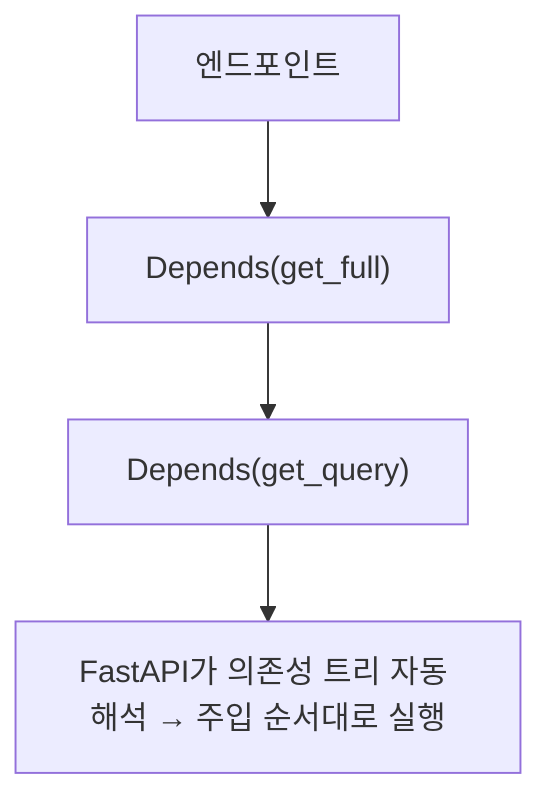

# 레슨 1. Depends 기초

## 이번 레슨에서 배울 내용

- 의존성 주입이란?
- `Depends` 기본 사용법
- 재사용과 테스트 용이성

---

## 1. 왜 의존성인가?

여러 엔드포인트에서 **같은 로직**이 반복될 때:

- 공통 헤더 검사
- 페이지네이션 파라미터
- DB 세션 생성/종료
- 현재 로그인 사용자 조회

이런 코드를 함수로 추출해 `Depends`로 주입하면 깔끔해집니다.

---

## 2. 가장 단순한 예

```python
from fastapi import Depends, FastAPI

app = FastAPI()


def common_parameters(skip: int = 0, limit: int = 100):
    return {"skip": skip, "limit": limit}


@app.get("/items")
def read_items(commons: dict = Depends(common_parameters)):
    return commons


@app.get("/users")
def read_users(commons: dict = Depends(common_parameters)):
    return commons
```

`/items?skip=10&limit=5` → `common_parameters`가 먼저 실행되고 결과가 `commons`로 들어옵니다.

---

## 3. 타입 힌트와 함께

```python
from typing import Annotated

CommonsDep = Annotated[dict, Depends(common_parameters)]


@app.get("/products")
def read_products(commons: CommonsDep):
    return commons
```

`Annotated`를 쓰면 시그니처가 짧아지고 재사용하기 좋습니다. (FastAPI 권장 스타일)

---

## 4. 의존성은 서브 의존성을 가질 수 있음

```python
def get_query(q: str | None = None):
    return q


def get_full(q: str | None = Depends(get_query), skip: int = 0):
    return {"q": q, "skip": skip}


@app.get("/search")
def search(params: dict = Depends(get_full)):
    return params
```

FastAPI가 의존성 트리를 자동으로 해석합니다.

---

## 정리

- `Depends(함수)` = “이 함수 결과를 주입해 주세요”
- 공통 로직 재사용, 테스트 시 mock 교체에 유리합니다
- `Annotated[..., Depends(...)]` 패턴을 익혀 두세요



---

## 연습 문제

1. `page`, `size`를 묶어 반환하는 `get_pagination` 의존성을 만드세요.
2. 두 개의 엔드포인트에서 그 의존성을 사용하세요.
3. `Annotated`로 타입 별칭을 정의해 보세요.
