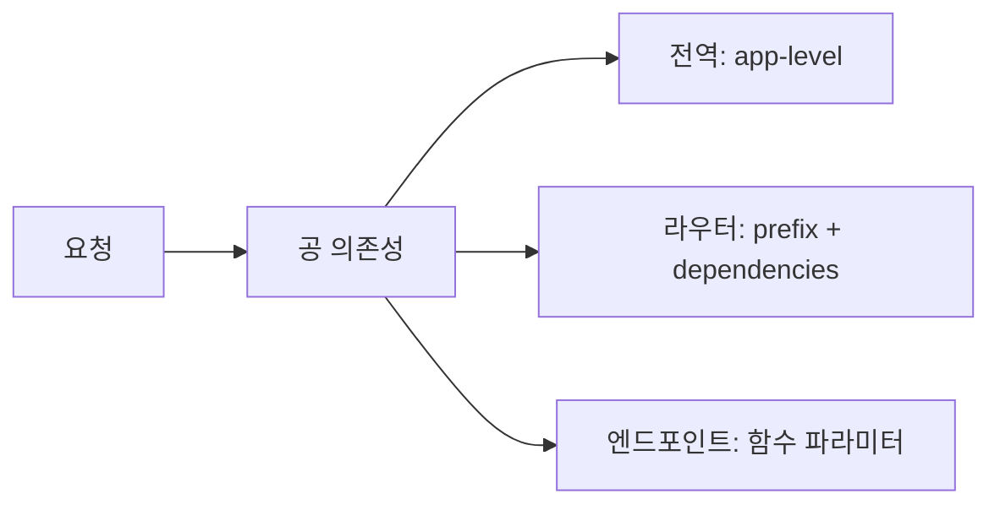

# 레슨 2. 실용 의존성 패턴

## 이번 레슨에서 배울 내용

- 헤더/토큰 검증 의존성
- `yield`로 리소스 정리 (DB 세션)
- 라우터/앱 레벨 의존성

---

## 1. 헤더에서 API 키 검사

```python
from typing import Annotated
from fastapi import Depends, FastAPI, Header, HTTPException, status

app = FastAPI()


def verify_api_key(x_api_key: Annotated[str | None, Header()] = None):
    if x_api_key != "secret-key":
        raise HTTPException(
            status_code=status.HTTP_401_UNAUTHORIZED,
            detail="Invalid API Key",
        )
    return x_api_key


@app.get("/private")
def private_data(api_key: Annotated[str, Depends(verify_api_key)]):
    return {"message": "비밀 데이터", "key": api_key}
```

요청 헤더: `X-API-Key: secret-key`

---

## 2. yield 의존성 (정리 보장)

```python
from collections.abc import Generator


def get_db() -> Generator[dict, None, None]:
    db = {"conn": "opened"}  # 실제로는 Session()
    try:
        yield db
    finally:
        db["conn"] = "closed"  # 응답 후 정리
        print("DB closed")


@app.get("/db-demo")
def db_demo(db: Annotated[dict, Depends(get_db)]):
    return db
```

요청 처리 중에는 `yield` 이전까지, 응답 후에는 `finally`가 실행됩니다.  
SQLAlchemy 세션 패턴의 핵심입니다.

---

## 3. 앱 전역 의존성

모든 경로에 공통 적용:

```python
app = FastAPI(dependencies=[Depends(verify_api_key)])
```

특정 라우터에만:

```python
from fastapi import APIRouter

router = APIRouter(
    prefix="/admin",
    dependencies=[Depends(verify_api_key)],
)
```

---

## 4. 현재 사용자 패턴 (맛보기)

```python
def get_current_user(token: Annotated[str | None, Header()] = None):
    if not token:
        raise HTTPException(status_code=401, detail="Not authenticated")
    return {"username": "kim", "token": token}


CurrentUser = Annotated[dict, Depends(get_current_user)]


@app.get("/me")
def read_me(user: CurrentUser):
    return user
```

인증 단원에서 JWT와 연결합니다.

---

## 정리

- 인증·권한·DB 세션은 의존성으로 빼는 것이 표준입니다
- `yield`로 열기/닫기를 안전하게 처리하세요
- 전역 vs 라우터 vs 엔드포인트 단위로 적용 범위를 조절하세요




---

## 연습 문제

1. `X-Request-Id` 헤더를 필수로 받는 의존성을 만드세요.
2. `get_db`처럼 `yield`를 쓰는 가짜 DB 의존성을 작성하세요.
3. `/admin` 라우터에만 API 키 검사를 거세요.
