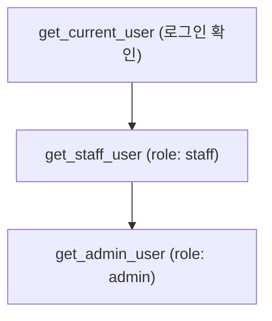

# 레슨 3. 체이닝과 클래스 의존성

## 이번 레슨에서 배울 내용

- 의존성 체이닝으로 권한 계층 만들기
- 호출 가능한 클래스(`__call__`) 의존성
- 캐시(`use_cache`) 개념

---

## 1. 체이닝: 로그인 → 관리자

```python
from typing import Annotated
from fastapi import Depends, FastAPI, HTTPException

app = FastAPI()


def get_current_user(token: str = "user-token"):
    if token == "user-token":
        return {"username": "kim", "role": "user"}
    if token == "admin-token":
        return {"username": "admin", "role": "admin"}
    raise HTTPException(status_code=401, detail="Invalid token")


def get_admin_user(user: Annotated[dict, Depends(get_current_user)]):
    if user["role"] != "admin":
        raise HTTPException(status_code=403, detail="Admin only")
    return user


@app.get("/profile")
def profile(user: Annotated[dict, Depends(get_current_user)]):
    return user


@app.get("/admin/stats")
def admin_stats(admin: Annotated[dict, Depends(get_admin_user)]):
    return {"ok": True, "admin": admin["username"]}
```

`get_admin_user`가 `get_current_user`에 의존 → **체이닝**.

---

## 2. 클래스 기반 의존성

설정값을 가진 재사용 컴포넌트에 유용합니다.

```python
class Pagination:
    def __init__(self, default_limit: int = 10, max_limit: int = 100):
        self.default_limit = default_limit
        self.max_limit = max_limit

    def __call__(self, skip: int = 0, limit: int | None = None):
        if limit is None:
            limit = self.default_limit
        if limit > self.max_limit:
            limit = self.max_limit
        return {"skip": skip, "limit": limit}


pagination = Pagination(default_limit=20, max_limit=50)


@app.get("/items")
def list_items(params: Annotated[dict, Depends(pagination)]):
    return params
```

인스턴스를 `Depends(pagination)`에 넘기면 `__call__`이 실행됩니다.

---

## 3. 같은 의존성의 중복 호출

한 요청 안에서 동일 의존성은 기본적으로 **한 번만** 실행되고 결과가 재사용됩니다.

```python
def costly_dep():
    print("called")
    return {"v": 1}


def dep_a(c=Depends(costly_dep)):
    return c


def dep_b(c=Depends(costly_dep)):
    return c


@app.get("/once")
def once(a=Depends(dep_a), b=Depends(dep_b)):
    return {"a": a, "b": b}
```

`called`는 한 번만 출력됩니다. (`use_cache=True`가 기본)

---

## 4. 설계 팁

1. **얇은 엔드포인트**: 라우트 함수는 조율만, 로직은 의존성/서비스로
2. **명시적 권한**: `get_current_user` → `get_admin_user`처럼 단계화
3. **테스트**: 테스트 시 `app.dependency_overrides[get_db] = ...`로 교체

```python
app.dependency_overrides[get_current_user] = lambda: {"username": "test", "role": "admin"}
```

---

## 정리

- 체이닝으로 인증/권한 계층을 만들 수 있습니다
- 클래스는 설정 가능한 의존성에 적합합니다
- 요청당 의존성 결과는 캐시되어 중복 실행을 줄입니다



---

## 연습 문제

1. `get_current_user` → `get_staff_user`(role이 staff/admin) 체인을 만드세요.
2. `SearchParams` 클래스 의존성으로 `q`, `limit`을 묶으세요.
3. `dependency_overrides`가 필요한 이유를 설명해 보세요.
