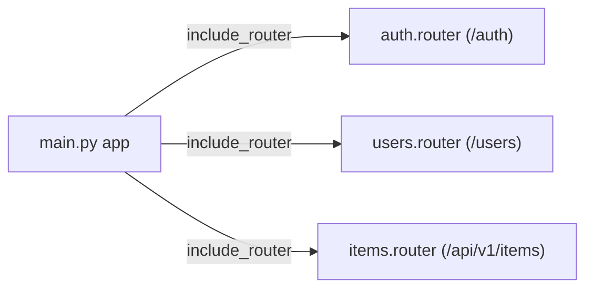

# 레슨 1. APIRouter

## 이번 레슨에서 배울 내용

- `APIRouter`로 라우트 분리
- `prefix`, `tags`, `dependencies`
- `include_router`로 조립

---

## 1. 한 파일에 모든 라우트가 있으면?

기능이 늘수록 `main.py`가 비대해집니다.  
도메인(users, items, auth…)마다 라우터 모듈로 나눕니다.

```python
# routers/items.py
from fastapi import APIRouter

router = APIRouter(prefix="/items", tags=["items"])


@router.get("/")
def list_items():
    return [{"id": 1, "name": "펜"}]


@router.get("/{item_id}")
def get_item(item_id: int):
    return {"id": item_id}
```

```python
# main.py
from fastapi import FastAPI
from routers import items

app = FastAPI()
app.include_router(items.router)
```

실제 경로: `/items/`, `/items/{item_id}`

---

## 2. 옵션 정리

```python
router = APIRouter(
    prefix="/users",
    tags=["users"],
    dependencies=[],  # 이 라우터 전체 의존성
    responses={404: {"description": "Not found"}},
)
```

버전 접두사 예시:

```python
app.include_router(items.router, prefix="/api/v1")
# → /api/v1/items/...
```

---

## 3. 여러 라우터 등록

```python
from routers import items, users, auth

app.include_router(auth.router)
app.include_router(users.router)
app.include_router(items.router)
```

---

## 4. 라우터 안에서도 하위 분리

큰 도메인은 파일만 나누고 같은 prefix를 공유할 수 있습니다.

```python
# routers/users/__init__.py
from fastapi import APIRouter
from .profile import router as profile_router
from .admin import router as admin_router

router = APIRouter(prefix="/users", tags=["users"])
router.include_router(profile_router)
router.include_router(admin_router)
```

---

## 정리

- `APIRouter` = 미니 앱처럼 라우트를 묶는 단위
- `include_router`로 메인 앱에 조립합니다
- `prefix` + `tags`로 URL과 문서를 정리하세요




---

## 연습 문제

1. `routers/books.py`에 `/books` CRUD 중 GET 목록/상세를 만드세요.
2. `main.py`에서 include 하세요.
3. 전체 API에 `/api/v1` prefix를 붙이세요.
