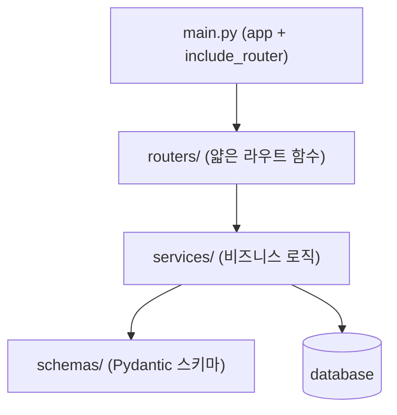

# 레슨 2. 프로젝트 구조화

## 이번 레슨에서 배울 내용

- 추천 폴더 구조
- 계층별 책임 (router / schema / service)
- 순환 import 피하기

---

## 1. 추천 구조 (중규모 API)

```text
app/
  main.py              # FastAPI 앱 생성, 라우터 등록
  config.py            # 설정
  dependencies.py      # 공통 Depends
  routers/
    users.py
    items.py
    auth.py
  schemas/
    user.py            # Pydantic 모델
    item.py
  models/
    user.py            # ORM 모델 (DB 단원)
    item.py
  services/
    user_service.py    # 비즈니스 로직
    item_service.py
  db/
    session.py
    base.py
```

처음에는 `routers` + `schemas`만으로 시작해도 충분합니다.

---

## 2. 계층 책임

| 계층 | 역할 | 하지 말 것 |
|------|------|------------|
| routers | HTTP 입출력, 상태 코드 | 복잡한 비즈니스 로직 |
| schemas | 요청/응답 검증 | DB 접근 |
| services | 비즈니스 규칙 | HTTPException만 난발하기보다 도메인 예외 |
| models / db | 영속화 | API 스키마 혼합 |

```python
# routers/items.py
from fastapi import APIRouter, Depends
from schemas.item import ItemCreate, ItemRead
from services import item_service

router = APIRouter(prefix="/items", tags=["items"])


@router.post("/", response_model=ItemRead)
def create_item(payload: ItemCreate):
    return item_service.create(payload)
```

```python
# services/item_service.py
from schemas.item import ItemCreate

_db: list[dict] = []


def create(payload: ItemCreate) -> dict:
    item = {"id": len(_db) + 1, **payload.model_dump()}
    _db.append(item)
    return item
```

---

## 3. main.py는 얇게

```python
from fastapi import FastAPI
from routers import items, users

app = FastAPI(title="My API")

app.include_router(users.router, prefix="/api/v1")
app.include_router(items.router, prefix="/api/v1")


@app.get("/health")
def health():
    return {"status": "ok"}
```

---

## 4. 순환 import 주의

- `routers` → `services` → `schemas` 방향이 안전합니다
- `services`가 `routers`를 import하면 순환이 생기기 쉽습니다
- 타입이 필요하면 `TYPE_CHECKING` 가드를 사용하세요

```python
from typing import TYPE_CHECKING

if TYPE_CHECKING:
    from schemas.item import ItemCreate
```

---

## 정리

- 라우터는 얇게, 로직은 서비스로
- 스키마(Pydantic)와 ORM 모델을 분리하세요
- 작은 프로젝트도 폴더를 미리 나눠 두면 확장에 유리합니다



---

## 연습 문제

1. `app/routers`, `app/schemas` 폴더를 만들고 users 도메인을 분리하세요.
2. 라우터에서 직접 list에 append하지 말고 service 함수를 호출하세요.
3. `/health`는 `main.py`에 두는 이유를 생각해 보세요.
