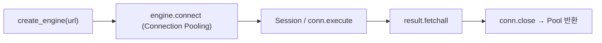

# 레슨 1. SQLAlchemy / SQLModel 기초

## 이번 레슨에서 배울 내용

- ORM이란 무엇인가
- SQLModel로 모델·엔진·세션 구성 (학습용으로 단순)
- 테이블 생성

---

## 1. 설치

```bash
pip install sqlmodel
```

SQLModel은 FastAPI 저자가 만든 라이브러리로, Pydantic + SQLAlchemy를 결합합니다.  
학습·중소규모 프로젝트에 잘 맞습니다.

---

## 2. 모델 정의

```python
# models.py
from sqlmodel import Field, SQLModel


class Hero(SQLModel, table=True):
    id: int | None = Field(default=None, primary_key=True)
    name: str
    secret_name: str
    age: int | None = None
```

- `table=True` → DB 테이블로 매핑
- API용 스키마는 `table=False`인 모델로 따로 둘 수 있습니다

```python
class HeroCreate(SQLModel):
    name: str
    secret_name: str
    age: int | None = None


class HeroRead(SQLModel):
    id: int
    name: str
    age: int | None = None
```

---

## 3. 엔진과 세션

```python
# database.py
from sqlmodel import Session, SQLModel, create_engine

sqlite_url = "sqlite:///./heroes.db"
engine = create_engine(sqlite_url, echo=True)


def create_db_and_tables():
    SQLModel.metadata.create_all(engine)


def get_session():
    with Session(engine) as session:
        yield session
```

---

## 4. 앱 시작 시 테이블 생성

```python
# main.py
from contextlib import asynccontextmanager
from fastapi import FastAPI
from database import create_db_and_tables


@asynccontextmanager
async def lifespan(app: FastAPI):
    create_db_and_tables()
    yield


app = FastAPI(lifespan=lifespan)
```

구버전 `@app.on_event("startup")` 대신 **lifespan**을 권장합니다.

---

## 5. ORM vs Raw SQL

| 방식    | 장점                 | 단점               |
| ------- | -------------------- | ------------------ |
| ORM     | 생산성, 타입, 이식성 | 복잡한 쿼리는 제한 |
| Raw SQL | 완전한 제어          | 검증·매핑 수동     |

학습 단계에서는 ORM으로 CRUD를 익히고, 필요 시 SQL을 섞으면 됩니다.

---

## 정리

- SQLModel로 “테이블 모델”과 “API 스키마”를 함께 관리할 수 있습니다
- `create_engine` + `Session` + `create_all`이 기본 뼈대입니다
- 세션은 요청 단위로 열고 닫습니다 (`yield`)




---

## 연습 문제

1. `Book(id, title, author, pages)` 테이블 모델을 정의하세요.
2. SQLite 엔진과 `get_session`을 작성하세요.
3. lifespan에서 테이블을 생성하세요.
