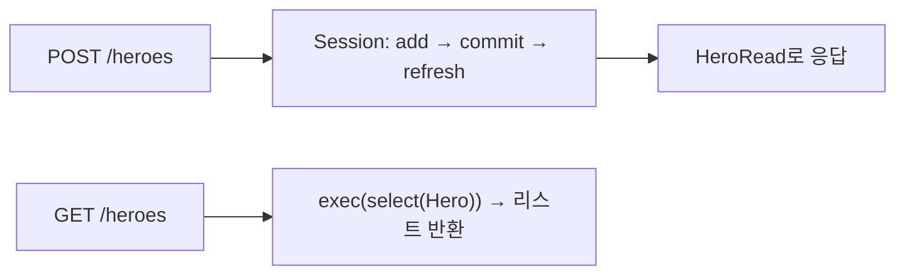

# 레슨 2. CRUD API 구현

## 이번 레슨에서 배울 내용

- Create / Read / Update / Delete 엔드포인트
- 세션 의존성 주입
- 존재하지 않는 리소스 처리

---

## 1. Create

```python
from typing import Annotated
from fastapi import Depends, FastAPI, HTTPException
from sqlmodel import Session, select

from database import get_session, create_db_and_tables
from models import Hero, HeroCreate, HeroRead

app = FastAPI()
SessionDep = Annotated[Session, Depends(get_session)]


@app.post("/heroes", response_model=HeroRead)
def create_hero(payload: HeroCreate, session: SessionDep):
    hero = Hero.model_validate(payload)
    session.add(hero)
    session.commit()
    session.refresh(hero)
    return hero
```

---

## 2. Read (목록 / 단건)

```python
@app.get("/heroes", response_model=list[HeroRead])
def list_heroes(session: SessionDep, offset: int = 0, limit: int = 10):
    heroes = session.exec(select(Hero).offset(offset).limit(limit)).all()
    return heroes


@app.get("/heroes/{hero_id}", response_model=HeroRead)
def get_hero(hero_id: int, session: SessionDep):
    hero = session.get(Hero, hero_id)
    if not hero:
        raise HTTPException(status_code=404, detail="Hero not found")
    return hero
```

---

## 3. Update

```python
class HeroUpdate(SQLModel):
    name: str | None = None
    secret_name: str | None = None
    age: int | None = None


@app.patch("/heroes/{hero_id}", response_model=HeroRead)
def update_hero(hero_id: int, payload: HeroUpdate, session: SessionDep):
    hero = session.get(Hero, hero_id)
    if not hero:
        raise HTTPException(status_code=404, detail="Hero not found")

    data = payload.model_dump(exclude_unset=True)
    hero.sqlmodel_update(data)
    session.add(hero)
    session.commit()
    session.refresh(hero)
    return hero
```

`exclude_unset=True` → 보낸 필드만 수정 (부분 업데이트).

---

## 4. Delete

```python
from fastapi import status
from fastapi.responses import Response


@app.delete("/heroes/{hero_id}", status_code=status.HTTP_204_NO_CONTENT)
def delete_hero(hero_id: int, session: SessionDep):
    hero = session.get(Hero, hero_id)
    if not hero:
        raise HTTPException(status_code=404, detail="Hero not found")
    session.delete(hero)
    session.commit()
    return Response(status_code=status.HTTP_204_NO_CONTENT)
```

---

## 5. 응답에서 비밀 필드 숨기기

`HeroRead`에 `secret_name`을 넣지 않으면 목록/조회 응답에서 자동으로 제외됩니다.  
입력(`HeroCreate`)과 출력(`HeroRead`)을 꼭 분리하세요.

---

## 정리

- CRUD = `add/commit/refresh`, `exec(select)`, `get`, `delete`
- 없으면 404
- PATCH는 `exclude_unset`으로 부분 수정을 구현합니다




---

## 연습 문제

1. Book에 대한 POST/GET 목록/GET 상세를 구현하세요.
2. PATCH로 `title`만 바꿀 수 있게 하세요.
3. DELETE는 204를 반환하세요.
