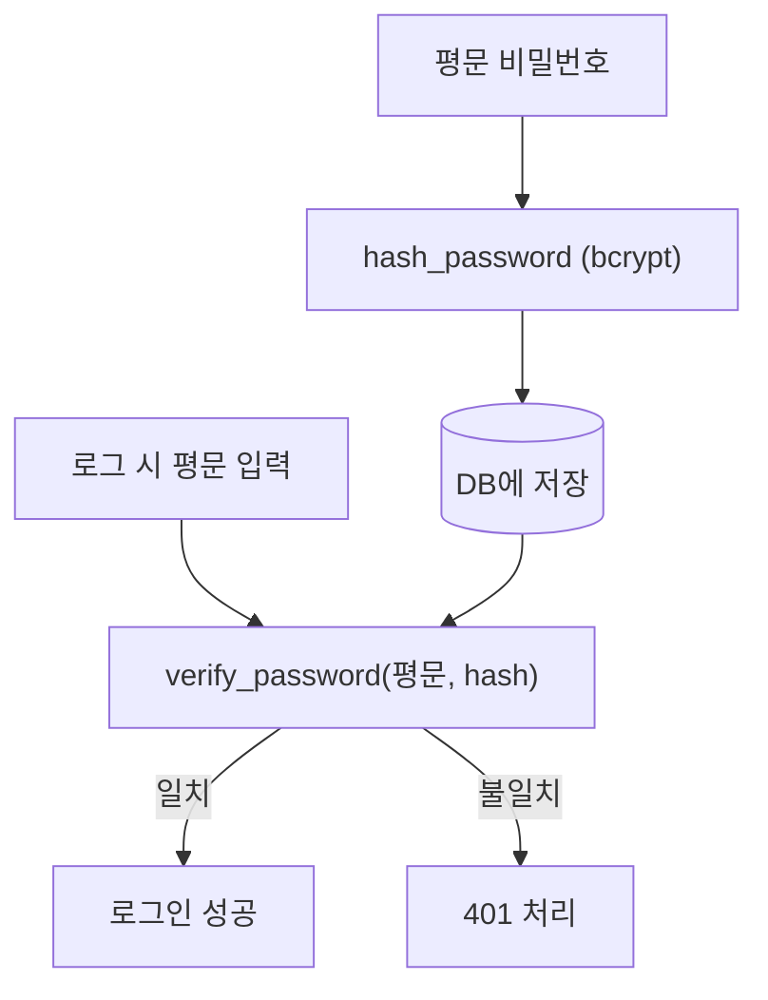

# 레슨 1. 비밀번호 해싱과 회원가입

## 이번 레슨에서 배울 내용

- 왜 해싱이 필요한가
- `pwdlib` / passlib / bcrypt 사용 개념
- 회원가입·로그인 검증 흐름

---

## 1. 절대 평문으로 저장하지 마세요

DB가 유출되어도 원문 비밀번호를 바로 알 수 없게 **단방향 해시**를 저장합니다.

```text
비밀번호 "secret123"
  → hash → "$2b$12$...."  (저장)
로그인 시 입력값과 hash를 비교 (verify)
```

---

## 2. 설치와 해시 유틸

FastAPI 문서 최신 예제는 `pwdlib`를 사용하기도 합니다.  
널리 쓰이는 패턴 예시(개념):

```bash
pip install "pwdlib[bcrypt]"
```

```python
# security.py
from pwdlib import PasswordHash

password_hash = PasswordHash.recommended()


def hash_password(plain: str) -> str:
    return password_hash.hash(plain)


def verify_password(plain: str, hashed: str) -> bool:
    return password_hash.verify(plain, hashed)
```

---

## 3. 회원가입

```python
from fastapi import FastAPI, HTTPException
from pydantic import BaseModel, EmailStr
from security import hash_password

app = FastAPI()

# 데모용 메모리 DB
USERS: dict[str, dict] = {}


class UserCreate(BaseModel):
    email: EmailStr
    password: str


class UserRead(BaseModel):
    email: EmailStr


@app.post("/register", response_model=UserRead)
def register(user: UserCreate):
    if user.email in USERS:
        raise HTTPException(status_code=400, detail="Email already registered")
    USERS[user.email] = {
        "email": user.email,
        "hashed_password": hash_password(user.password),
    }
    return {"email": user.email}
```

---

## 4. 로그인 검증 (토큰 발급 전 단계)

```python
class LoginIn(BaseModel):
    email: EmailStr
    password: str


@app.post("/login-check")
def login_check(body: LoginIn):
    saved = USERS.get(body.email)
    if not saved or not verify_password(body.password, saved["hashed_password"]):
        raise HTTPException(status_code=401, detail="Incorrect email or password")
    return {"message": "login ok", "email": body.email}
```

실제로는 여기서 JWT를 발급합니다 (다음 레슨).

---

## 5. 보안 체크리스트

- 비밀번호 최소 길이·복잡도 정책
- 로그인 실패 메시지에 “이메일 없음/비번 틀림”을 너무 자세히 구분하지 않기 (계정 열거 완화)
- HTTPS 사용 (운영)
- 해시 알고리즘은 bcrypt/argon2 등 검증된 것 사용

---

## 정리

- 저장은 hash, 비교는 verify
- 응답 모델에 비밀번호/해시를 절대 포함하지 마세요
- 회원가입과 로그인 검증을 먼저 이해한 뒤 JWT로 확장합니다



---

## 연습 문제

1. `hash_password` / `verify_password`를 구현하세요.
2. 이미 등록된 이메일이면 400을 반환하세요.
3. 로그인 실패 시 401을 반환하세요.
