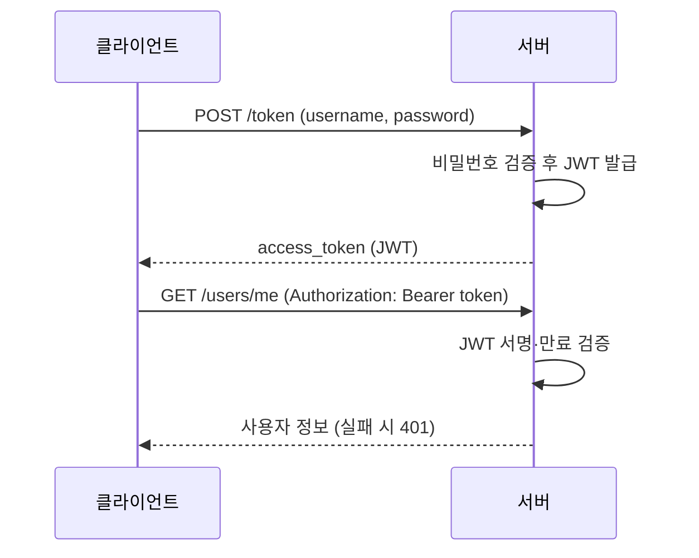

# 레슨 2. OAuth2와 JWT

## 이번 레슨에서 배울 내용

- OAuth2 Password Bearer 흐름
- JWT 발급과 검증
- `get_current_user` 의존성

---

## 1. 큰 그림

```text
1) POST /token  (username/password)
2) 서버가 access_token (JWT) 반환
3) 클라이언트는 Authorization: Bearer <token>
4) 보호된 API는 토큰을 검증 후 사용자 식별
```

---

## 2. 설치

```bash
pip install PyJWT passlib[bcrypt]
# 또는 최신 문서 권장 조합 (pwdlib + PyJWT)
pip install pyjwt
```

---

## 3. 토큰 발급·검증 유틸

```python
# security.py
from datetime import datetime, timedelta, timezone
import jwt
from jwt.exceptions import InvalidTokenError

SECRET_KEY = "change-me-in-production"
ALGORITHM = "HS256"
ACCESS_TOKEN_EXPIRE_MINUTES = 30


def create_access_token(subject: str, expires_minutes: int = ACCESS_TOKEN_EXPIRE_MINUTES) -> str:
    expire = datetime.now(timezone.utc) + timedelta(minutes=expires_minutes)
    payload = {"sub": subject, "exp": expire}
    return jwt.encode(payload, SECRET_KEY, algorithm=ALGORITHM)


def decode_access_token(token: str) -> str:
    try:
        payload = jwt.decode(token, SECRET_KEY, algorithms=[ALGORITHM])
        sub: str | None = payload.get("sub")
        if sub is None:
            raise InvalidTokenError("missing sub")
        return sub
    except InvalidTokenError:
        raise
```

---

## 4. /token 엔드포인트

```python
from typing import Annotated
from fastapi import Depends, FastAPI, HTTPException, status
from fastapi.security import OAuth2PasswordBearer, OAuth2PasswordRequestForm

app = FastAPI()
oauth2_scheme = OAuth2PasswordBearer(tokenUrl="token")


@app.post("/token")
def login(form_data: Annotated[OAuth2PasswordRequestForm, Depends()]):
    # form: username, password (OAuth2 관례상 username 필드 사용)
    user = USERS.get(form_data.username)
    if not user or not verify_password(form_data.password, user["hashed_password"]):
        raise HTTPException(
            status_code=status.HTTP_401_UNAUTHORIZED,
            detail="Incorrect username or password",
            headers={"WWW-Authenticate": "Bearer"},
        )
    token = create_access_token(subject=user["email"])
    return {"access_token": token, "token_type": "bearer"}
```

`/docs`의 Authorize 버튼이 이 흐름과 연결됩니다.

---

## 5. 현재 사용자 의존성

```python
def get_current_user(token: Annotated[str, Depends(oauth2_scheme)]):
    credentials_exception = HTTPException(
        status_code=status.HTTP_401_UNAUTHORIZED,
        detail="Could not validate credentials",
        headers={"WWW-Authenticate": "Bearer"},
    )
    try:
        email = decode_access_token(token)
    except InvalidTokenError:
        raise credentials_exception
    user = USERS.get(email)
    if user is None:
        raise credentials_exception
    return {"email": user["email"]}


@app.get("/users/me")
def read_me(current_user: Annotated[dict, Depends(get_current_user)]):
    return current_user
```

---

## 6. 주의사항

- `SECRET_KEY`는 충분히 길고 무작위여야 합니다
- 토큰 만료(`exp`)를 반드시 넣으세요
- 민감 API는 HTTPS + 짧은 만료 + (필요 시) refresh token 전략
- 권한(admin)은 JWT claim 또는 DB role로 추가 검사

---

## 정리

- Password Flow로 토큰을 받고, Bearer로 API를 보호합니다
- JWT는 서명 검증 + 만료 확인이 핵심입니다
- `OAuth2PasswordBearer` + `Depends(get_current_user)`가 표준 패턴입니다




---

## 연습 문제

1. `/token`에서 유효한 사용자에게 JWT를 발급하세요.
2. `/users/me`를 토큰 없이 호출하면 401이 나오는지 확인하세요.
3. 토큰 만료 시간을 5분으로 바꿔 보세요.
