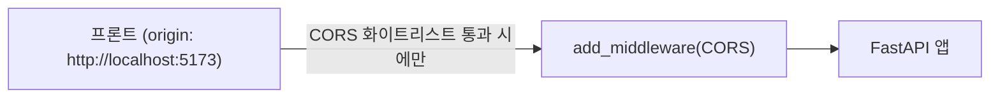

# 레슨 3. CORS와 미들웨어

## 이번 레슨에서 배울 내용

- CORS가 필요한 이유
- `CORSMiddleware` 설정
- 커스텀 미들웨어와 신뢰 호스트

---

## 1. CORS란?

브라우저에서 **프론트(예: http://localhost:5173)** 가 **API(예: http://localhost:8000)** 를 호출하면 출처(origin)가 달라 보안 정책이 적용됩니다.  
서버가 허용 Origin을 알려줘야 브라우저가 응답을 JS에 넘겨 줍니다.

---

## 2. CORSMiddleware

```python
from fastapi import FastAPI
from fastapi.middleware.cors import CORSMiddleware

app = FastAPI()

origins = [
    "http://localhost:5173",
    "http://127.0.0.1:5173",
]

app.add_middleware(
    CORSMiddleware,
    allow_origins=origins,
    allow_credentials=True,
    allow_methods=["*"],
    allow_headers=["*"],
)
```

| 옵션                | 의미                      |
| ------------------- | ------------------------- |
| `allow_origins`     | 허용할 프론트 Origin 목록 |
| `allow_credentials` | 쿠키 포함 여부            |
| `allow_methods`     | GET, POST…                |
| `allow_headers`     | Authorization 등          |

운영에서는 `allow_origins=["*"]`와 `allow_credentials=True`를 함께 쓰지 마세요.  
구체적인 도메인을 명시합니다.

---

## 3. 커스텀 미들웨어

모든 요청 전후에 공통 작업을 넣을 수 있습니다.

```python
import time
from fastapi import Request


@app.middleware("http")
async def add_process_time_header(request: Request, call_next):
    start = time.perf_counter()
    response = await call_next(request)
    elapsed = time.perf_counter() - start
    response.headers["X-Process-Time"] = f"{elapsed:.4f}"
    return response
```

로깅, 요청 ID 부여, 간단한 레이트리밋 등에 활용합니다.

---

## 4. TrustedHostMiddleware

Host 헤더 공격을 완화합니다.

```python
from uvicorn.middleware.proxy_headers import ProxyHeadersMiddleware  # 배포 환경에 따라
from fastapi.middleware.trustedhost import TrustedHostMiddleware

app.add_middleware(
    TrustedHostMiddleware,
    allowed_hosts=["example.com", "*.example.com", "localhost"],
)
```

---

## 5. 보안 기본값 체크

1. 문서(`/docs`) 운영 노출 여부
2. CORS Origin 화이트리스트
3. HTTPS / 리버스 프록시 헤더
4. 에러 메시지에 스택트레이스 미포함
5. 의존성(패키지) 업데이트

---

## 정리

- SPA + API 분리 구조에서는 CORS 설정이 필수입니다
- 미들웨어로 횡단 관심사(로깅, 헤더)를 처리합니다
- 운영에서는 Origin·Host·HTTPS를 엄격히 관리하세요



---

## 연습 문제

1. Vite 기본 포트(5173)만 허용하는 CORS를 설정하세요.
2. 모든 응답에 `X-App-Version: 0.1.0` 헤더를 미들웨어로 추가하세요.
3. `allow_origins=["*"]`가 위험한 상황을 설명해 보세요.
