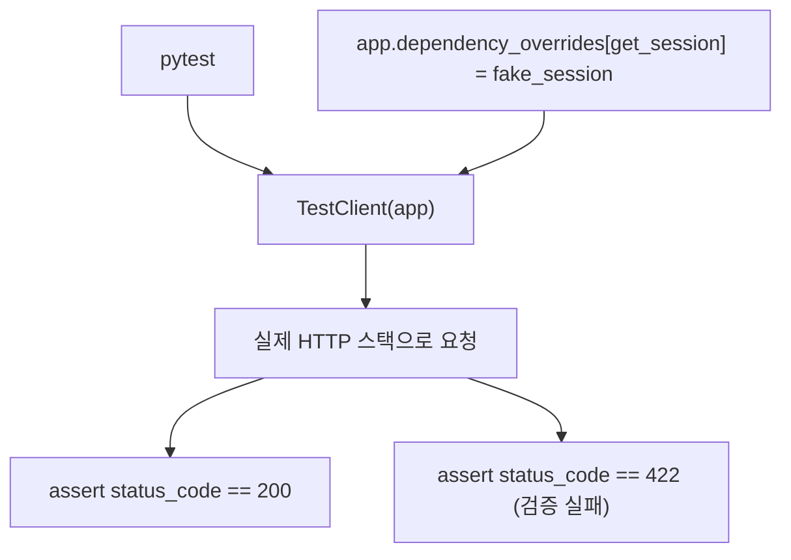

# 레슨 1. API 테스트

## 이번 레슨에서 배울 내용

- `TestClient`로 엔드포인트 테스트
- 픽스처와 dependency override
- 비동기 테스트 개요

---

## 1. 설치

```bash
pip install pytest httpx
```

FastAPI의 `TestClient`는 Starlette 기반으로, httpx를 사용합니다.

---

## 2. 기본 테스트

```python
# main.py
from fastapi import FastAPI

app = FastAPI()


@app.get("/health")
def health():
    return {"status": "ok"}
```

```python
# tests/test_health.py
from fastapi.testclient import TestClient
from main import app

client = TestClient(app)


def test_health():
    res = client.get("/health")
    assert res.status_code == 200
    assert res.json() == {"status": "ok"}
```

실행:

```bash
pytest
```

---

## 3. POST와 검증 실패

```python
def test_create_item():
    res = client.post("/items", json={"name": "펜", "price": 1000})
    assert res.status_code == 201
    data = res.json()
    assert data["name"] == "펜"


def test_create_item_invalid():
    res = client.post("/items", json={"name": "펜"})  # price 누락
    assert res.status_code == 422
```

---

## 4. 의존성 오버라이드

DB나 인증을 테스트에서 교체합니다.

```python
from main import app
from database import get_session


def fake_session():
    yield FakeSession()


app.dependency_overrides[get_session] = fake_session


def test_with_fake_db():
    res = client.get("/heroes")
    assert res.status_code == 200


app.dependency_overrides.clear()
```

인증:

```python
app.dependency_overrides[get_current_user] = lambda: {"email": "test@example.com"}
```

---

## 5. 테스트 구조 팁

```text
tests/
  conftest.py      # client fixture, DB setup
  test_users.py
  test_items.py
```

```python
# conftest.py
import pytest
from fastapi.testclient import TestClient
from main import app


@pytest.fixture
def client():
    with TestClient(app) as c:
        yield c
```

---

## 정리

- `TestClient`로 실제 HTTP 스택에 가까운 테스트를 작성합니다
- 422/401/404 같은 실패 경로도 꼭 검증하세요
- `dependency_overrides`로 외부 의존성을 격리합니다



---

## 연습 문제

1. `/health` 성공 테스트를 작성하세요.
2. 잘못된 Body로 422를 검증하세요.
3. `get_current_user`를 override해 보호 API를 테스트하세요.
