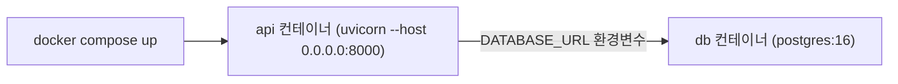

# 레슨 2. Docker 배포

## 이번 레슨에서 배울 내용

- FastAPI용 Dockerfile 작성
- 이미지 빌드와 컨테이너 실행
- docker-compose로 API + DB

---

## 1. 최소 Dockerfile

```dockerfile
FROM python:3.12-slim

WORKDIR /app

COPY requirements.txt .
RUN pip install --no-cache-dir -r requirements.txt

COPY ./app ./app

EXPOSE 8000

CMD ["uvicorn", "app.main:app", "--host", "0.0.0.0", "--port", "8000"]
```

`requirements.txt` 예:

```text
fastapi[standard]
sqlmodel
pyjwt
pwdlib[bcrypt]
```

---

## 2. 빌드와 실행

```bash
docker build -t my-fastapi .
docker run --rm -p 8000:8000 -e SECRET_KEY=prod-secret my-fastapi
```

브라우저: http://localhost:8000/docs

---

## 3. .dockerignore

```text
venv/
.venv/
__pycache__/
.git/
.env
*.md
tests/
```

불필요한 파일을 이미지에 넣지 않습니다.

---

## 4. docker-compose (API + Postgres)

```yaml
# docker-compose.yml
services:
  db:
    image: postgres:16
    environment:
      POSTGRES_USER: app
      POSTGRES_PASSWORD: app
      POSTGRES_DB: app
    ports:
      - "5432:5432"

  api:
    build: .
    ports:
      - "8000:8000"
    environment:
      DATABASE_URL: postgresql://app:app@db:5432/app
      SECRET_KEY: change-me
    depends_on:
      - db
```

```bash
docker compose up --build
```

---

## 5. 운영 시 uvicorn 팁

개발용 `--reload`는 끄고, 워커를 늘립니다.

```bash
uvicorn app.main:app --host 0.0.0.0 --port 8000 --workers 4
```

또는 gunicorn + uvicorn worker:

```bash
gunicorn app.main:app -k uvicorn.workers.UvicornWorker -w 4 -b 0.0.0.0:8000
```

---

## 정리

- 컨테이너는 `0.0.0.0`으로 바인딩해야 외부에서 접근됩니다
- 시크릿은 이미지에 넣지 말고 환경 변수로 주입하세요
- compose로 DB와 API를 함께 올리면 로컬 통합이 쉽습니다



---

## 연습 문제

1. 프로젝트용 Dockerfile을 작성해 빌드하세요.
2. `-e`로 환경 변수를 넘겨 `/info`에서 확인하세요.
3. `.dockerignore`에 `venv`를 추가하세요.
