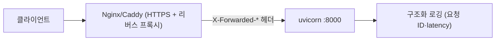

# 레슨 3. 프로덕션 체크리스트

## 이번 레슨에서 배울 내용

- 배포 전 점검 항목
- 로깅·모니터링 기본
- 학습 커리큘럼 마무리 프로젝트 제안

---

## 1. 배포 전 체크리스트

### 앱 설정

- [ ] `DEBUG=False`
- [ ] `SECRET_KEY` 무작위·충분히 김
- [ ] `/docs`, `/redoc` 노출 정책 결정
- [ ] CORS Origin이 실제 프론트 도메인만 허용
- [ ] Trusted Host 설정

### 데이터·보안

- [ ] DB 비밀번호/시크릿이 코드·이미지에 없음
- [ ] 마이그레이션 절차 준비 (Alembic 등)
- [ ] 비밀번호 해시 저장 확인
- [ ] HTTPS 종료(리버스 프록시) 구성

### 런타임

- [ ] `--reload` 비활성
- [ ] workers 수 적절히 설정
- [ ] health check 엔드포인트 (`/health`)
- [ ] 타임아웃·바디 크기 제한 검토

### 품질

- [ ] 핵심 API pytest 통과
- [ ] 에러 응답 포맷 통일
- [ ] 의존성 취약점 점검 (`pip audit` 등)

---

## 2. 로깅 기본

```python
import logging
from fastapi import FastAPI

logging.basicConfig(level=logging.INFO)
logger = logging.getLogger("app")

app = FastAPI()


@app.get("/health")
def health():
    logger.info("health checked")
    return {"status": "ok"}
```

요청 ID, 사용자 ID, latency를 구조화 로그(JSON)로 남기면 운영에 유리합니다.

---

## 3. 리버스 프록시

일반적인 구성:

```text
Client → Nginx/Caddy (HTTPS) → uvicorn (8000)
```

프록시 뒤에서 `X-Forwarded-*` 헤더를 신뢰하도록 배포 환경에 맞게 설정합니다.

---

## 4. 마무리 미니 프로젝트 제안

커리큘럼 통합 실습으로 아래 중 하나를 만들어 보세요.

### A. Todo API

- 회원가입/로그인 (JWT)
- Todo CRUD (본인 것만)
- 페이지네이션, 테스트, Docker

### B. Bookstore API

- 책/저자 리소스
- 관리자만 등록, 일반 사용자는 조회
- CORS + React/Vite 연동

### C. URL Shortener

- 단축 URL 생성/리다이렉트
- 클릭 수 카운트
- SQLite → Postgres 전환

---

## 5. 다음 학습 추천

1. 배경 작업: Celery / ARQ / FastAPI BackgroundTasks
2. WebSocket
3. OpenAPI 클라이언트 자동 생성
4. 관측성: OpenTelemetry, Prometheus
5. 공식 문서: https://fastapi.tiangolo.com

---

## 정리

- 운영은 “되는 코드”가 아니라 **안전한 기본값 + 관측 + 테스트**입니다
- 체크리스트를 배포 파이프라인에 녹이세요
- 미니 프로젝트로 단원 지식을 하나로 연결해 보세요



---

## 연습 문제

1. 현재 프로젝트에 `/health`를 추가하세요.
2. 운영용으로 `docs_url`을 끄는 설정을 환경 변수로 분기하세요.
3. Todo 또는 Bookstore 범위로 요구사항 5줄을 직접 적어 보세요.

---

수고하셨습니다. 단원 01부터 09까지가 FastAPI 백엔드의 핵심 경로입니다.  
막히는 부분이 있으면 해당 레슨의 예제를 다시 실행해 보시고, 미니 프로젝트로 마무리해 보시면 좋습니다.
