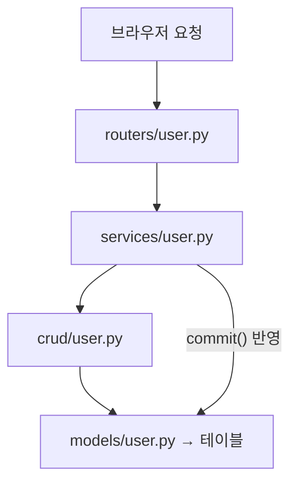

# 레슨 1. 실전 프로젝트 구조

## 이번 레슨에서 배울 내용

- 초기 설정 파일들의 역할
- Model / Schemas / Crud / Service / Routers 계층
- 요청이 흘러가는 전체 흐름

---

## 1. 초기 설정 파일

| 파일 | 역할 |
|------|------|
| `.env` | 환경 설정(DB 정보, JWT 정보) |
| `core/settings.py` | `.env`의 설정값을 읽는 Settings 클래스 |
| `core/jwt_handler.py` | bcrypt 해시, 토큰 생성·검증 |
| `database.py` | DB 연결 엔진·세션 생성, FastAPI 의존성에 세션 공급 |
| `main.py` | FastAPI 앱 생성, lifespan, CORS, 라우터 연결 |

## 2. Model · CRUD 계층

| 파일 | 역할 |
|------|------|
| `models/user.py` | ORM 모델 — DB 테이블로 매핑 |
| `schemas/users.py` | Pydantic 모델 — API로 주고받는 데이터 모양, 값 검증 |
| `crud/user.py` | CRUD 작업 — `flush()`까지만 수행, `commit()`은 service가 담당 |
| `services/user.py` | `crud` 호출 + `commit()`까지 처리 → DB에 쿼리문 영구 반영 |

## 3. 요청 흐름



`routers/user.py`는 "어떤 URL에 어떤 요청이 들어오면 어떤 함수를 실행할지" 연결합니다.

```python
# routers/user.py
from fastapi import APIRouter, Depends

router = APIRouter(prefix="/user", tags=["user"])

@router.get("/user/{user_id}")
async def get_user(user_id: int, db: Session = Depends(get_db)):
    return user_service.read_user(db, user_id)
```

- `Router → Service → Crud → Model` 순서로 계층이 분리되어 있습니다.
- `crud`는 `flush()`까지만 하고, `commit()`은 service에서 결정합니다.