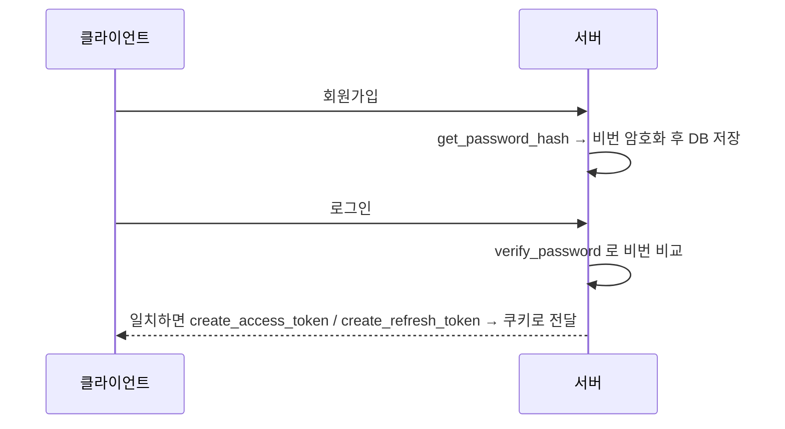

# 레슨 3. JWT Handler — 해시·토큰 실전

## 이번 레슨에서 배울 내용

- bcrypt로 비밀번호를 해시·검증하는 함수
- access/refresh 토큰 생성 흐름
- 쿠키에 토큰을 전달하는 방식

---

## 1. `core/jwt_handler.py`의 역할

- 비밀번호를 bcrypt로 해시하고, 로그인 시 입력값이 맞는지 확인
- 토큰 생성과 검증

---

## 2. 회원가입·로그인 흐름

1. 회원가입 → `get_password_hash`로 비밀번호를 암호화해 DB에 저장
2. 로그인 → `verify_password`로 비교 → 일치하면 토큰 생성
3. `create_access_token` / `create_refresh_token` → 쿠키에 전달

---

## 3. 서비스·CRD 계층과의 관계

- `services/user.py`는 CRUD 작업 + `commit()`까지 처리 → DB에 쿼리문이 영구 반영됩니다.
- 예: `@router.get("/user/{user_id}")` → service → crud → 모델(테이블) 순서.

---

## 연습 문제

1. `get_password_hash` / `verify_password` 함수를 구현하세요.
2. `create_access_token`, `create_refresh_token`을 만들어 보세요.
3. 로그인 응답에 쿠키로 토큰을 전달하는 코드를 작성하세요.
