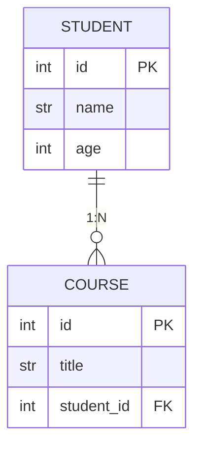

# 레슨 4. FastAPI 팀플 체크리스트

## 팀플 요구사항

- 주제·역할분담 정하기 (기한: 정한 날로부터 익일)
- 테이블 5~6개 설정
- Pydantic 모델링
- 경로 매개변수, 쿼리 매개변수, Request Body 처리
- SQLAlchemy를 사용한 CRUD, ORM 사용
- 인증 및 권한 관리: OAuth 및 JWT 사용
- RESTful API 설계 방식으로 API 명세서 사용

## 제출 목록

1. 주제/역할분담 (기한 내 제출)
2. Swagger UI 또는 Thunder Client / Postman으로 경로 설정 결과 제출
3. RESTful API 설계 방식으로 API 명세서 제출

## Student / Course 과제

`Student` / `Course` API 과제 요구사항입니다.

### ORM 모델

**Student**

| 컬럼 | 타입 |
|------|------|
| id | PK, Integer |
| name | String(20) |
| age | Integer |

**Course**

| 컬럼 | 타입 |
|------|------|
| id | PK, Integer |
| title | String(30) |
| student_id | FK → Student.id |

### Pydantic 모델

- `StudentCreate`: `name` 최소 2자~최대 20자, `age` 10~100
- `CourseCreate`: `title` 최소 2자~최대 30자, `student_id` Integer

### API 엔드포인트

| 엔드포인트 | 동작 |
|-----------|------|
| `POST /students` | Body → DB 추가 후 학생 정보 반환 |
| `GET /students` | 선택 Query `age` → 해당 나이 **이상**만 조회 |
| `GET /students/{id}` | 없으면 404 |
| `DELETE /students/{id}` | 없으면 404, 성공 시 `{"msg": "삭제 완료"}` |
| `POST /courses` | Body → `student_id` 없으면 404, DB 추가 후 과목 정보 반환 |
| `GET /courses` | 선택 Query `title` → 부분 검색(contains) |
| `GET /students/{id}/courses` | 없으면 404 |
| `DELETE /courses/{id}` | 없으면 404, 성공 시 `{"msg": "삭제 완료"}` |
| `GET /students/{id}/count` | `{ "student_id": 1, "course_count": 3 }` |

실습 코드는 `sources/main3.py`를 참고하세요.
