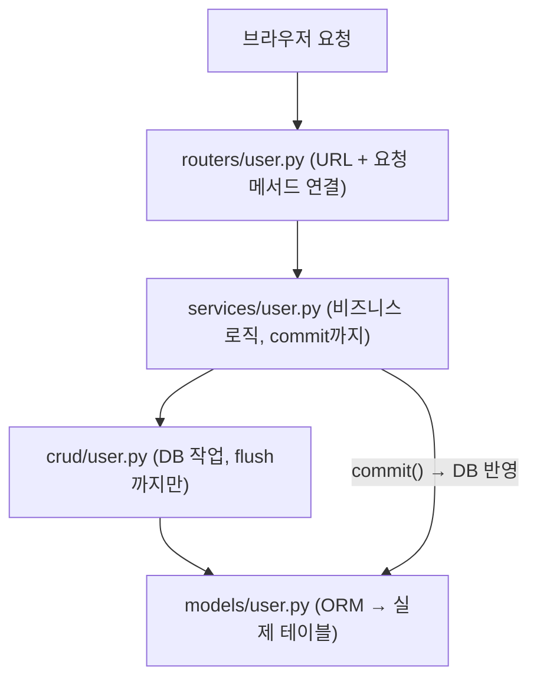

# 단원 10. 실전 프로젝트 — FastAPI 팀플 구조

## 학습 목표

- 초기 설정 파일 구조(`.env`, `core/settings.py`, `database.py`, `main.py`)를 이해합니다.
- Model/Schemas/Crud/Service/Routers 계층 구조를 익힙니다.
- 요청이 라우터를 거쳐 서비스·CRD·모델로 흘러가는 흐름을 파악합니다.
- JWT(비번 해시 + access/refresh 토큰) 실전 구현을 이해합니다.
- 팀플 요구사항(테이블 5~6개, Pydantic, CRUD, OAuth/JWT, API 명세서)을 확인합니다.

## 레슨 목록

- [01-project-structure.md](./01-project-structure.md) — 프로젝트 폴더·파일 설명, 요청 흐름
- [02-settings-env.md](./02-settings-env.md) — `.env`, Settings 클래스, requirements.txt, Alembic
- [03-jwt-handler.md](./03-jwt-handler.md) — bcrypt 해시, 토큰 발급·검증, 쿠키 전달
- [04-team-project-checklist.md](./04-team-project-checklist.md) — 팀플 요구사항·제출 목록

## 요청 흐름 한눈에 보기

- `crud`는 `flush()`까지만 수행하고 `commit()`은 service가 담당합니다.
- commit이 완료되어야 DB에 쿼리 결과가 영구 반영됩니다.
