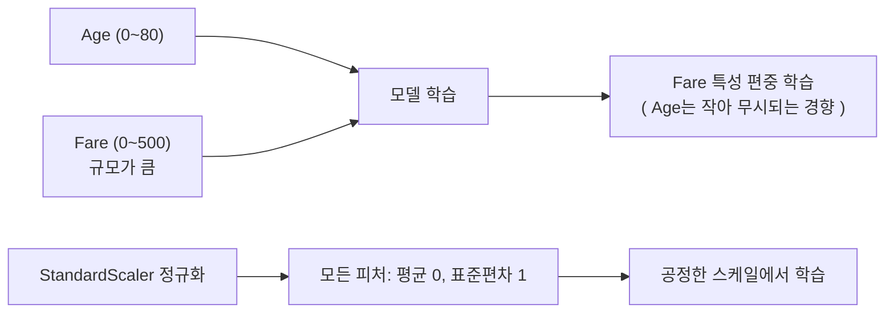
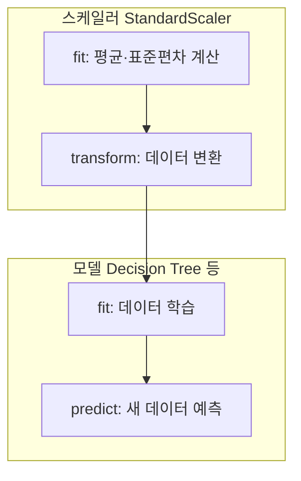

# 세션 08: 타이타닉 데이터셋 실습 (데이터 다루기)

## 1. 실습 준비 — 데이터 도구 불러오기

```python
# 데이터 툴 numpy np라는 이름으로 불러오기
import numpy as np

# 데이터 툴 pandas pd라는 이름으로 불러오기
import pandas as pd

# 데이터 시각화 툴 matplotlib.pyplot을 plt라는 이름으로 불러오기
import matplotlib.pyplot as plt

# Titanic dataset 불러오기
# notebook 위치: Machine Learning/Jupyter/titanic.ipynb
# 데이터 위치: Machine Learning/data/train.csv
# Jupyter는 notebook이 있는 폴더(Jupyter/)가 실행 기준(base directory)이므로
# 한 칸 위로 올라가서 data 폴더로 진입해야 함
titanic_data = pd.read_csv('../data/train.csv')
titanic_data
```

- 세션 01에서 배운 도구 3종(numpy, pandas, matplotlib)을 실제 프로젝트에 첫 적용
- `pd.read_csv()`로 CSV 파일을 DataFrame으로 읽는다
- 실행 구조:
  - notebook: `Machine Learning/Jupyter/titanic.ipynb`
  - 데이터: `Machine Learning/data/train.csv`
  - Jupyter는 notebook 폴더(`Jupyter/`) 기준으로 경로를 해석하므로 `../data/train.csv` 사용
- NumPy 입문 실습은 `Machine Learning/Jupyter/numpy_basics.ipynb`를 참고
- 대안: 절대경로 사용 — `pd.read_csv(r'C:\AX Academy\study\Machine Learning\data\train.csv')` (위치에 관계없이 항상 동작)

## 2. 타이타닉 데이터셋 구조 (Feature 컬럼)

| Feature (컬럼명) | 설명                  | 값/예시                                     | 의미                                                      |
| ---------------- | --------------------- | ------------------------------------------- | --------------------------------------------------------- |
| PassengerId      | 승객 ID (고유 식별자) | 1, 2, 3, 4, ...                             | 데이터셋 내에서 각 승객을 식별하기 위한 고유 번호.        |
| Survived         | 생존 여부             | 0: 사망, 1: 생존                            | 승객의 생존 여부를 나타냄.                                |
| Pclass           | 객실 등급             | 1: 1등석, 2: 2등석, 3: 3등석                | 승객이 탑승한 객실의 등급 정보를 나타냄.                  |
| Name             | 승객 이름             | Braund, Mr. Owen Harris                     | 승객의 이름과 함께 호칭(예: Mr., Mrs. 등)을 포함.         |
| Sex              | 성별                  | male: 남성, female: 여성                    | 승객의 성별을 나타냄.                                     |
| Age              | 나이                  | 22, 38, NaN                                 | 승객의 나이를 나타내며, 일부 데이터는 결측값(NaN)을 포함. |
| SibSp            | 형제/배우자 수        | 0, 1, 2, ...                                | 함께 탑승한 형제자매 또는 배우자의 수를 나타냄.           |
| Parch            | 부모/자녀 수          | 0, 1, 2, ...                                | 함께 탑승한 부모 또는 자녀의 수를 나타냄.                 |
| Ticket           | 티켓 번호             | A/5 21171, PC 17599                         | 승객이 사용한 티켓 번호를 나타냄.                         |
| Fare             | 요금                  | 7.25, 71.2833, 8.05                         | 승객이 지불한 운임 금액을 나타냄.                         |
| Cabin            | 객실 번호             | C85, NaN                                    | 승객의 객실 번호를 나타내며, 결측값이 많음.               |
| Embarked         | 탑승 항구             | C: Cherbourg, Q: Queenstown, S: Southampton | 승객이 탑승한 항구를 나타냄.                              |

- 학습 목표(정답 / label)는 **Survived** 컬럼
- Age, Cabin은 NaN 결측값 포함 → 세션 06에서 배운 전처리(채우거나 삭제) 필요

### 데이터 유형 분류

```mermaid
flowchart TD
    A[데이터] --> B[수치형 데이터]
    A --> C[범주형 데이터]
    B --> B1[연속형 데이터<br>ex) 키, 몸무게]
    B --> B2[이산형 데이터<br>ex) 책 페이지 수, 물건 개수]
    C --> C1[순서형 데이터<br>ex) 학점, 순위]
    C --> C2[명목형 데이터<br>ex) 성별, 음식]
```

| 대분류        | 소분류        | 예시                         | 타이타닉 컬럼 예시             |
| ------------- | ------------- | ---------------------------- | ------------------------------ |
| 수치형 데이터 | 연속형 데이터 | 키, 몸무게 등                | Age, Fare                      |
| 수치형 데이터 | 이산형 데이터 | 책 페이지 수, 물건의 개수 등 | SibSp, Parch                   |
| 범주형 데이터 | 순서형 데이터 | 학점, 순위 등                | Pclass (1·2·3등석에 순서 있음) |
| 범주형 데이터 | 명목형 데이터 | 성별, 음식 등                | Sex, Embarked                  |

- 수치형: 값 자체에 의미, 사칙연산/비교 가능
- 범주형: 값이 분류 라벨에 가까움 → 모델에 넣기 전 숫자 변환(인코딩) 필요

## 3. 정규화 (Normalization / Scaling)

### 왜 하는가

- Age 0~80, Fare 0~500 → Fare 값이 너무 커서 모델이 Fare에 치우친 학습 가능



- 그래프의 y축 스케일이 서로 다른 두 특성을 한 축에 맞추는 것
- **StandardScaler**: 모든 피처를 평균 0, 표준편차 1 수준으로 맞춤
  - 표준화 공식: z = (x − 평균) / 표준편차
  - ex) Fare의 평균 30이라 하면 Fare의 모든 값은 평균을 기준으로 −30 ~ +470이 된다

## 4. 메서드 4종 — 스케일러 vs 모델

### 데이터(스케일러)에 사용하는 메서드

- **fit**: 주어진 스케일 변환을 위해 데이터의 평균 및 표준편차 등을 계산
- **transform**: 계산한 내용을 바탕으로 데이터를 변환

### 모델 관련 메서드

- **fit**: 주어진 데이터를 학습하여 모델을 훈련(학습)시키는 단계
- **predict**: 학습된 모델을 사용하여 새로운 데이터에 대해 예측값을 반환



### 흐름으로 정리

1. 데이터를 불러오기 (`pd.read_csv`)
2. 전처리: NaN 처리, 범주형 숫자 변환
3. `scaler.fit(X)` → 평균/표준편차 계산
4. `scaler.transform(X)` → 스케일 통일
5. `model.fit(X_train, y_train)` → 학습
6. `model.predict(X_test)` → 예측
7. 검증·평가지표로 성능 확인 (세션 07)
