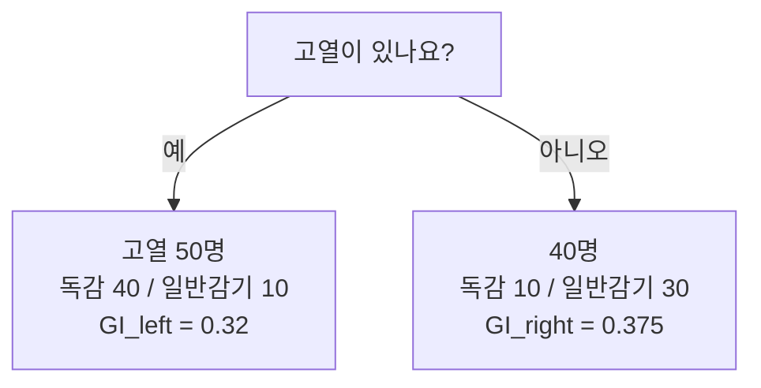
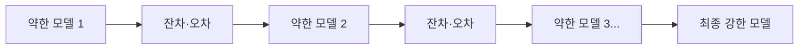

# 세션 09: 지니 불순도 & Gradient Boosting

<!-- session-nav -->
**이동:** [← 세션 08](./session08.md) · [세션 10 →](./session10.md)

> **이 세션이 하는 일 (쉬운 말)**  
> 지난번에 결정 트리(Decision Tree)와 앙상블을 배웠습니다.  
> 오늘은 트리가 **어떤 질문을 먼저 고르는지** 숫자로 보는 법(**지니 불순도**)과,  
> 틀린 곳을 하나씩 고쳐 가는 **Gradient Boosting**을 쉽게 정리합니다.

---

## 1. 지니 불순도 (Gini Impurity)

- 데이터셋 안에 서로 다른 분류가 얼마나 섞여 있는지 나타내는 지표
- 값이 낮을수록 한쪽으로 잘 갈라진 상태 (순수에 가까움)
- Decision Tree는 분할 질문마다 불순도를 계산해, 가장 낮아지는 질문을 선택

> **쉽게 이해하기**  
> **결정 트리(Decision Tree)** 는 나눈 뒤 **지니 불순도(Gini Impurity, 섞임 정도)** 가 가장 줄어드는 질문을 고릅니다.  
> 지니 불순도는 한 덩어리에 서로 다른 **클래스(종류)** 가 얼마나 섞였는지 숫자로 잰 값입니다.  
> 한 종류만 있으면 값이 낮고, 반반이면 높습니다.  
> 사탕을 색으로 나누는 질문처럼, 한쪽이 깨끗해지는 질문이 유리합니다.

### 예시 — 질문: "고열이 있나요?" (분류 대상: 독감)

| 분기 | 인원 | 독감 | 일반감기 | GI |
| ---- | ---- | ---- | -------- | ----- |
| 예 (left) | 50 | 40 | 10 | 0.32 |
| 아니오 (right) | 40 | 10 | 30 | 0.375 |

> **쉽게 이해하기**  
> “고열이 있나요?”로 나눈 뒤 **GI(지니 불순도)** 를 봅니다.  
> **예(left)**: 독감 40·감기 10 → GI ≈ 0.32  
> **아니오(right)**: 독감 10·감기 30 → GI ≈ 0.375  
> 한쪽이 한 종류에 가까울수록 GI가 작습니다.  
> 트리는 양쪽 **인원 비율로 가중 평균**한 GI로 질문 후보를 비교합니다.

### 질문별 불순도 비교 → root 선택

| 질문 | 불순도 | 비고 |
| ---- | ------ | ---- |
| 고열 | 0.344 | 두 번째 분할 |
| 목아픔 | 0.532 | 불순도 높음 |
| 기침 | 0.333 | **가장 낮음 → root** |

- 기침 질문이 root, 그다음 고열로 이어지는 트리 구조

> **쉽게 이해하기**  
> **root(루트, 맨 위 질문)** 는 가중 GI가 **가장 낮은** 질문입니다.  
> 목아픔 0.532, 고열 0.344, **기침 0.333** → 기침이 root입니다.  
> 트리는 “기침 → 고열 …” 순으로, 아래로 갈수록 섞임을 줄입니다.

---

## 2. Gradient Boosting

- weak learner(약한 학습기)를 **순차적으로** 학습
- 주로 Decision Tree를 사용
- 이전 모델의 오차를 경사하강법(Gradient Descent)으로 줄여 나감
- 대표 변형: **XGBoost** (속도·규제·가지치기 개선)

- session06 앙상블: Bagging은 병렬·분산 감소, Boosting(Gradient Boost 포함)은 순차·오답 집중으로 정확도 향상

> **쉽게 이해하기**  
> **Gradient Boosting(그래디언트 부스팅)** 은 **weak learner(약한 학습기, 작은 모델)** 를 순서대로 쌓아, 이전 **잔차(residual, 남은 오차)** 를 다음 모델이 줄입니다.  
> 보통 얕은 **결정 트리(Decision Tree)** 를 씁니다.  
> 오차를 줄이는 방향은 **경사하강법(Gradient Descent)** 과 같은 아이디어입니다.  
> **XGBoost** 는 속도·규제·가지치기를 더한 대표 변형입니다.  
> **Bagging**(예: Random Forest)은 병렬·투표로 흔들림을 줄이고, **Boosting** 은 순차로 오답에 집중합니다.

---

## 복습 체크 (스스로)

1. 지니 불순도가 “낮다”는 것은 데이터가 어떤 상태인가요?
2. 결정 트리는 여러 질문 후보 중 무엇을 고르나요?
3. Gradient Boosting에서 다음 모델은 무엇을 배우나요?
4. Bagging과 Boosting의 큰 차이는 무엇인가요?
5. XGBoost는 무엇의 변형인가요?

답 보기

1. 한 종류로 잘 모여 있어 섞임이 적은(순수한) 상태.
2. 나눈 뒤 불순도가 가장 낮아지는(가장 잘 가르는) 질문.
3. 이전 모델이 남긴 잔차·오차를 줄이는 쪽을 학습합니다.
4. Bagging은 병렬·투표로 흔들림을 줄이고, Boosting은 순차로 오답에 집중해 정확도를 올립니다.
5. Gradient Boosting을 속도·규제·가지치기 등으로 개선한 변형입니다.

<!-- session-nav -->
**이동:** [← 세션 08](./session08.md) · [세션 10 →](./session10.md)
