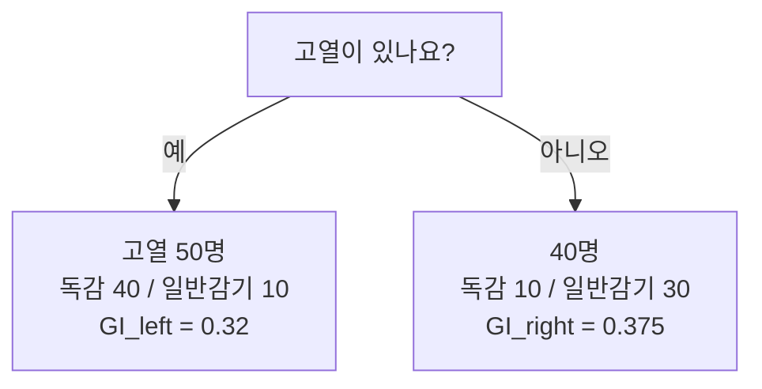

# 세션 09: 지니 불순도 & Gradient Boosting

> **이 세션이 하는 일 (쉬운 말)**  
> 지난번에 결정 트리(Decision Tree)와 앙상블을 배웠습니다.  
> 오늘은 트리가 **어떤 질문을 먼저 고르는지** 숫자로 보는 법(**지니 불순도**)과,  
> 틀린 곳을 하나씩 고쳐 가는 **Gradient Boosting**을 쉽게 정리합니다.

---

## 1. 지니 불순도 (Gini Impurity)

- 데이터셋 안에 서로 다른 분류가 얼마나 섞여 있는지 나타내는 지표
- 값이 낮을수록 한쪽으로 잘 갈라진 상태 (순수에 가까움)
- Decision Tree는 분할 질문마다 불순도를 계산해, 가장 낮아지는 질문을 선택

> **쉽게 이해하기**  
> **지니 불순도(Gini Impurity)** = “이 바구니에 서로 다른 종류가 얼마나 섞여 있나?”를 숫자로 잰 값입니다.
>
> - 바구니에 **독감만** 있으면 → 아주 순수 → 불순도 **낮음** (거의 0)
> - 독감과 감기가 **반반**이면 → 많이 섞임 → 불순도 **높음**
>
> 결정 트리(Decision Tree)는 질문을 하나 던질 때마다  
> “예 / 아니오” 두 바구니로 나눕니다.  
> 그리고 **나눈 뒤 불순도가 가장 많이 떨어지는 질문**을 고릅니다.
>
> 비유: 사탕을 “빨강만 / 파랑만”으로 잘 가르는 질문을 찾는 것과 같습니다.  
> “맛있니?”처럼 애매한 질문보다, “빨간색이니?”처럼 **한쪽이 깨끗해지는** 질문이 이깁니다.

### 예시 — 질문: "고열이 있나요?" (분류 대상: 독감)

| 분기 | 인원 | 독감 | 일반감기 | GI |
| ---- | ---- | ---- | -------- | ----- |
| 예 (left) | 50 | 40 | 10 | 0.32 |
| 아니오 (right) | 40 | 10 | 30 | 0.375 |

> **쉽게 이해하기**  
> “고열이 있나요?”로 나눈 결과입니다.
>
> - **예(left)**: 50명 중 독감 40, 감기 10 → 독감 쪽으로 꽤 몰림 → GI ≈ 0.32 (상대적으로 낮음)
> - **아니오(right)**: 40명 중 독감 10, 감기 30 → 감기가 많지만 아직 섞임 → GI ≈ 0.375
>
> 한쪽이 “거의 독감만”에 가까울수록 그 바구니의 GI는 작아집니다.  
> 트리는 이런 숫자를 **양쪽 인원 비율로 가중 평균**해서,  
> “이 질문이 전체로 얼마나 깨끗하게 갈랐는지”를 비교합니다.

### 질문별 불순도 비교 → root 선택

| 질문 | 불순도 | 비고 |
| ---- | ------ | ---- |
| 고열 | 0.344 | 두 번째 분할 |
| 목아픔 | 0.532 | 불순도 높음 |
| 기침 | 0.333 | **가장 낮음 → root** |

- 기침 질문이 root, 그다음 고열로 이어지는 트리 구조

> **쉽게 이해하기**  
> 후보 질문 세 개를 같은 방식으로 점수 매깁니다.
>
> - 목아픔: 0.532 → 갈라도 여전히 많이 섞임 → 나쁜 첫 질문
> - 고열: 0.344 → 괜찮은 편
> - 기침: 0.333 → **가장 낮음** → **root(맨 위 질문)** 으로 선택
>
> 그래서 트리는 “기침 → (그다음) 고열 …” 순으로 자랍니다.  
> **root** = 나무의 뿌리 = 맨 처음 던지는 질문입니다.  
> “제일 잘 가르는 질문을 맨 위에 두고, 남은 섞임을 아래에서 이어서 줄인다”가 핵심입니다.

---

## 2. Gradient Boosting

- weak learner(약한 학습기)를 **순차적으로** 학습
- 주로 Decision Tree를 사용
- 이전 모델의 오차를 경사하강법(Gradient Descent)으로 줄여 나감
- 대표 변형: **XGBoost** (속도·규제·가지치기 개선)

- session06 앙상블: Bagging은 병렬·분산 감소, Boosting(Gradient Boost 포함)은 순차·오답 집중으로 정확도 향상

> **쉽게 이해하기**  
> **Gradient Boosting(그래디언트 부스팅)** = “약한 모델”을 **한 명씩 차례로** 불러서,  
> 앞 사람이 **틀린 부분**을 다음 사람이 고치게 하는 방법입니다.
>
> 1. 약한 모델 1이 대충 예측합니다  
> 2. 틀린 양(**잔차·오차, residual**)을 계산합니다  
> 3. 약한 모델 2는 “그 틀린 양”을 맞추도록 학습합니다  
> 4. 모델 3, 4…도 같은 식으로 **남은 오차**를 줄입니다  
> 5. 마지막에 이들의 예측을 합치면 **강한 모델**이 됩니다
>
> **weak learner(약한 학습기)** = 혼자서는 성능이 평범한 작은 모델.  
> 보통 얕은 결정 트리(Decision Tree)를 많이 씁니다.
>
> “Gradient(경사)”가 붙는 이유:  
> 오차를 줄이는 방향을 **경사하강법(Gradient Descent)** 아이디어로 잡기 때문입니다.  
> “틀린 쪽으로 조금씩 보정”을 반복한다고 생각하면 됩니다.
>
> **XGBoost** = Gradient Boosting을 **더 빠르고 단단하게** 만든 대표 변형입니다.  
> (속도 최적화, 규제, 가지치기 등이 들어갑니다.)
>
> session06 복습 한 줄:
>
> - **Bagging**(예: Random Forest): 여러 모델을 **동시에(병렬)** 키우고 투표 → 흔들림(분산) 줄이기
> - **Boosting**(예: Gradient Boosting): 모델을 **차례로(순차)** 키우고 오답에 집중 → 정확도 끌어올리기

---

## 복습 체크 (스스로)

1. 지니 불순도가 “낮다”는 것은 데이터가 어떤 상태인가요?
2. 결정 트리는 여러 질문 후보 중 무엇을 고르나요?
3. Gradient Boosting에서 다음 모델은 무엇을 배우나요?
4. Bagging과 Boosting의 큰 차이는 무엇인가요?
5. XGBoost는 무엇의 변형인가요?

답 보기

1. 한 종류로 잘 모여 있어 섞임이 적은(순수한) 상태.
2. 나눈 뒤 불순도가 가장 낮아지는(가장 잘 가르는) 질문.
3. 이전 모델이 남긴 잔차·오차를 줄이는 쪽을 학습합니다.
4. Bagging은 병렬·투표로 흔들림을 줄이고, Boosting은 순차로 오답에 집중해 정확도를 올립니다.
5. Gradient Boosting을 속도·규제·가지치기 등으로 개선한 변형입니다.

