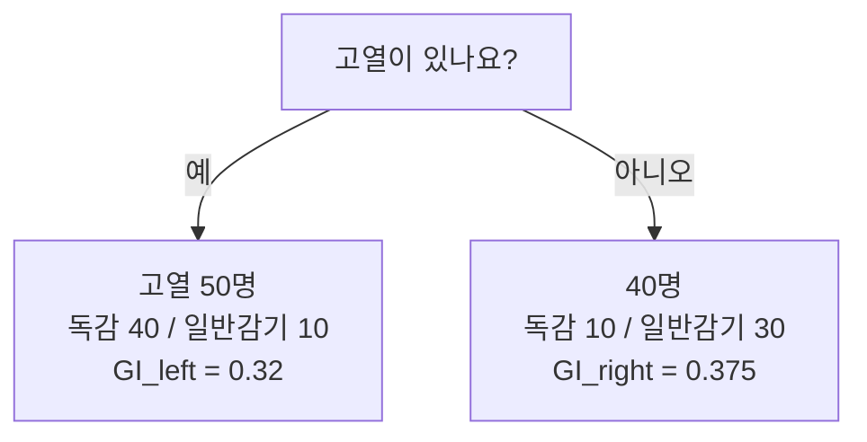

# 세션 09: 지니 불순도 & Gradient Boosting

## 1. 지니 불순도 (Gini Impurity)

- 데이터셋 안에 서로 다른 분류가 얼마나 섞여 있는지 나타내는 지표
- 값이 낮을수록 한쪽으로 잘 갈라진 상태 (순수에 가까움)
- Decision Tree는 분할 질문마다 불순도를 계산해, 가장 낮아지는 질문을 선택

### 예시 — 질문: "고열이 있나요?" (분류 대상: 독감)

| 분기 | 인원 | 독감 | 일반감기 | GI |
| ---- | ---- | ---- | -------- | ----- |
| 예 (left) | 50 | 40 | 10 | 0.32 |
| 아니오 (right) | 40 | 10 | 30 | 0.375 |

### 질문별 불순도 비교 → root 선택

| 질문 | 불순도 | 비고 |
| ---- | ------ | ---- |
| 고열 | 0.344 | 두 번째 분할 |
| 목아픔 | 0.532 | 불순도 높음 |
| 기침 | 0.333 | **가장 낮음 → root** |

- 기침 질문이 root, 그다음 고열로 이어지는 트리 구조

## 2. Gradient Boosting

- weak learner(약한 학습기)를 **순차적으로** 학습
- 주로 Decision Tree를 사용
- 이전 모델의 오차를 경사하강법(Gradient Descent)으로 줄여 나감
- 대표 변형: **XGBoost** (속도·규제·가지치기 개선)

- session06 앙상블: Bagging은 병렬·분산 감소, Boosting(Gradient Boost 포함)은 순차·오답 집중으로 정확도 향상
