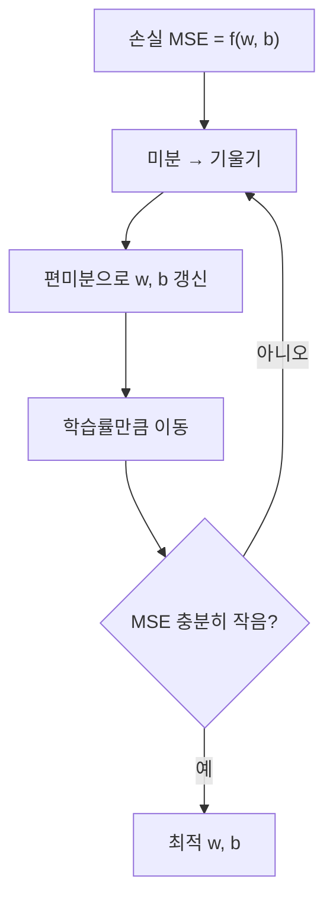

# 세션 10: 회귀 입문 (머신 러닝 4)

## 1. 회귀(Regression)란

- 프랜시스 골턴(Francis Galton)에서 유래한 개념
- **연속형 수치**를 예측하는 지도학습
- 예: 강수량, 매출, 집값, 성적
- 회귀모델 학습 방법 중 하나가 **경사하강법(Gradient Descent)**

### 단순 선형 vs 다중 선형

| 구분 | 식 | 설명 |
| ---- | -- | ---- |
| 단순 선형회귀 | \( y = wx + b \) | 독립변수(피처) 1개 |
| 다중 선형회귀 | \( y = w_1 x_1 + \cdots + w_n x_n + b \) | 독립변수 2개 이상 |

- **단순 선형회귀**: 하나의 피처로 목표값을 직선으로 설명
- **다중 선형회귀**: 여러 피처의 가중합으로 목표값을 설명

## 2. 분류 vs 회귀

| 구분 | 분류 (Classification) | 회귀 (Regression) |
| ---- | --------------------- | ----------------- |
| 예측 대상 | 범주·클래스 | 연속형 수치 |
| 예 | 독감/감기, 생존/사망 | 집값 3억, 점수 82.5 |
| 주의 | — | 집가격을 "저/중/고" **구간**으로 나누면 회귀가 아님 → 분류 |

## 3. 차원 (Dimension)

- 피처 하나 = 차원 하나
- 평수·가격 → **2차원**
- 평수·방 개수·가격 → **3차원**
- 피처가 늘수록 공간이 커지고, 시각화·해석이 어려워짐

## 4. BMI 예시 (단변수 선형회귀)

- 식: \( \hat{y} = \text{coef} \cdot \text{BMI} + \text{intercept} \)
- 예: `coef` ≈ 933.2 또는 977.7, `intercept` ≈ 152.5
- **coef**: BMI가 1 증가할 때 예측값이 얼마나 변하는지 (기울기)
- **intercept**: BMI가 0일 때 예측값 (절편, y절편)

## 5. California Housing 데이터

- 다중 선형회귀 실습에 자주 쓰는 주택 가격 데이터
- Kaggle: [california-housing](https://www.kaggle.com/datasets/sooyoungher/california-housing?resource=download)

## 6. 다중공선성 (Multicollinearity)

- 피처끼리 상관관계가 높으면 가중치가 **불안정**해짐
- 예: 가격 ↔ 평수 ↔ 화장실 수 ↔ 방 개수
- 비슷한 정보를 중복 넣으면 어떤 피처의 영향인지 분리하기 어려움

## 7. 규제 (Regularization)

| 기법 | 방식 | 효과 |
| ---- | ---- | ---- |
| L1 Lasso | 가중치 절댓값 합 | 일부 가중치를 **0**으로 → 피처 선택 |
| L2 Ridge | 가중치 제곱합 | 모든 가중치를 **조금씩** 축소 |
| Elastic Net | L1 + L2 혼합 | 둘의 장점 절충 |

## 8. 다항회귀 (Polynomial Regression)

- \( x^2, x^3 \) 등 고차항을 피처로 추가
- 직선이 아닌 **곡선** 패턴을 학습

## 9. MSE와 오차 최소화

### MSE (Mean Squared Error)

- 실제값과 예측값 차의 **제곱합 평균**
- \( \mathrm{MSE} = \dfrac{1}{n} \sum (y_i - \hat{y}_i)^2 \)
- 손실 함수가 **이차함수** 형태 → 아래로 볼록한 그릇 모양
- 목표: MSE를 최소화하는 \( w, b \) 찾기

### 경사하강법으로 파라미터 탐색

- \( y = wx + b \)에서 가중치 \( w \)를 반복 갱신
- **학습률(learning rate)**: 한 번에 얼마나 이동할지
- **경사하강법** = 최적화 알고리즘 (어떻게 찾을지)
- **회귀** = 모델(예측 식의 모양)
