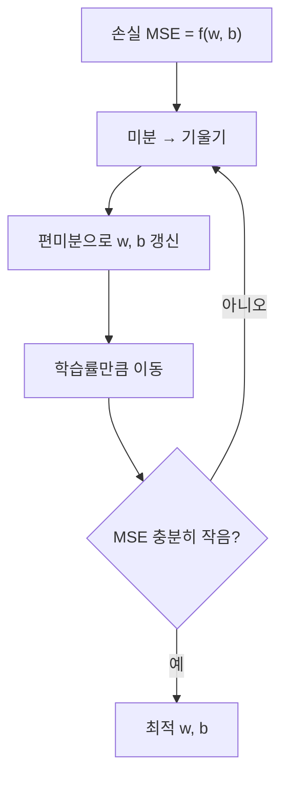

# 세션 10: 회귀 입문 (머신 러닝 4)

<!-- session-nav -->
**이동:** [← 세션 09](./session09.md) · [세션 11 →](./session11.md)

> **이 세션이 하는 일 (쉬운 말)**  
> 지금까지는 주로 “어느 쪽일까?”(**분류**)를 봤습니다.  
> 오늘은 “얼마일까?”(**회귀**)로 넘어갑니다.  
> 직선으로 숫자를 맞추는 기본 아이디어, 오차(MSE), 경사하강법,  
> 그리고 변수가 많을 때 쓰는 **규제**까지 **입문** 눈높이로 정리합니다.  
> (같은 주제의 심화는 session15에서 이어집니다.)

---

## 1. 회귀(Regression)란

- 프랜시스 골턴(Francis Galton)에서 유래한 개념
- **연속형 수치**를 예측하는 지도학습
- 예: 강수량, 매출, 집값, 성적
- 회귀모델 학습 방법 중 하나가 **경사하강법(Gradient Descent)**

> **쉽게 이해하기**  
> **회귀(Regression)** 는 **숫자**를 맞추는 지도학습입니다.  
> 강수량·집값처럼 연속 값이 목표입니다. 분류는 예/아니오, 회귀는 “얼마”입니다.  
> 오차를 줄이는 대표 방법이 **경사하강법(Gradient Descent)** 입니다.

### 단순 선형 vs 다중 선형

| 구분 | 식 | 설명 |
| ---- | -- | ---- |
| 단순 선형회귀 | \( y = wx + b \) | 독립변수(피처) 1개 |
| 다중 선형회귀 | \( y = w_1 x_1 + \cdots + w_n x_n + b \) | 독립변수 2개 이상 |

- **단순 선형회귀**: 하나의 피처로 목표값을 직선으로 설명
- **다중 선형회귀**: 여러 피처의 가중합으로 목표값을 설명

> **쉽게 이해하기**  
> **피처(feature, 특성)** 는 원인, **타깃(target)** 은 맞출 숫자입니다.  
> **단순 선형회귀(Simple Linear Regression)** 는 피처 하나로 직선 \( y = wx + b \) 를 맞춥니다.  
> **다중 선형회귀(Multiple Linear Regression)** 는 피처 여러 개의 가중합으로 맞춥니다.  
> 입문 한 줄: 단순은 직선 하나, 다중은 원인 여러 개를 더합니다.

---

## 2. 분류 vs 회귀

| 구분 | 분류 (Classification) | 회귀 (Regression) |
| ---- | --------------------- | ----------------- |
| 예측 대상 | 범주·클래스 | 연속형 수치 |
| 예 | 독감/감기, 생존/사망 | 집값 3억, 점수 82.5 |
| 주의 | — | 집가격을 "저/중/고" **구간**으로 나누면 회귀가 아님 → 분류 |

> **쉽게 이해하기**  
> **분류(Classification)** 는 클래스를, **회귀(Regression)** 는 연속 숫자를 맞춥니다.  
> 집값을 “저·중·고” 구간으로 바꾸면 분류가 됩니다.  
> 숫자 그 자체를 맞출 때만 회귀입니다.

---

## 3. 차원 (Dimension)

- 피처 하나 = 차원 하나
- 평수·가격 → **2차원**
- 평수·방 개수·가격 → **3차원**
- 피처가 늘수록 공간이 커지고, 시각화·해석이 어려워짐

> **쉽게 이해하기**  
> **차원(Dimension)** 은 피처(축) 개수입니다.  
> 피처 2개면 2차원, 3개면 3차원입니다.  
> 축이 많을수록 눈으로 보기·해석하기 어렵습니다.

---

## 4. BMI 예시 (단변수 선형회귀)

- 식: \( \hat{y} = \text{coef} \cdot \text{BMI} + \text{intercept} \)
- 예: `coef` ≈ 933.2 또는 977.7, `intercept` ≈ 152.5
- **coef**: BMI가 1 증가할 때 예측값이 얼마나 변하는지 (기울기)
- **intercept**: BMI가 0일 때 예측값 (절편, y절편)

> **쉽게 이해하기**  
> BMI 하나로 목표값을 **직선**으로 맞추는 입문 예입니다.  
> \( \hat{y} \) 는 예측값, `coef_` 는 기울기, `intercept_` 는 절편입니다.  
> BMI가 커질수록 목표값도 대체로 커지는 **기울기 감각**만 잡으면 됩니다.

---

## 5. California Housing 데이터

- 다중 선형회귀 실습에 자주 쓰는 주택 가격 데이터
- Kaggle: [california-housing](https://www.kaggle.com/datasets/sooyoungher/california-housing?resource=download)

> **쉽게 이해하기**  
> 캘리포니아 주택 표로 **다중 선형회귀** 를 연습합니다.  
> 여러 집 특징으로 **집값** 하나를 맞춥니다.

---

## 6. 다중공선성 (Multicollinearity)

- 피처끼리 상관관계가 높으면 가중치가 **불안정**해짐
- 예: 가격 ↔ 평수 ↔ 화장실 수 ↔ 방 개수
- 비슷한 정보를 중복 넣으면 어떤 피처의 영향인지 분리하기 어려움

> **쉽게 이해하기**  
> **다중공선성(Multicollinearity)** 은 피처끼리 정보가 거의 겹칠 때입니다.  
> 평수·방 개수·화장실 수를 같이 넣으면 가중치 \( w \) 가 불안정해질 수 있습니다.  
> **규제(Regularization)** 또는 피처를 줄이면 완화합니다.

---

## 7. 규제 (Regularization)

| 기법 | 방식 | 효과 |
| ---- | ---- | ---- |
| L1 Lasso | 가중치 절댓값 합 | 일부 가중치를 **0**으로 → 피처 선택 |
| L2 Ridge | 가중치 제곱합 | 모든 가중치를 **조금씩** 축소 |
| Elastic Net | L1 + L2 혼합 | 둘의 장점 절충 |

> **쉽게 이해하기**  
> **규제(Regularization)** 는 가중치를 키우지 않게 **벌점**을 주어 **과적합(overfitting)** 을 줄입니다.  
> **Lasso(L1)** 는 일부 가중치를 0으로, **Ridge(L2)** 는 전체를 조금씩 줄입니다.  
> **Elastic Net** 은 둘을 섞습니다. 오늘은 이름만 구분하면 됩니다.

---

## 8. 다항회귀 (Polynomial Regression)

- \( x^2, x^3 \) 등 고차항을 피처로 추가
- 직선이 아닌 **곡선** 패턴을 학습

> **쉽게 이해하기**  
> **다항회귀(Polynomial Regression)** 는 \( x^2 \), \( x^3 \) 항을 추가해 **곡선**을 맞춥니다.  
> 차수를 너무 높이면 **과적합** 하기 쉽습니다.  
> 직선으로 안 되면 곡선을 시도한다고 기억하세요.

---

## 9. MSE와 오차 최소화

### MSE (Mean Squared Error)

- 실제값과 예측값 차의 **제곱합 평균**
- \( \mathrm{MSE} = \dfrac{1}{n} \sum (y_i - \hat{y}_i)^2 \)
- 손실 함수가 **이차함수** 형태 → 아래로 볼록한 그릇 모양
- 목표: MSE를 최소화하는 \( w, b \) 찾기

> **쉽게 이해하기**  
> **MSE(Mean Squared Error, 평균제곱오차)** 는 실제 \( y \) 와 예측 \( \hat{y} \) 차이를 제곱해 평균 낸 점수입니다.  
> 작을수록 숫자를 잘 맞춘 것입니다.  
> \( w \), \( b \) 를 바꿔 MSE **최소** 를 찾는 것이 목표입니다.

### 경사하강법으로 파라미터 탐색

- \( y = wx + b \)에서 가중치 \( w \)를 반복 갱신
- **학습률(learning rate)**: 한 번에 얼마나 이동할지
- **경사하강법** = 최적화 알고리즘 (어떻게 찾을지)
- **회귀** = 모델(예측 식의 모양)

> **쉽게 이해하기**  
> **경사하강법(Gradient Descent)** 은 MSE가 줄어드는 방향으로 \( w \), \( b \) 를 반복해 고칩니다.  
> 눈 감고 **골짜기(최소 오차)** 로 내려가는 비유로 이해할 수 있습니다.  
> **학습률(learning rate)** 는 한 걸음 크기입니다. 너무 크면 흔들리고, 너무 작으면 느립니다.  
> **회귀** 는 예측 식 모양, **경사하강법** 은 그 계수를 찾는 방법입니다.

---

## 복습 체크 (스스로)

1. 분류와 회귀의 차이는 무엇인가요? 집값을 “저/중/고”로 나누면 어떤가요?
2. 단순 선형회귀와 다중 선형회귀의 차이는 무엇인가요?
3. 다중공선성이란 무엇인가요? 왜 불편한가요?
4. Lasso와 Ridge를 한 줄씩 말해 보세요.
5. MSE는 무엇을 재나요? 경사하강법은 무엇을 하나요?

답 보기

1. 분류는 범주, 회귀는 연속 숫자. 집값을 구간 라벨로 나누면 분류입니다.
2. 단순은 피처 1개(직선), 다중은 피처 여러 개를 합쳐 맞춤.
3. 피처끼리 정보가 겹쳐 가중치가 불안정·해석이 어려워지는 현상입니다.
4. Lasso는 일부 가중치를 0으로 꺼 피처 선택, Ridge는 가중치를 조금씩 축소합니다.
5. MSE는 예측 오차(제곱 평균). 경사하강법은 MSE가 작아지도록 \( w \), \( b \)를 반복 수정합니다.

<!-- session-nav -->
**이동:** [← 세션 09](./session09.md) · [세션 11 →](./session11.md)
