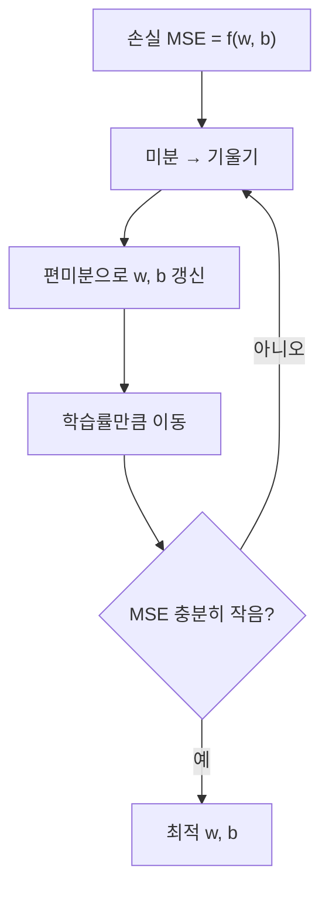

# 세션 10: 회귀 입문 (머신 러닝 4)

> **이 세션이 하는 일 (쉬운 말)**  
> 지금까지는 주로 “어느 쪽일까?”(**분류**)를 봤습니다.  
> 오늘은 “얼마일까?”(**회귀**)로 넘어갑니다.  
> 직선으로 숫자를 맞추는 기본 아이디어, 오차(MSE), 경사하강법,  
> 그리고 변수가 많을 때 쓰는 **규제**까지 **입문** 눈높이로 정리합니다.  
> (같은 주제의 심화는 session15에서 이어집니다.)

---

## 1. 회귀(Regression)란

- 프랜시스 골턴(Francis Galton)에서 유래한 개념
- **연속형 수치**를 예측하는 지도학습
- 예: 강수량, 매출, 집값, 성적
- 회귀모델 학습 방법 중 하나가 **경사하강법(Gradient Descent)**

> **쉽게 이해하기**  
> **회귀(Regression)** = “예/아니오”가 아니라 **숫자**를 맞추는 지도학습입니다.
>
> - 내일 비 올까? → 분류
> - 내일 강수량이 **몇 mm**일까? → 회귀
> - 이 집이 비쌀까/쌀까? → 분류(구간)
> - 이 집값이 **얼마**일까? → 회귀
>
> 이름은 오래전 통계학자 **Francis Galton**의 연구에서 나왔습니다.  
> (지금은 “숫자 예측”이라는 뜻으로 넓게 씁니다.)
>
> 모델을 학습할 때 “얼마나 틀렸는지”를 줄이는 방법 중 하나가  
> 나중에 나올 **경사하강법(Gradient Descent)** 입니다.

### 단순 선형 vs 다중 선형

| 구분 | 식 | 설명 |
| ---- | -- | ---- |
| 단순 선형회귀 | \( y = wx + b \) | 독립변수(피처) 1개 |
| 다중 선형회귀 | \( y = w_1 x_1 + \cdots + w_n x_n + b \) | 독립변수 2개 이상 |

- **단순 선형회귀**: 하나의 피처로 목표값을 직선으로 설명
- **다중 선형회귀**: 여러 피처의 가중합으로 목표값을 설명

> **쉽게 이해하기**  
> **피처(feature, 특성)** = 원인으로 넣는 정보.  
> **목표값(target)** = 맞추고 싶은 숫자.
>
> - **단순 선형회귀(Simple Linear Regression)**: 원인 **1개** → 결과.  
>   종이에 점 찍고 **한 직선**으로 흐름을 설명합니다.  
>   식 \( y = wx + b \)에서 \( w \)는 기울기, \( b \)는 시작 높이(절편)입니다.
>
> - **다중 선형회귀(Multiple Linear Regression)**: 원인 **여러 개**를 한꺼번에.  
>   예: 평수 + 방 개수 + 역까지 거리 → 집값.  
>   각 원인마다 가중치 \( w \)가 하나씩 있고, 영향을 **더해서** 예측합니다.
>
> 입문에서 기억할 한 줄:  
> **단순 = 직선 하나 / 다중 = 여러 원인을 합쳐서 맞춤.**

---

## 2. 분류 vs 회귀

| 구분 | 분류 (Classification) | 회귀 (Regression) |
| ---- | --------------------- | ----------------- |
| 예측 대상 | 범주·클래스 | 연속형 수치 |
| 예 | 독감/감기, 생존/사망 | 집값 3억, 점수 82.5 |
| 주의 | — | 집가격을 "저/중/고" **구간**으로 나누면 회귀가 아님 → 분류 |

> **쉽게 이해하기**  
> 같은 데이터라도 **질문 방식**에 따라 분류/회귀가 갈립니다.
>
> - “이 사람이 생존했을까?” → **분류(Classification)** (클래스)
> - “이 집값이 얼마일까?” → **회귀(Regression)** (연속 숫자)
>
> 함정: 집값을 “저 / 중 / 고” **구간 라벨**로 바꾸면  
> 더 이상 회귀가 아니라 **분류**입니다.  
> “숫자 자체”를 맞출 때만 회귀라고 부르면 헷갈리지 않습니다.

---

## 3. 차원 (Dimension)

- 피처 하나 = 차원 하나
- 평수·가격 → **2차원**
- 평수·방 개수·가격 → **3차원**
- 피처가 늘수록 공간이 커지고, 시각화·해석이 어려워짐

> **쉽게 이해하기**  
> **차원(Dimension)** = “축이 몇 개냐”입니다.  
> 피처를 하나 넣을 때마다 축이 하나 늘어납니다.
>
> - 평수 → 가격만 보면: 가로·세로 **2차원** 평면 위의 점
> - 평수·방 개수 → 가격: **3차원** 공간의 점
> - 피처가 10개면: 사람이 그리기 어려운 고차원 공간
>
> 차원이 커질수록 “점들이 넓게 흩어지고”,  
> 눈으로 보기·해석하기가 어려워집니다.  
> (나중에 규제·피처 선택이 중요해지는 이유 중 하나입니다.)

---

## 4. BMI 예시 (단변수 선형회귀)

- 식: \( \hat{y} = \text{coef} \cdot \text{BMI} + \text{intercept} \)
- 예: `coef` ≈ 933.2 또는 977.7, `intercept` ≈ 152.5
- **coef**: BMI가 1 증가할 때 예측값이 얼마나 변하는지 (기울기)
- **intercept**: BMI가 0일 때 예측값 (절편, y절편)

> **쉽게 이해하기**  
> BMI 하나만으로 어떤 점수(또는 목표값)를 직선으로 맞추는 **입문 예시**입니다.
>
> - \( \hat{y} \) (와이 햇): 모델이 내놓은 **예측값**
> - `coef`(coefficient, 계수/기울기): BMI가 1 올라갈 때 예측이 얼마나 변하는지
> - `intercept`(절편): BMI가 0일 때의 시작값. “기본 높이”
>
> 숫자가 커 보여도 겁낼 필요 없습니다.  
> “BMI가 커질수록 목표값이 대체로 커진다”는 **기울기 감각**만 잡으면 됩니다.  
> (실제 숫자는 데이터·단위에 따라 달라집니다.)

---

## 5. California Housing 데이터

- 다중 선형회귀 실습에 자주 쓰는 주택 가격 데이터
- Kaggle: [california-housing](https://www.kaggle.com/datasets/sooyoungher/california-housing?resource=download)

> **쉽게 이해하기**  
> 캘리포니아 주택 표입니다.  
> 여러 집 특징(위치, 방 수 등)으로 **집값**을 맞추는  
> **다중 선형회귀** 연습용으로 자주 씁니다.  
> “원인 여러 개 → 숫자 하나(가격)”를 코드로 돌려 보기 좋은 데이터입니다.

---

## 6. 다중공선성 (Multicollinearity)

- 피처끼리 상관관계가 높으면 가중치가 **불안정**해짐
- 예: 가격 ↔ 평수 ↔ 화장실 수 ↔ 방 개수
- 비슷한 정보를 중복 넣으면 어떤 피처의 영향인지 분리하기 어려움

> **쉽게 이해하기**  
> **다중공선성(Multicollinearity)** = 피처끼리 정보가 **거의 겹치는** 상황입니다.
>
> 예: 큰 집일수록 방도 많고 화장실도 많습니다.  
> “평수 / 방 개수 / 화장실 수”를 전부 넣으면,  
> 모델이 “집값을 올린 주인공이 누구인지”를 헷갈릴 수 있습니다.
>
> 그 결과 가중치(\( w \))가 **들쭉날쭉·불안정**해질 수 있습니다.  
> 입문 단계에서는 “비슷한 피처를 잔뜩 넣으면 해석이 어려워진다” 정도만 기억해도 충분합니다.  
> (해결 힌트는 아래 **규제**, 또는 피처를 줄이는 것입니다.)

---

## 7. 규제 (Regularization)

| 기법 | 방식 | 효과 |
| ---- | ---- | ---- |
| L1 Lasso | 가중치 절댓값 합 | 일부 가중치를 **0**으로 → 피처 선택 |
| L2 Ridge | 가중치 제곱합 | 모든 가중치를 **조금씩** 축소 |
| Elastic Net | L1 + L2 혼합 | 둘의 장점 절충 |

> **쉽게 이해하기**  
> **규제(Regularization)** = “계수 너무 키우지 마”라는 **벌점**을 넣는 것입니다.  
> 시험 문제만 외운 학생처럼 **학습 데이터에만** 과하게 맞추는 것(**과적합, overfitting**)을 막아,  
> 새 데이터에도 더 잘 버티게(**일반화**) 도와줍니다.
>
> 입문용 한 줄 비교:
>
> - **Lasso (L1)**: 별로 안 중요한 피처의 가중치를 **0으로 끔** → 자동 피처 선택
> - **Ridge (L2)**: 가중치를 **0까지는 안 가더라도** 전체적으로 줄임 → 볼륨만 낮추기
> - **Elastic Net**: 둘을 **섞음**
>
> session15에서 식과 차이를 더 깊게 봅니다.  
> 오늘은 “왜 필요하냐 / 이름만 구분”이면 됩니다.

---

## 8. 다항회귀 (Polynomial Regression)

- \( x^2, x^3 \) 등 고차항을 피처로 추가
- 직선이 아닌 **곡선** 패턴을 학습

> **쉽게 이해하기**  
> 현실의 관계가 항상 직선은 아닙니다.  
> 처음엔 천천히 오르다가 나중에 급격히 오르는 식의 **곡선**일 수 있습니다.
>
> **다항회귀(Polynomial Regression)**는 \( x \) 외에 \( x^2 \), \( x^3 \) 같은 항을  
> 피처처럼 추가해서, **구부러진 선**을 맞출 수 있게 합니다.
>
> 주의: 차수를 너무 높이면 구불구불해지며 **과적합**하기 쉽습니다.  
> “직선으로 안 되면 곡선을 시도한다” 정도만 기억하세요.

---

## 9. MSE와 오차 최소화

### MSE (Mean Squared Error)

- 실제값과 예측값 차의 **제곱합 평균**
- \( \mathrm{MSE} = \dfrac{1}{n} \sum (y_i - \hat{y}_i)^2 \)
- 손실 함수가 **이차함수** 형태 → 아래로 볼록한 그릇 모양
- 목표: MSE를 최소화하는 \( w, b \) 찾기

> **쉽게 이해하기**  
> **MSE(Mean Squared Error, 평균제곱오차)** = “얼마나 틀렸는지”를 하나의 점수로 만든 것입니다.
>
> 1. 실제 \( y \)와 예측 \( \hat{y} \)의 차이를 구합니다  
> 2. 제곱합니다 (큰 실수를 더 크게 벌하고, 부호를 없앱니다)  
> 3. 평균을 냅니다
>
> MSE가 작을수록 모델이 숫자를 잘 맞춘 것입니다.  
> \( w \), \( b \)를 바꾸면 MSE가 달라집니다.  
> 그 모양을 그리면 대체로 **아래로 볼록한 그릇**처럼 보입니다.  
> 우리는 그 그릇의 **맨 아래(최소)** 를 찾고 싶습니다.

### 경사하강법으로 파라미터 탐색

- \( y = wx + b \)에서 가중치 \( w \)를 반복 갱신
- **학습률(learning rate)**: 한 번에 얼마나 이동할지
- **경사하강법** = 최적화 알고리즘 (어떻게 찾을지)
- **회귀** = 모델(예측 식의 모양)

> **쉽게 이해하기**  
> 정답 \( w \), \( b \)를 처음부터 알 수는 없습니다.  
> **경사하강법(Gradient Descent)** 은 이렇게 찾습니다.
>
> 1. 아무 값으로 시작해 예측한다  
> 2. MSE(오차)를 본다  
> 3. 오차가 **줄어드는 방향**(기울기)으로 \( w \), \( b \)를 살짝 고친다  
> 4. 충분히 작아질 때까지 반복한다
>
> 비유: 눈 감고 산에서 **골짜기(최소 오차)** 로 한 걸음씩 내려가기.
>
> - **학습률(learning rate)**: 한 번에 몇 걸음 크게 가느냐  
>   - 너무 크면: 골짜기를 지나쳐 흔들림  
>   - 너무 작으면: 너무 느림
>
> 역할 구분 (중요):
>
> - **회귀** = “예측 식이 어떤 모양인지”(모델)
> - **경사하강법** = “그 식의 \( w \), \( b \)를 **어떻게 찾을지**”(최적화 알고리즘)

---

## 복습 체크 (스스로)

1. 분류와 회귀의 차이는 무엇인가요? 집값을 “저/중/고”로 나누면 어떤가요?
2. 단순 선형회귀와 다중 선형회귀의 차이는 무엇인가요?
3. 다중공선성이란 무엇인가요? 왜 불편한가요?
4. Lasso와 Ridge를 한 줄씩 말해 보세요.
5. MSE는 무엇을 재나요? 경사하강법은 무엇을 하나요?

답 보기

1. 분류는 범주, 회귀는 연속 숫자. 집값을 구간 라벨로 나누면 분류입니다.
2. 단순은 피처 1개(직선), 다중은 피처 여러 개를 합쳐 맞춤.
3. 피처끼리 정보가 겹쳐 가중치가 불안정·해석이 어려워지는 현상입니다.
4. Lasso는 일부 가중치를 0으로 꺼 피처 선택, Ridge는 가중치를 조금씩 축소합니다.
5. MSE는 예측 오차(제곱 평균). 경사하강법은 MSE가 작아지도록 \( w \), \( b \)를 반복 수정합니다.

