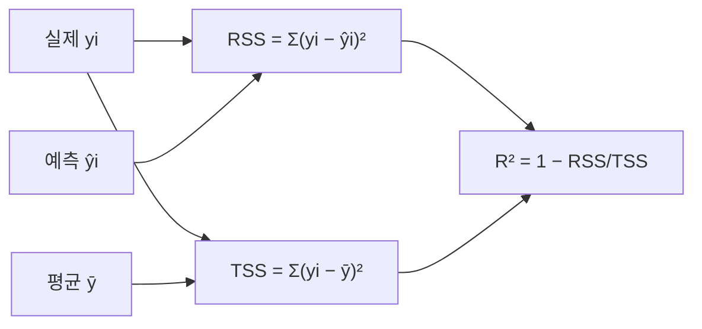

# 세션 11: 당뇨병 회귀 & R²

<!-- session-nav -->

**이동:** [← 세션 10](./session10.md) · [세션 12 →](./session12.md)

> **이 세션이 하는 일 (쉬운 말)**  
> session10에서 배운 “숫자 맞추기(회귀)”를  
> **당뇨병 데이터 + BMI 하나**로 실제로 돌려 봅니다.  
> 그리고 모델이 얼마나 잘했는지 알려 주는 점수 **R²(결정계수)** 를  
> 쉬운 말로 읽습니다.

---

## 1. sklearn diabetes — 단변수 선형회귀

- `sklearn.datasets`의 diabetes 데이터
- 피처: BMI → 타깃: 당뇨 진행 점수 (연속값)
- 모델: `LinearRegression` (단변수: BMI 하나)

```python
from sklearn.linear_model import LinearRegression

regr = LinearRegression()
regr.fit(X_bmi, y)   # X_bmi: BMI, y: 당뇨 진행 점수
```

### 학습된 파라미터

| 속성              | 의미               | 예시                                  |
| ----------------- | ------------------ | ------------------------------------- |
| `regr.coef_`      | 기울기 \( \beta \) | `[333]` → BMI 1 증가 시 점수 **+333** |
| `regr.intercept_` | 절편 \( \alpha \)  | `152.91` → BMI가 0일 때 예측값        |

- 예측식: \( \hat{y} = 333 \cdot \mathrm{BMI} + 152.91 \) (예시 수치)

> **쉽게 이해하기**  
> **diabetes 데이터** 는 sklearn 연습용 표입니다. **BMI** 하나로 **당뇨 진행 점수** 를 맞추는 **단변수 선형회귀** 입니다.  
> `LinearRegression().fit(X_bmi, y)` 로 직선을 학습합니다.  
> `coef_` 는 기울기, `intercept_` 는 절편입니다.  
> \( \hat{y} = (\text{기울기}) \times \mathrm{BMI} + (\text{절편}) \) 형태입니다.

---

## 2. 결정계수 R²

> **쉽게 이해하기**  
> **R²**는 “평균만 찍는 것보다 모델이 얼마나 나은가?”를 보는 점수입니다.  
> 수식 기호가 나와도, 먼저 **1에 가까우면 잘 맞춘 편**, **0이면 평균과 비슷**, **음수면 평균보다 못함**만 기억하시면 됩니다.  
> 아래 RSS·TSS는 그 점수를 나누는 **재료**입니다.

\[
R^2 = 1 - \dfrac{\mathrm{RSS}}{\mathrm{TSS}}
\]

| 기호 | 식                              | 의미                                              |
| ---- | ------------------------------- | ------------------------------------------------- |
| RSS  | \( \sum (y_i - \hat{y}\_i)^2 \) | 예측과 실제 차의 제곱합 (Residual Sum of Squares) |
| TSS  | \( \sum (y_i - \bar{y})^2 \)    | 평균과 실제 차의 제곱합 (Total Sum of Squares)    |

### R² 해석

| R² 값 | 의미                    |
| ----- | ----------------------- |
| 1     | 완벽한 예측             |
| 0     | 평균값만 찍은 것과 같음 |
| < 0   | 평균보다도 못한 예측    |



- RSS가 TSS보다 작을수록(예측이 평균보다 나을수록) R²는 1에 가까워짐

> **쉽게 이해하기**  
> **R²(R-squared, 결정계수)** 는 “평균만 찍기”보다 모델이 얼마나 나은지 0~1 근처로 보여 줍니다.  
> **RSS(Residual Sum of Squares, 잔차제곱합)** 는 실제와 **예측** 차이의 제곱합입니다.  
> **TSS(Total Sum of Squares, 총제곱합)** 는 실제와 **평균** 차이의 제곱합(기준)입니다.  
> \( R^2 = 1 - \mathrm{RSS}/\mathrm{TSS} \). RSS가 작을수록 1에 가깝고, 평균과 같으면 0, 더 나쁘면 음수입니다.  
> 입문에서는 **1에 가까울수록 평균 대비 설명이 좋다** 고 보면 됩니다.

---

## 실습 노트북

- `Machine Learning/Jupyter/03_diabetes_regression.ipynb`에서 BMI 단변수 회귀·R² 실습

> **쉽게 이해하기**  
> `03_diabetes_regression.ipynb` 에서 BMI 직선·`coef_`·`intercept_`·R² 를 숫자로 확인합니다.

---

## 복습 체크 (스스로)

1. 이 실습에서 피처와 타깃은 각각 무엇인가요?
2. `coef_`와 `intercept_`는 각각 무엇을 의미하나요?
3. RSS와 TSS는 각각 무엇을 재나요?
4. R²가 0에 가깝다는 것은 어떤 뜻인가요?
5. R²가 음수이면 무엇을 의미하나요?

<details>
<summary>답 보기</summary>

1. 피처는 BMI, 타깃은 당뇨 진행 점수(연속값)입니다.
2. `coef_`는 기울기(BMI 1 증가 시 점수 변화), `intercept_`는 BMI 0일 때 예측값(절편)입니다.
3. RSS는 실제−예측 오차의 제곱합, TSS는 실제−평균 차이의 제곱합입니다.
4. 모델이 “평균만 찍는 것”과 비슷한 설명력이라는 뜻입니다.
5. 평균만 말하는 것보다도 못하다는 뜻입니다.

</details>

<!-- session-nav -->

**이동:** [← 세션 10](./session10.md) · [세션 12 →](./session12.md)
