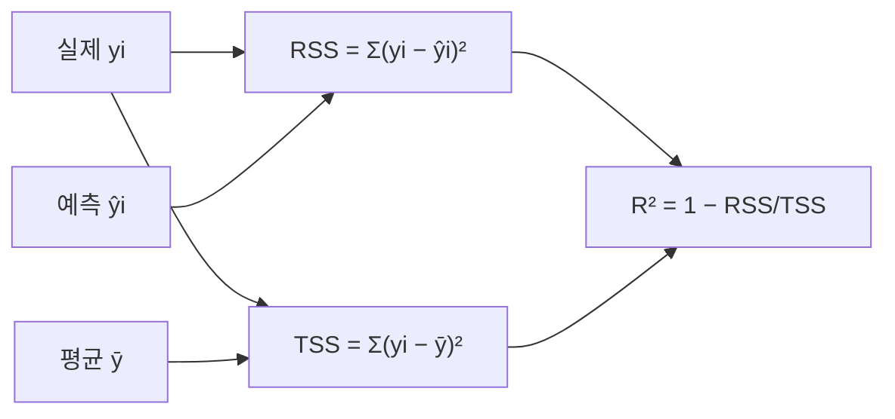

# 세션 11: 당뇨병 회귀 & R²

> **이 세션이 하는 일 (쉬운 말)**  
> session10에서 배운 “숫자 맞추기(회귀)”를  
> **당뇨병 데이터 + BMI 하나**로 실제로 돌려 봅니다.  
> 그리고 모델이 얼마나 잘했는지 알려 주는 점수 **R²(결정계수)** 를  
> 쉬운 말로 읽습니다.

---

## 1. sklearn diabetes — 단변수 선형회귀

- `sklearn.datasets`의 diabetes 데이터
- 피처: BMI → 타깃: 당뇨 진행 점수 (연속값)
- 모델: `LinearRegression` (단변수: BMI 하나)

```python
from sklearn.linear_model import LinearRegression

regr = LinearRegression()
regr.fit(X_bmi, y)   # X_bmi: BMI, y: 당뇨 진행 점수
```

### 학습된 파라미터

| 속성 | 의미 | 예시 |
| ---- | ---- | ---- |
| `regr.coef_` | 기울기 \( \beta \) | `[333]` → BMI 1 증가 시 점수 **+333** |
| `regr.intercept_` | 절편 \( \alpha \) | `152.91` → BMI가 0일 때 예측값 |

- 예측식: \( \hat{y} = 333 \cdot \mathrm{BMI} + 152.91 \) (예시 수치)

> **쉽게 이해하기**  
> **diabetes 데이터** = sklearn이 제공하는 연습용 당뇨 관련 표입니다.  
> 각 줄 = 환자(또는 관측) 하나.  
> 오늘은 그중 **BMI 하나만** 원인으로 쓰고,  
> **당뇨 진행 점수**(연속 숫자)를 맞춥니다 → **단변수 선형회귀**.
>
> 코드가 하는 일:
>
> 1. `LinearRegression()`으로 빈 직선 모델을 만듭니다  
> 2. `fit(X_bmi, y)`로 “BMI → 점수”에 가장 잘 맞는 직선(\( w \), \( b \))을 배웁니다
>
> 학습 후 꺼내는 숫자:
>
> - `coef_`(coefficient, 계수/기울기 \( \beta \)): BMI가 1 커질 때 점수가 대략 얼마나 변하는지  
>   예시 `[333]` → “BMI +1 → 점수 약 +333” (데이터·스케일에 따른 예시)
> - `intercept_`(절편 \( \alpha \)): BMI가 0일 때의 시작 예측값
>
> 그래서 예측식은  
> \( \hat{y} = (\text{기울기}) \times \mathrm{BMI} + (\text{절편}) \)  
> 형태입니다.  
> “BMI가 클수록 진행 점수도 대체로 크다”는 **직선 한 줄**로 요약한 것입니다.

---

## 2. 결정계수 R²

\[
R^2 = 1 - \dfrac{\mathrm{RSS}}{\mathrm{TSS}}
\]

| 기호 | 식 | 의미 |
| ---- | -- | ---- |
| RSS | \( \sum (y_i - \hat{y}_i)^2 \) | 예측과 실제 차의 제곱합 (Residual Sum of Squares) |
| TSS | \( \sum (y_i - \bar{y})^2 \) | 평균과 실제 차의 제곱합 (Total Sum of Squares) |

### R² 해석

| R² 값 | 의미 |
| ----- | ---- |
| 1 | 완벽한 예측 |
| 0 | 평균값만 찍은 것과 같음 |
| < 0 | 평균보다도 못한 예측 |



- RSS가 TSS보다 작을수록(예측이 평균보다 나을수록) R²는 1에 가까워짐

> **쉽게 이해하기**  
> **R²(R-squared, 결정계수)** = “우리 모델이, **그냥 평균만 찍는 것**보다 얼마나 나은가?”를  
> 0~1 근처의 점수로 보여 줍니다.
>
> 먼저 두 가지 오차 바구니를 만듭니다.
>
> - **RSS (Residual Sum of Squares, 잔차제곱합)**  
>   실제와 **모델 예측**이 얼마나 다른지(제곱해서 합함).  
>   → “우리 직선이 틀린 총량”
>
> - **TSS (Total Sum of Squares, 총제곱합)**  
>   실제와 **전체 평균** \( \bar{y} \)가 얼마나 다른지.  
>   → “아무 생각 없이 평균만 말할 때 틀리는 총량” (기준선)
>
> 식 \( R^2 = 1 - \mathrm{RSS}/\mathrm{TSS} \)의 느낌:
>
> - 모델이 아주 잘해서 RSS가 거의 0 → R² ≈ **1** (완벽에 가까움)
> - 모델이 평균과 비슷하면 RSS ≈ TSS → R² ≈ **0** (“평균만 찍은 것과 같음”)
> - 모델이 평균보다 못하면 RSS > TSS → R²가 **음수** (“평균만 말하는 게 나음”)
>
> 비유:  
> 반 평균 점수만 말하는 친구(기준) vs 각자 BMI로 점수를 맞추는 모델.  
> R²가 높을수록 “평균 친구보다 **설명력이 좋다**”는 뜻입니다.
>
> 주의: R²가 높다고 항상 “현실에서 완벽”은 아닙니다.  
> 피처가 하나뿐이면(지금처럼 BMI만) 한계가 있을 수 있고,  
> 과적합 여부·새 데이터 성능은 따로 봐야 합니다.  
> 입문에서는 **“1에 가까울수록 평균 대비 설명이 좋다”** 만 확실히 잡으면 됩니다.

---

## 실습 노트북

- `Machine Learning/Jupyter/diabetes.ipynb`에서 BMI 단변수 회귀·R² 실습

> **쉽게 이해하기**  
> 위 개념을 숫자로 직접 확인하는 노트북입니다.  
> BMI로 직선을 맞춘 뒤 `coef_`, `intercept_`를 보고,  
> R²로 “평균만 찍기보다 나은지”를 확인해 보세요.

---

## 복습 체크 (스스로)

1. 이 실습에서 피처와 타깃은 각각 무엇인가요?
2. `coef_`와 `intercept_`는 각각 무엇을 의미하나요?
3. RSS와 TSS는 각각 무엇을 재나요?
4. R²가 0에 가깝다는 것은 어떤 뜻인가요?
5. R²가 음수이면 무엇을 의미하나요?

<details>
<summary>답 보기</summary>

1. 피처는 BMI, 타깃은 당뇨 진행 점수(연속값)입니다.
2. `coef_`는 기울기(BMI 1 증가 시 점수 변화), `intercept_`는 BMI 0일 때 예측값(절편)입니다.
3. RSS는 실제−예측 오차의 제곱합, TSS는 실제−평균 차이의 제곱합입니다.
4. 모델이 “평균만 찍는 것”과 비슷한 설명력이라는 뜻입니다.
5. 평균만 말하는 것보다도 못하다는 뜻입니다.

</details>
