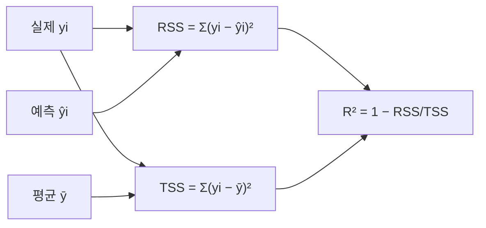

# 세션 11: 당뇨병 회귀 & R²

## 1. sklearn diabetes — 단변수 선형회귀

- `sklearn.datasets`의 diabetes 데이터
- 피처: BMI → 타깃: 당뇨 진행 점수 (연속값)
- 모델: `LinearRegression` (단변수: BMI 하나)

```python
from sklearn.linear_model import LinearRegression

regr = LinearRegression()
regr.fit(X_bmi, y)   # X_bmi: BMI, y: 당뇨 진행 점수
```

### 학습된 파라미터

| 속성 | 의미 | 예시 |
| ---- | ---- | ---- |
| `regr.coef_` | 기울기 \( \beta \) | `[333]` → BMI 1 증가 시 점수 **+333** |
| `regr.intercept_` | 절편 \( \alpha \) | `152.91` → BMI가 0일 때 예측값 |

- 예측식: \( \hat{y} = 333 \cdot \mathrm{BMI} + 152.91 \) (예시 수치)

## 2. 결정계수 R²

\[
R^2 = 1 - \dfrac{\mathrm{RSS}}{\mathrm{TSS}}
\]

| 기호 | 식 | 의미 |
| ---- | -- | ---- |
| RSS | \( \sum (y_i - \hat{y}_i)^2 \) | 예측과 실제 차의 제곱합 (Residual Sum of Squares) |
| TSS | \( \sum (y_i - \bar{y})^2 \) | 평균과 실제 차의 제곱합 (Total Sum of Squares) |

### R² 해석

| R² 값 | 의미 |
| ----- | ---- |
| 1 | 완벽한 예측 |
| 0 | 평균값만 찍은 것과 같음 |
| < 0 | 평균보다도 못한 예측 |



- RSS가 TSS보다 작을수록(예측이 평균보다 나을수록) R²는 1에 가까워짐

---

## 실습 노트북

- `Machine Learning/Jupyter/diabetes.ipynb`에서 BMI 단변수 회귀·R² 실습
