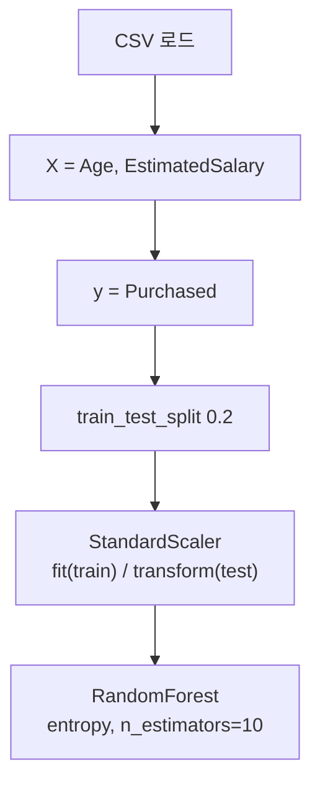

# 세션 12: 오후 실습 (Titanic Bagging / Social_Network_Ads)

> **이 세션이 하는 일 (쉬운 말)**  
> 이론은 이미 session06(앙상블)·session08(전처리 규칙)에서 봤습니다.  
> 오늘은 노트북으로 **직접 돌려 보는 실습**입니다.  
> Titanic에는 **Bagging(Random Forest)** 을 붙이고,  
> Social_Network_Ads에서는 **스케일링 → 랜덤 포레스트 분류** 흐름을 따라갑니다.  
> “각 단계가 **왜** 필요한지”만 쉽게 읽고, 체크리스트·코드 원문은 그대로 따라가면 됩니다.

---

## 파일 경로

| 구분 | 경로 |
| ---- | ---- |
| Titanic 노트북 | `Machine Learning/Jupyter/titanic.ipynb` |
| Social Ads 노트북 | `Machine Learning/Jupyter/social_network_ads.ipynb` |
| Social Ads 데이터 | `Machine Learning/data/Social_Network_Ads.csv` |
| Titanic 데이터 (기존) | `Machine Learning/data/train.csv` |

- Jupyter 실행 기준은 `Jupyter/` 폴더 → 데이터는 `../data/...`로 읽음

> **쉽게 이해하기**  
> 노트북은 `Jupyter/` 안에서 열고, 데이터는 한 단계 위 `data/`에 있습니다.  
> 그래서 경로가 `../data/...`입니다.  
> (노트북 위치 기준으로 “한 칸 위로 가서 data 폴더”라는 뜻입니다.)

---

## 1. Titanic — Bagging (Random Forest)

- notebook: `titanic.ipynb`
- session06 앙상블의 Bagging을 타이타닉에 적용
- `RandomForestClassifier(n_estimators=10)` = DT 10개를 부트스트랩으로 학습
- `GradientBoostingClassifier`도 import (이어서 Boosting 비교용)

> **쉽게 이해하기**  
> 타이타닉은 “이 승객이 **생존했을까?**”를 맞추는 **분류** 문제입니다.
>
> 여기서 쓰는 것은 **Bagging** 계열의 **Random Forest(랜덤 포레스트)** 입니다.
>
> - 결정 트리(Decision Tree)를 **여러 개**(여기서는 10개, `n_estimators=10`) 만듭니다  
> - 각 트리는 데이터를 **조금씩 다르게 뽑아(부트스트랩, bootstrap)** 학습합니다  
> - 마지막에 투표(또는 평균)로 답을 정합니다
>
> 왜 하나요?  
> 트리 하나면 데이터에 민감해서 흔들릴 수 있습니다.  
> 여러 개를 **병렬로** 키워 합치면 흔들림이 줄어드는 것이 Bagging의 아이디어입니다.  
> (`GradientBoostingClassifier`는 나중에 Boosting과 **비교**해 보려고 import해 둔 것입니다.)

### 평가 헬퍼 `eval_model`

```python
from sklearn.ensemble import RandomForestClassifier
from sklearn.ensemble import GradientBoostingClassifier
from sklearn.metrics import accuracy_score, f1_score
import time

def eval_model(model, X_train, y_train, X_test, y_test):
  start_time = time.time()
  model.fit(X_train, y_train)
  elapse_time = time.time() - start_time

  y_train_pred = model.predict(X_train)
  y_test_pred = model.predict(X_test)

  acc_train = accuracy_score(y_train, y_train_pred)
  f1_train = f1_score(y_train, y_train_pred)
  acc_test = accuracy_score(y_test, y_test_pred)
  f1_test = f1_score(y_test, y_test_pred)

  return acc_train, f1_train, acc_test, f1_test, elapse_time
```

> **쉽게 이해하기**  
> `eval_model`은 “모델 하나 넣으면 **학습 → 예측 → 점수·시간**을 한 번에 돌려주는” 도우미 함수입니다.
>
> 안에서 보는 것:
>
> - `fit`: 학습  
> - `predict`: 예측  
> - **accuracy(정확도)**: 맞힌 비율  
> - **F1-score**: 정밀도·재현율을 균형 있게 보는 점수 (생존처럼 클래스 불균형이 있을 때 자주 함께 봄)  
> - `elapse_time`: 학습에 걸린 시간
>
> train/test를 **둘 다** 재는 이유:  
> train만 높고 test가 낮으면 **과적합** 신호일 수 있습니다.  
> 실습에서는 주로 **test 점수**로 “새 데이터에 얼마나 버티나”를 봅니다.

### Bagging 학습·결과

```python
# Bagging
bagging_rf = RandomForestClassifier(n_estimators=10, random_state=1)
acc_train, f1_train, acc_test, f1_test, elapse_time = eval_model(
    bagging_rf, X_train, y_train, X_test, y_test
)
print(f"Bagging 정확도: {acc_test:.2f}, F1-score: {f1_test:.2f}, 학습시간: {elapse_time:.2f}초")
```

| 지표 | 값 |
| ---- | -- |
| 정확도 (test) | **0.79** |
| F1-score (test) | **0.71** |

> **쉽게 이해하기**  
> `random_state=1`은 “랜덤을 같은 시드로 고정”해서  
> 다시 실행해도 **같은 결과**가 나오게 합니다. (재현성)
>
> 표의 숫자는 이 설정으로 돌렸을 때 **test**에서 나온 예시 결과입니다.
>
> - 정확도 0.79 → 대략 100명 중 79명꼴로 맞춤  
> - F1 0.71 → 정확도만 보지 않고, 맞힘의 **질**도 함께 본 점수
>
> “완벽한 점수”가 목표가 아니라,  
> **Bagging을 타이타닉에 붙이는 절차**와 **평가 보는 법**을 익히는 것이 목적입니다.

---

## 2. Social_Network_Ads — Random Forest 분류

### 데이터 컬럼

| 컬럼 | 설명 |
| ---- | ---- |
| User ID | 사용자 ID |
| Gender | 성별 |
| Age | 나이 |
| EstimatedSalary | 추정 급여 |
| Purchased | 구매 여부 (0/1) — **label** |

> **쉽게 이해하기**  
> SNS 광고 맥락의 연습 데이터입니다.  
> 각 줄 = 사용자 한 명.
>
> - **Age**, **EstimatedSalary**: 모델에 넣을 **피처(feature)**  
> - **Purchased**: 광고 상품을 샀는지(0/1) — **label(정답 라벨)**  
> - User ID는 사람 구분자일 뿐 패턴이 아니라서 보통 제외  
> - 이 실습에서는 Gender도 빼고, 나이·급여만 사용합니다
>
> 목표: “나이와 급여를 보고 **살까/안 살까**를 분류”하는 것입니다.

### 실습 흐름



> **쉽게 이해하기**  
> 왜 이 순서인가요?
>
> 1. **CSV 로드**: 표 읽기  
> 2. **X / y 나누기**: 원인(피처)과 정답(라벨) 분리  
> 3. **train_test_split**: 학습용 80% / 시험용 20%로 쪼개기  
>    → 외운 문제로만 잘하는지(과적합) 걸러 내기 위함  
> 4. **StandardScaler**: 나이(수십)와 급여(수만)처럼 **단위·크기가 다른 숫자**를  
>    비슷한 스케일로 맞춤. 거리·분할이 한 피처에만 끌려가지 않게 하려는 전처리  
> 5. **Random Forest**: 트리 여러 개로 분류 학습
>
> “데이터를 읽자마자 바로 모델”이 아니라,  
> **쪼개고 → (필요하면) 스케일 → 학습**이 기본 루틴입니다.

### 핵심 코드

```python
import pandas as pd
from sklearn.model_selection import train_test_split
from sklearn.preprocessing import StandardScaler
from sklearn.ensemble import RandomForestClassifier

dataset = pd.read_csv("../data/Social_Network_Ads.csv")

X = dataset.iloc[:, [2, 3]]   # Age, EstimatedSalary
y = dataset["Purchased"]

X_train, X_test, y_train, y_test = train_test_split(
    X, y, test_size=0.2, random_state=1
)

sc = StandardScaler()
X_train = sc.fit_transform(X_train)   # train에서만 fit
X_test = sc.transform(X_test)         # test는 transform만 (누수 방지)

rf = RandomForestClassifier(
    n_estimators=10, criterion="entropy", random_state=0
)
```

- Age·EstimatedSalary만 피처로 사용 (User ID·Gender 제외)
- scaler: train에 `fit_transform`, test에는 `transform`만 → session08 메서드 규칙과 동일
- `criterion='entropy'`: 분할 기준으로 엔트로피(정보이득) 사용

> **쉽게 이해하기**  
> 코드 한 줄씩 “왜”만 짚습니다. (체크리스트·원문 규칙은 위 불릿 그대로입니다.)
>
> - `iloc[:, [2, 3]]`: 표에서 Age, EstimatedSalary 열만 고름  
> - `test_size=0.2`: 20%를 시험용으로 남겨 둠  
> - **스케일러 규칙 (아주 중요)**  
>   - train: `fit_transform` → “평균·표준편차를 **학습 데이터로만** 계산하고 변환”  
>   - test: `transform`만 → “이미 배운 기준으로만 변환”  
>   - test에까지 `fit` 하면 시험지를 미리 엿보는 **데이터 누수(data leakage)** 가 됩니다  
>     → session08에서 본 메서드 규칙과 같습니다
>
> - `n_estimators=10`: 트리 10개  
> - `criterion="entropy"`: 트리가 가지를 나눌 때  
>   **엔트로피(entropy) / 정보이득(information gain)** 기준으로 “얼마나 깨끗해지나”를 봄  
>   (지니 불순도 대신 엔트로피 쪽을 쓰는 설정입니다)
>
> 실습 체크포인트:
>
> 1. 경로 `../data/...`가 맞는지  
> 2. X/y가 의도한 열인지  
> 3. scaler가 train만 fit인지  
> 4. Random Forest 하이퍼파라미터를 바꿔 보며 점수·시간을 비교해 보기

---

## 복습 체크 (스스로)

1. Titanic 실습에서 Random Forest를 쓰는 이유는 Bagging 관점에서 무엇인가요?
2. `eval_model`이 train과 test 점수를 같이 보는 이유는 무엇인가요?
3. Social_Network_Ads에서 피처와 라벨은 각각 무엇인가요?
4. StandardScaler에서 test에 `fit`을 하면 안 되는 이유는 무엇인가요?
5. `criterion="entropy"`는 무엇을 기준으로 분할하나요?

<details>
<summary>답 보기</summary>

1. 트리 여러 개를 부트스트랩으로 병렬 학습·합쳐 흔들림을 줄이기 위해서입니다.
2. train만 좋고 test가 나쁘면 과적합 신호일 수 있어, 일반화(test)를 함께 보려고입니다.
3. 피처는 Age·EstimatedSalary, 라벨은 Purchased(0/1)입니다.
4. test 통계를 미리 보면 누수(leakage)가 되어 시험 성적이 과대평가됩니다.
5. 엔트로피(정보이득)를 분할 기준으로 사용합니다.

</details>
