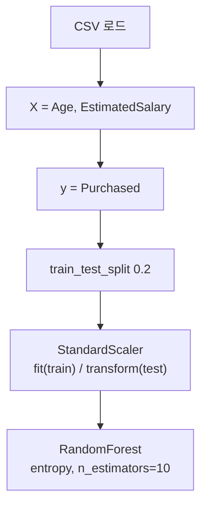

# 세션 12: 오후 실습 (Titanic Bagging / Social_Network_Ads)

<!-- session-nav -->
**이동:** [← 세션 11](./session11.md) · [세션 13 →](./session13.md)

> **이 세션이 하는 일 (쉬운 말)**  
> 이론은 이미 session06(앙상블)·session08(전처리 규칙)에서 봤습니다.  
> 오늘은 노트북으로 **직접 돌려 보는 실습**입니다.  
> Titanic에는 **Bagging(Random Forest)** 을 붙이고,  
> Social_Network_Ads에서는 **스케일링 → 랜덤 포레스트 분류** 흐름을 따라갑니다.  
> “각 단계가 **왜** 필요한지”만 쉽게 읽고, 체크리스트·코드 원문은 그대로 따라가면 됩니다.

---

## 파일 경로

| 구분 | 경로 |
| ---- | ---- |
| Titanic 노트북 | `Machine Learning/Jupyter/02_titanic_classification.ipynb` |
| Social Ads 노트북 | `Machine Learning/Jupyter/05_social_network_ads_rf.ipynb` |
| Social Ads 데이터 | `Machine Learning/data/Social_Network_Ads.csv` |
| Titanic 데이터 (기존) | `Machine Learning/data/train.csv` |

- Jupyter 실행 기준은 `Jupyter/` 폴더 → 데이터는 `../data/...`로 읽음

> **쉽게 이해하기**  
> 노트북은 `Jupyter/` 에서 열고, 데이터는 한 칸 위 `data/` 이므로 `../data/...` 를 씁니다.

---

## 1. Titanic — Bagging (Random Forest)

- notebook: `02_titanic_classification.ipynb`
- session06 앙상블의 Bagging을 타이타닉에 적용
- `RandomForestClassifier(n_estimators=10)` = DT 10개를 부트스트랩으로 학습
- `GradientBoostingClassifier`도 import (이어서 Boosting 비교용)

> **쉽게 이해하기**  
> 타이타닉 **분류(Classification)** 는 승객 **생존 여부** 를 맞춥니다.  
> **Random Forest(랜덤 포레스트)** 는 **Bagging** 으로 결정 트리 **10개**(`n_estimators=10`)를 **부트스트랩(bootstrap, 복원 추출)** 로 학습해 투표합니다.  
> 트리 하나보다 흔들림이 줄어듭니다. `GradientBoostingClassifier` 는 Boosting 비교용 import입니다.

### 평가 헬퍼 `eval_model`

```python
from sklearn.ensemble import RandomForestClassifier
from sklearn.ensemble import GradientBoostingClassifier
from sklearn.metrics import accuracy_score, f1_score
import time

def eval_model(model, X_train, y_train, X_test, y_test):
  start_time = time.time()
  model.fit(X_train, y_train)
  elapse_time = time.time() - start_time

  y_train_pred = model.predict(X_train)
  y_test_pred = model.predict(X_test)

  acc_train = accuracy_score(y_train, y_train_pred)
  f1_train = f1_score(y_train, y_train_pred)
  acc_test = accuracy_score(y_test, y_test_pred)
  f1_test = f1_score(y_test, y_test_pred)

  return acc_train, f1_train, acc_test, f1_test, elapse_time
```

> **쉽게 이해하기**  
> `eval_model` 은 **fit → predict → 정확도·F1·시간** 을 한 번에 돌립니다.  
> **accuracy(정확도)** 는 맞힌 비율, **F1-score** 는 정밀도·재현율 균형 점수입니다.  
> train이 높고 test가 낮으면 **과적합(overfitting)** 신호일 수 있어, 실습은 **test** 를 봅니다.

### Bagging 학습·결과

```python
# Bagging
bagging_rf = RandomForestClassifier(n_estimators=10, random_state=1)
acc_train, f1_train, acc_test, f1_test, elapse_time = eval_model(
    bagging_rf, X_train, y_train, X_test, y_test
)
print(f"Bagging 정확도: {acc_test:.2f}, F1-score: {f1_test:.2f}, 학습시간: {elapse_time:.2f}초")
```

| 지표 | 값 |
| ---- | -- |
| 정확도 (test) | **0.79** |
| F1-score (test) | **0.71** |

> **쉽게 이해하기**  
> `random_state=1` 은 같은 **난수 시드** 로 결과를 고정합니다(재현성).  
> 예시 **test** 정확도 0.79, F1 0.71 은 절차·평가 익히기용입니다. 완벽 점수가 목표는 아닙니다.

---

## 2. Social_Network_Ads — Random Forest 분류

### 데이터 컬럼

| 컬럼 | 설명 |
| ---- | ---- |
| User ID | 사용자 ID |
| Gender | 성별 |
| Age | 나이 |
| EstimatedSalary | 추정 급여 |
| Purchased | 구매 여부 (0/1) — **label** |

> **쉽게 이해하기**  
> 각 줄은 사용자 한 명입니다. **Age**, **EstimatedSalary** 가 **피처(feature)**, **Purchased** 가 **label(정답)** 입니다.  
> User ID·Gender 는 빼고, 나이·급여로 **구매 여부(0/1)** 를 분류합니다.

### 실습 흐름



> **쉽게 이해하기**  
> 순서는 **로드 → X/y 분리 → train_test_split → StandardScaler → Random Forest** 입니다.  
> 스케일은 단위가 다른 숫자를 맞추는 전처리입니다.  
> **쪼개고 → (필요하면) 스케일 → 학습** 이 기본 루틴입니다.

### 핵심 코드

```python
import pandas as pd
from sklearn.model_selection import train_test_split
from sklearn.preprocessing import StandardScaler
from sklearn.ensemble import RandomForestClassifier

dataset = pd.read_csv("../data/Social_Network_Ads.csv")

X = dataset.iloc[:, [2, 3]]   # Age, EstimatedSalary
y = dataset["Purchased"]

X_train, X_test, y_train, y_test = train_test_split(
    X, y, test_size=0.2, random_state=1
)

sc = StandardScaler()
X_train = sc.fit_transform(X_train)   # train에서만 fit
X_test = sc.transform(X_test)         # test는 transform만 (누수 방지)

rf = RandomForestClassifier(
    n_estimators=10, criterion="entropy", random_state=0
)
```

- Age·EstimatedSalary만 피처로 사용 (User ID·Gender 제외)
- scaler: train에 `fit_transform`, test에는 `transform`만 → session08 메서드 규칙과 동일
- `criterion='entropy'`: 분할 기준으로 엔트로피(정보이득) 사용

> **쉽게 이해하기**  
> `iloc[:, [2, 3]]` 로 Age·EstimatedSalary 만 씁니다. `test_size=0.2` 는 20% 시험용입니다.  
> train은 `fit_transform`, test는 `transform` 만 — test에 `fit` 하면 **데이터 누수(data leakage)** 입니다(session08과 동일).  
> `n_estimators=10`, `criterion="entropy"`(엔트로피·정보이득 분할) 설정입니다.  
> 경로·X/y·scaler fit 여부를 체크하세요.

---

## 복습 체크 (스스로)

1. Titanic 실습에서 Random Forest를 쓰는 이유는 Bagging 관점에서 무엇인가요?
2. `eval_model`이 train과 test 점수를 같이 보는 이유는 무엇인가요?
3. Social_Network_Ads에서 피처와 라벨은 각각 무엇인가요?
4. StandardScaler에서 test에 `fit`을 하면 안 되는 이유는 무엇인가요?
5. `criterion="entropy"`는 무엇을 기준으로 분할하나요?

<details>
<summary>답 보기</summary>

1. 트리 여러 개를 부트스트랩으로 병렬 학습·합쳐 흔들림을 줄이기 위해서입니다.
2. train만 좋고 test가 나쁘면 과적합 신호일 수 있어, 일반화(test)를 함께 보려고입니다.
3. 피처는 Age·EstimatedSalary, 라벨은 Purchased(0/1)입니다.
4. test 통계를 미리 보면 누수(leakage)가 되어 시험 성적이 과대평가됩니다.
5. 엔트로피(정보이득)를 분할 기준으로 사용합니다.

</details>

<!-- session-nav -->
**이동:** [← 세션 11](./session11.md) · [세션 13 →](./session13.md)
