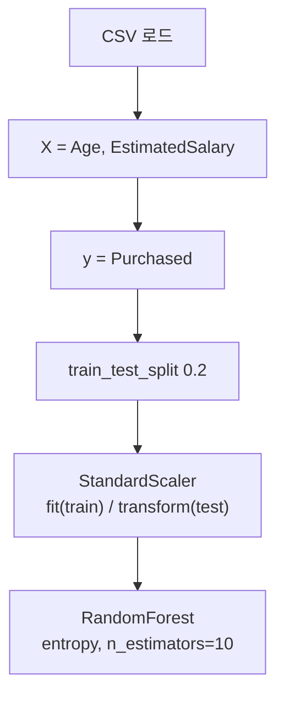

# 세션 12: 오후 실습 (Titanic Bagging / Social_Network_Ads)

## 파일 경로

| 구분 | 경로 |
| ---- | ---- |
| Titanic 노트북 | `Machine Learning/Jupyter/titanic.ipynb` |
| Social Ads 노트북 | `Machine Learning/Jupyter/social_network_ads.ipynb` |
| Social Ads 데이터 | `Machine Learning/data/Social_Network_Ads.csv` |
| Titanic 데이터 (기존) | `Machine Learning/data/train.csv` |

- Jupyter 실행 기준은 `Jupyter/` 폴더 → 데이터는 `../data/...`로 읽음

---

## 1. Titanic — Bagging (Random Forest)

- notebook: `titanic.ipynb`
- session06 앙상블의 Bagging을 타이타닉에 적용
- `RandomForestClassifier(n_estimators=10)` = DT 10개를 부트스트랩으로 학습
- `GradientBoostingClassifier`도 import (이어서 Boosting 비교용)

### 평가 헬퍼 `eval_model`

```python
from sklearn.ensemble import RandomForestClassifier
from sklearn.ensemble import GradientBoostingClassifier
from sklearn.metrics import accuracy_score, f1_score
import time

def eval_model(model, X_train, y_train, X_test, y_test):
  start_time = time.time()
  model.fit(X_train, y_train)
  elapse_time = time.time() - start_time

  y_train_pred = model.predict(X_train)
  y_test_pred = model.predict(X_test)

  acc_train = accuracy_score(y_train, y_train_pred)
  f1_train = f1_score(y_train, y_train_pred)
  acc_test = accuracy_score(y_test, y_test_pred)
  f1_test = f1_score(y_test, y_test_pred)

  return acc_train, f1_train, acc_test, f1_test, elapse_time
```

### Bagging 학습·결과

```python
# Bagging
bagging_rf = RandomForestClassifier(n_estimators=10, random_state=1)
acc_train, f1_train, acc_test, f1_test, elapse_time = eval_model(
    bagging_rf, X_train, y_train, X_test, y_test
)
print(f"Bagging 정확도: {acc_test:.2f}, F1-score: {f1_test:.2f}, 학습시간: {elapse_time:.2f}초")
```

| 지표 | 값 |
| ---- | -- |
| 정확도 (test) | **0.79** |
| F1-score (test) | **0.71** |

---

## 2. Social_Network_Ads — Random Forest 분류

### 데이터 컬럼

| 컬럼 | 설명 |
| ---- | ---- |
| User ID | 사용자 ID |
| Gender | 성별 |
| Age | 나이 |
| EstimatedSalary | 추정 급여 |
| Purchased | 구매 여부 (0/1) — **label** |

### 실습 흐름



### 핵심 코드

```python
import pandas as pd
from sklearn.model_selection import train_test_split
from sklearn.preprocessing import StandardScaler
from sklearn.ensemble import RandomForestClassifier

dataset = pd.read_csv("../data/Social_Network_Ads.csv")

X = dataset.iloc[:, [2, 3]]   # Age, EstimatedSalary
y = dataset["Purchased"]

X_train, X_test, y_train, y_test = train_test_split(
    X, y, test_size=0.2, random_state=1
)

sc = StandardScaler()
X_train = sc.fit_transform(X_train)   # train에서만 fit
X_test = sc.transform(X_test)         # test는 transform만 (누수 방지)

rf = RandomForestClassifier(
    n_estimators=10, criterion="entropy", random_state=0
)
```

- Age·EstimatedSalary만 피처로 사용 (User ID·Gender 제외)
- scaler: train에 `fit_transform`, test에는 `transform`만 → session08 메서드 규칙과 동일
- `criterion='entropy'`: 분할 기준으로 엔트로피(정보이득) 사용
