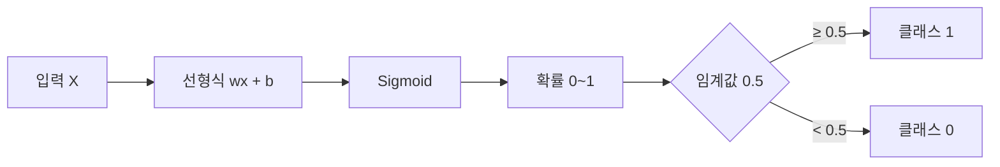
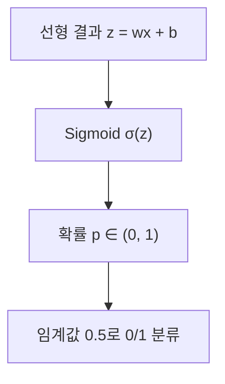

# 세션 15: 머신 러닝 5 — 회귀 심화 · 로지스틱 회귀

session10(회귀 입문)의 연장. 단순·다중·규제는 짧게 복습하고, **로지스틱 회귀·Sigmoid**를 중심으로 정리합니다.

> **이 세션이 하는 일 (쉬운 말)**  
> 지난번에 “숫자를 맞추는 법”(회귀)을 배웠습니다.  
> 오늘은 그걸 조금 더 단단하게 복습한 뒤,  
> **“예 / 아니오”를 가리는 법**(분류)으로 넘어갑니다.  
> 그 다리 역할을 하는 도구가 **로지스틱 회귀**와 **Sigmoid**입니다.

---

## 1. 단순 선형회귀

- 한 원인 \( X \) → 결과 \( Y \)
- 식: \( y = wx + b \) (직선)
- 예: 키 → 몸무게. 흩어진 점의 **전체 흐름**을 가장 잘 나타내는 직선을 찾음

> **쉽게 이해하기**  
> 종이에 점 여러 개를 찍었다고 생각해 보세요. (키 170 → 몸무게 65, 키 180 → 몸무게 75 …)  
> 점들이 완벽한 일직선은 아닙니다. 사람마다 다르니까요.  
> 그래도 “키가 커질수록 몸무게도 대체로 커진다”는 **전체 흐름**은 보입니다.  
> 단순 선형회귀는 그 흐름을 **한 줄(직선)**로 표현하는 방법입니다.
>
> 식 \( y = wx + b \)의 뜻:
>
> - \( x \): 원인(키)
> - \( y \): 결과(몸무게 예측값)
> - \( w \) (가중치/기울기): \( x \)가 1 커질 때 \( y \)가 얼마나 변하는지
> - \( b \) (절편): \( x \)가 0일 때 시작 높이. “기본값” 같은 역할
>
> **목표:** 실제 점들과 직선 사이의 차이가 가장 작아지도록 \( w \)와 \( b \)를 찾는 것.

---

## 2. 다중 선형회귀

- \( X_1, X_2, X_3, \ldots \) → \( Y \)
- 평면(또는 다차원 초평면)으로 맞춤
- 예: 키·나이·운동량 → 몸무게. 각 요인의 영향을 **합산**

> **쉽게 이해하기**  
> 몸무게를 키만으로 설명하면 부족합니다. 나이, 운동량도 영향을 주니까요.  
> 원인이 여러 개면 **단순** 직선이 아니라, 여러 원인을 한꺼번에 넣는 **다중** 선형회귀를 씁니다.
>
> 느낌은 이렇습니다:  
> 예측 몸무게 ≈ (키의 영향) + (나이의 영향) + (운동량의 영향) + 기본값
>
> 각 원인마다 \( w \)가 하나씩 있습니다.  
> “키 1cm가 몸무게에 얼마나 기여하나”, “운동 1시간이 얼마나 기여하나”를 각각 숫자로 배웁니다.  
> 차원이 많아지면 그림으로 그리기 어렵지만, 아이디어는 같습니다. **여러 손잡이를 동시에 맞춰서** 오차를 줄입니다.

---

## 3. 경사하강법 (Gradient Descent)

- 최적 기울기 \( w \), 절편 \( b \)를 찾는 방법
- 비유: 눈 감고 산에서 **골짜기(최소 오차)**로 조금씩 내려감
- 조금씩 이동 = **학습률**, 골짜기 도착 = 데이터에 가장 잘 맞는 직선/평면

| 용어          | 비유        |
| ------------- | ----------- |
| 단순 선형회귀 | 직선        |
| 다중 선형회귀 | 평면        |
| 경사하강법    | 산 내려가기 |

> **쉽게 이해하기**  
> \( w \)와 \( b \)의 “정답 조합”을 처음부터 알 수는 없습니다.  
> 그래서 컴퓨터는 이렇게 합니다.
>
> 1. 아무 값으로 시작해 예측한다
> 2. 실제와 얼마나 틀린지(오차)를 본다
> 3. 오차가 **줄어드는 방향**으로 \( w \), \( b \)를 살짝 고친다
> 4. 1~3을 여러 번 반복한다
>
> 산에 올라가서 **눈 감고 골짜기로 내려가는** 것과 비슷합니다.  
> 발밑이 어느 쪽이 더 낮은지 느끼며 한 걸음씩 내려갑니다.  
> 골짜기 바닥 = 오차가 가장 작은 지점 = “이 직선/평면이 제일 잘 맞음”.
>
> **학습률(learning rate)** = 한 번에 몇 걸음 크게 가느냐
>
> - 너무 크면: 골짜기를 지나쳐 왔다 갔다 함
> - 너무 작으면: 천천히 내려가서 시간이 오래 걸림

---

## 4. 규제가 필요한 이유

- feature가 많거나 **다중공선성**이 있으면 성능↓, 계수가 과도하게 커질 수 있음
- → **Regularization**으로 가중치를 통제

> **쉽게 이해하기**  
> **feature(특성/변수)** = 모델에 넣는 원인 정보. 키, 나이, 운동량 같은 것.
>
> 변수를 너무 많이 넣으면 모델이 학습 데이터에 **과도하게 맞추려** 합니다.  
> 시험 문제만 통째로 외운 학생처럼, **본 적 있는 문제만** 잘하고 새 문제는 못 합니다.  
> 이걸 **과적합(overfitting)**이라고 합니다.
>
> **다중공선성** = 변수끼리 정보가 거의 겹치는 상황.  
> 예: “키”와 “팔 길이”는 대체로 같이 커집니다.  
> 비슷한 정보가 두 개면, 모델이 “어느 쪽 비중을 얼마나 줄지” 헷갈려서  
> 계수(\( w \))가 비정상적으로 커지거나 들쭉날쭉해질 수 있습니다.
>
> **규제(Regularization)** = “계수 너무 키우지 마”라는 **벌점(패널티)**을 넣는 것.  
> 오차만 줄이는 게 목표가 아니라, **오차 + (계수가 큰 것에 대한 벌)**을 같이 줄이게 합니다.  
> 그 결과 모델이 단순해지고, 새 데이터에도 더 잘 버티는 편입니다(**일반화**).

---

## 5. L1 Lasso

- \( |w| \) 합에 패널티 → 일부 계수를 **0**으로 → 변수 선택
- \( \mathrm{Loss} = \sum (y - \hat{y})^2 + \alpha \sum |w| \)
- \( \alpha \): 규제 강도
- **Ridge vs Lasso**: Ridge는 0을 만들지 않음 / Lasso는 **희소 모델**

> **쉽게 이해하기**  
> Lasso는 각 계수의 **절댓값** \( |w| \)을 벌로 줍니다.  
> 이 방식의 특징: 별로 안 중요한 변수의 계수를 **아예 0**으로 만들 수 있습니다.  
> 0이 되면 그 변수는 예측에 안 쓰입니다. → **자동으로 변수 고르기**.
>
> 식의 의미(크게만):
>
> - 앞부분 \( \sum (y - \hat{y})^2 \): 예측이 실제와 얼마나 다른지(오차)
> - 뒷부분 \( \alpha \sum |w| \): 계수들을 크게 쓰지 말라는 벌
> - \( \alpha \)가 클수록 벌을 세게 → 0이 되는 계수가 더 많아짐
> - \( \alpha \)가 0이면 규제 거의 없음
>
> **희소 모델(sparse)** = 계수 대부분이 0이고, 몇 개만 살아 있는 가벼운 모델.  
> “필요한 스위치만 켜 두고 나머지는 끈다”는 느낌입니다.

---

## 6. L2 Ridge

- \( w^2 \) 합. 큰 가중치에 더 큰 규제 → 균등하게 축소
- \( \mathrm{Loss} = \sum (y - \hat{y})^2 + \alpha \sum w^2 \)
- 과적합 방지, 일반화↑, **희소성 없음**

> **쉽게 이해하기**  
> Ridge는 계수의 **제곱** \( w^2 \)을 벌로 줍니다.  
> 제곱이라서, 계수가 이미 크면 벌이 **더 세게** 들어갑니다.  
> 그래서 한두 개 계수만 지나치게 커지는 걸 막아 줍니다.
>
> Lasso와의 큰 차이:  
> Ridge는 계수를 **줄이되**, 보통 **정확히 0으로 만들지는 않습니다**.  
> 변수는 다 남겨 두고, 영향력만 고르게 작게 만드는 느낌입니다.  
> “전원 끄기”가 아니라 “볼륨만 낮추기”.
>
> 그래서 Ridge에는 **희소성(많은 0)**이 없습니다.  
> 변수 선택이 목적이면 Lasso, 과적합만 부드럽게 막고 싶으면 Ridge를 자주 씁니다.

---

## 7. ElasticNet

- L1 + L2 혼합
- \( \mathrm{Loss} = \sum (y - \hat{y})^2 + \alpha \bigl( \rho \sum |w| + (1-\rho) \sum w^2 \bigr) \)
- \( \rho \) (`l1_ratio`): 1 = Lasso, 0 = Ridge
- 변수가 많거나 상관이 있을 때 Lasso보다 **더 안정적**

> **쉽게 이해하기**  
> ElasticNet은 Lasso와 Ridge를 **섞은** 방법입니다.
>
> - Lasso 쪽: 필요 없는 변수를 0으로 끔
> - Ridge 쪽: 남은 계수들을 고르게 눌러 줌
>
> \( \rho \) (`l1_ratio`)는 섞는 비율입니다.
>
> - \( \rho = 1 \) → 거의 순수 Lasso
> - \( \rho = 0 \) → 거의 순수 Ridge
> - 그 사이 값 → 둘의 장점을 비율대로 사용
>
> 왜 쓰나?  
> 변수끼리 비슷할 때 Lasso만 쓰면, 비슷한 변수 중 **하나만 랜덤하게** 남기고 나머지를 끄는 일이 생깁니다.  
> ElasticNet은 Ridge의 “고르게 줄이기”가 섞여서, 이런 상황에서 **더 안정적**인 경우가 많습니다.

---

## 8. Diamonds 데이터셋 (실습 후보)

- Kaggle: https://www.kaggle.com/datasets/shivam2503/diamonds
- `cut`, `color`, `clarity`, `price` 등으로 회귀·전처리 연습에 쓰기 좋음

> **쉽게 이해하기**  
> 연습용 다이아몬드 표입니다.  
> 각 줄 = 다이아 하나.  
> 열 예시:
>
> - `cut`: 컷 등급(문자)
> - `color`: 색 등급(문자)
> - `clarity`: 투명도(문자)
> - `price`: 가격(숫자) ← 맞추고 싶은 목표
>
> “특징들로 가격을 예측하는 회귀”를 해 볼 수 있고,  
> 문자를 숫자로 바꾸는 **전처리** 연습에도 자주 쓰입니다.

---

## 9. Logistic Regression (핵심)

- 이름은 회귀지만, 실제로는 **분류** (확률 예측)
- 예: 스팸 여부, 병 여부
- 먼저 \( y = wx + b \)를 구한 뒤, **Sigmoid**로 0~1 확률로 변환
- 선형회귀는 MSE 계열로 연속값을 맞춤 / 로지스틱은 **Cross-Entropy** 손실을 GD로 최소화

| 구분 | 선형회귀         | 로지스틱 회귀        |
| ---- | ---------------- | -------------------- |
| 출력 | 연속값           | 확률 (0~1) → 분류    |
| 변환 | 없음 (직선/평면) | Sigmoid              |
| 손실 | MSE 계열         | Cross-Entropy        |
| 용도 | 집값, 몸무게     | 스팸/정상, 양성/음성 |

### 왜 “회귀”라는 이름인가?

- 안쪽의 **선형식** \( wx + b \)는 회귀와 같음
- 다만 Sigmoid로 확률화한 뒤 임계값으로 0/1 **분류**



> **쉽게 이해하기**  
> 이름이 “회귀”여서 헷갈리기 쉽습니다.  
> 하는 일은 **숫자(집값)를 맞추는 게 아니라**, **어느 쪽인지 가르는 분류**입니다.  
> 예: 이 메일이 스팸일까? / 이 검사 결과가 양성일까?
>
> 진행 순서는 세 단계입니다.
>
> 1. **선형식** \( z = wx + b \)로 “점수”를 만듭니다. (회귀와 같은 모양)
> 2. 그 점수를 **Sigmoid**에 넣어 **0~1 사이 확률**로 바꿉니다.  
>    예: 0.82 → “스팸일 확률 82%”
> 3. 보통 **0.5**를 기준으로 자릅니다.  
>    0.5 이상 → 클래스 1, 미만 → 클래스 0
>
> 그래서 이름에 회귀가 붙은 이유:  
> **안쪽 계산은 회귀처럼 선형식**이고,  
> **바깥에서 확률→예/아니오로 바꾸는 포장**이 추가된 것입니다.
>
> **손실 함수가 다른 이유**
>
> - 선형회귀: 연속 숫자 오차를 보는 MSE 계열
> - 로지스틱: “확률을 얼마나 자신 있게 틀렸나”를 보는 **Cross-Entropy**  
>   (정답이 1인데 0.1로 예측하면 크게 혼납니다)
>
> 학습 자체는 앞에서 본 **경사하강법**으로, Cross-Entropy가 작아지도록 \( w \), \( b \)를 고칩니다.

---

## 10. Sigmoid

- 출력이 항상 **0~1**, S자 곡선
- 입력↑ → 1에 가까움, ↓ → 0에 가까움, 입력이 0이면 **0.5**
- 임계값 0.5: \( \ge 0.5 \) → 1, \( < 0.5 \) → 0
- **왜 쓰나**: 선형 결과는 음수이거나 1을 넘을 수 있음 → Sigmoid로 **확률화**



> **쉽게 이해하기**  
> 선형식 결과 \( z \)는 −100도, 3.7도, 999도 될 수 있습니다.  
> 그런데 “확률”은 원래 **0% ~ 100%**(0~1) 사이여야 말이 됩니다.  
> −30% 확률, 250% 확률은 해석이 안 됩니다.
>
> **Sigmoid**는 어떤 큰 수·작은 수든 받아들여서  
> 항상 **0과 1 사이**로 눌러 주는 **S자 모양 변환**입니다.
>
> - \( z \)가 아주 크면 → 거의 1 (거의 확실하다)
> - \( z \)가 아주 작으면(큰 음수) → 거의 0
> - \( z = 0 \)이면 → 정확히 **0.5** (반반)
>
> 비유: 상·하한 없는 점수를, 0~1짜리 **확률 다이얼**에 끼워 넣는 깔때기.  
> 그다음 다이얼이 0.5를 넘는지 보고 “예/아니오”를 정합니다.
>
> (참고: 임계값 0.5는 기본값입니다.  
> 의료처럼 “놓치면 위험”한 경우에는 0.3처럼 낮춰서  
> 더 예민하게 양성으로 잡는 식으로 바꿀 수도 있습니다.)

---

## 전체 지도 (한눈에)

```text
[숫자 맞추기 = 회귀]
  단순: 원인 1개 → 직선
  다중: 원인 여러 개 → 합쳐서 맞춤
  학습: 경사하강법 (오차 골짜기로 내려가기)
  과적합 방지: 규제
    Lasso  = 불필요 변수 끄기(0)
    Ridge  = 계수 고르게 줄이기
    ElasticNet = 둘 섞기

[예/아니오 = 분류]  ← 이번 핵심
  로지스틱 회귀
    선형식으로 점수 → Sigmoid로 확률 → 임계값으로 0/1
```

---

## 복습 체크 (스스로)

1. 단순 선형회귀와 다중 선형회귀의 차이는 무엇인가요?
2. 규제를 넣는 이유를, “시험 공부”에 비유해 말해 보세요.
3. Lasso와 Ridge의 가장 큰 차이는 무엇인가요?
4. 로지스틱 회귀는 왜 이름에 “회귀”가 들어가나요? 실제로는 무엇을 하나요?
5. Sigmoid가 없으면 무엇이 불편한가요?

<details>
<summary>답 보기</summary>

1. 단순 = 원인 1개(직선). 다중 = 원인 여러 개를 합쳐 맞춤.
2. 규제 없으면 학습 데이터만 외우듯 과적합. 규제 = “너무 복잡한 답 쓰지 마” 벌점 → 새 문제에도 버티게.
3. Lasso는 계수를 0으로 만들어 변수를 끔. Ridge는 0으로 거의 안 만들고 크기만 줄임.
4. 안쪽이 \( wx+b \) 선형식이라 회귀처럼 보이지만, Sigmoid+임계값으로 **분류**를 함.
5. 선형 점수가 음수이거나 1을 넘을 수 있어 확률로 해석하기 어려움. Sigmoid가 0~1로 눌러 줌.

</details>
