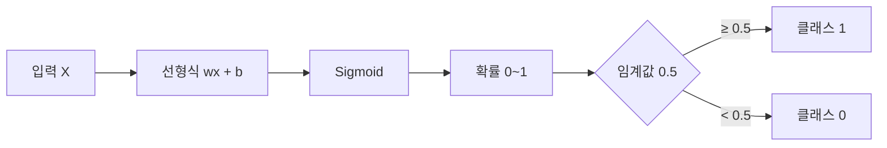
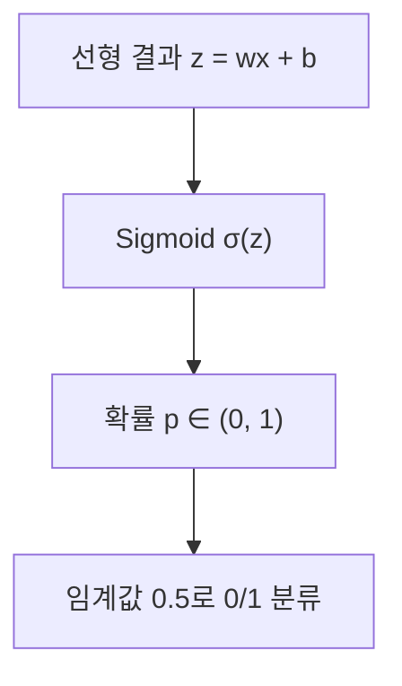

# 세션 15: 머신 러닝 5 — 회귀 심화 · 로지스틱 회귀

session10(회귀 입문)의 연장. 단순·다중·규제는 짧게 복습하고, **로지스틱 회귀·Sigmoid**를 중심으로 정리합니다.

## 1. 단순선형회귀

- 한 원인 \( X \) → 결과 \( Y \)
- 식: \( y = wx + b \) (직선)
- 예: 키 → 몸무게. 흩어진 점의 **전체 흐름**을 가장 잘 나타내는 직선을 찾음

## 2. 다중선형회귀

- \( X_1, X_2, X_3, \ldots \) → \( Y \)
- 평면(또는 다차원 초평면)으로 맞춤
- 예: 키·나이·운동량 → 몸무게. 각 요인의 영향을 **합산**

## 3. 경사하강법 (Gradient Descent)

- 최적 기울기 \( w \), 절편 \( b \)를 찾는 방법
- 비유: 눈 감고 산에서 **골짜기(최소 오차)** 로 조금씩 내려감
- 조금씩 이동 = **학습률**, 골짜기 도착 = 데이터에 가장 잘 맞는 직선/평면

| 용어 | 비유 |
| ---- | ---- |
| 단순 선형회귀 | 직선 |
| 다중 선형회귀 | 평면 |
| 경사하강법 | 산 내려가기 |

## 4. 규제가 필요한 이유

- feature가 많거나 **다중공선성**이 있으면 성능↓, 계수가 과도하게 커질 수 있음
- → **Regularization**으로 가중치를 통제

## 5. L1 Lasso

- \( |w| \) 합에 패널티 → 일부 계수를 **0**으로 → 변수 선택
- \( \mathrm{Loss} = \sum (y - \hat{y})^2 + \alpha \sum |w| \)
- \( \alpha \): 규제 강도
- **Ridge vs Lasso**: Ridge는 0을 만들지 않음 / Lasso는 **희소 모델**

## 6. L2 Ridge

- \( w^2 \) 합. 큰 가중치에 더 큰 규제 → 균등하게 축소
- \( \mathrm{Loss} = \sum (y - \hat{y})^2 + \alpha \sum w^2 \)
- 과적합 방지, 일반화↑, **희소성 없음**

## 7. ElasticNet

- L1 + L2 혼합
- \( \mathrm{Loss} = \sum (y - \hat{y})^2 + \alpha \bigl( \rho \sum |w| + (1-\rho) \sum w^2 \bigr) \)
- \( \rho \) (`l1_ratio`): 1 = Lasso, 0 = Ridge
- 변수가 많거나 상관이 있을 때 Lasso보다 **안정**

## 8. Diamonds 데이터셋 (실습 후보)

- Kaggle: https://www.kaggle.com/datasets/shivam2503/diamonds
- `cut`, `color`, `clarity`, `price` 등으로 회귀·전처리 연습에 쓰기 좋음

---

## 9. Logistic Regression (핵심)

- 이름은 회귀지만, 실제로는 **분류** (확률 예측)
- 예: 스팸 여부, 병 여부
- 먼저 \( y = wx + b \)를 구한 뒤, **Sigmoid**로 0~1 확률로 변환
- 선형회귀는 MSE 계열로 연속값을 맞춤 / 로지스틱은 **Cross-Entropy** 손실을 GD로 최소화

| 구분 | 선형회귀 | 로지스틱 회귀 |
| ---- | -------- | ------------- |
| 출력 | 연속값 | 확률 (0~1) → 분류 |
| 변환 | 없음 (직선/평면) | Sigmoid |
| 손실 | MSE 계열 | Cross-Entropy |
| 용도 | 집값, 몸무게 | 스팸/정상, 양성/음성 |

### 왜 “회귀”라는 이름인가?

- 안쪽의 **선형식** \( wx + b \)는 회귀와 같음
- 다만 Sigmoid로 확률화한 뒤 임계값으로 0/1 **분류**

## 10. Sigmoid

- 출력이 항상 **0~1**, S자 곡선
- 입력↑ → 1에 가까움, ↓ → 0에 가까움, 입력이 0이면 **0.5**
- 임계값 0.5: \( \ge 0.5 \) → 1, \( < 0.5 \) → 0
- **왜 쓰나**: 선형 결과는 음수이거나 1을 넘을 수 있음 → Sigmoid로 **확률화**

